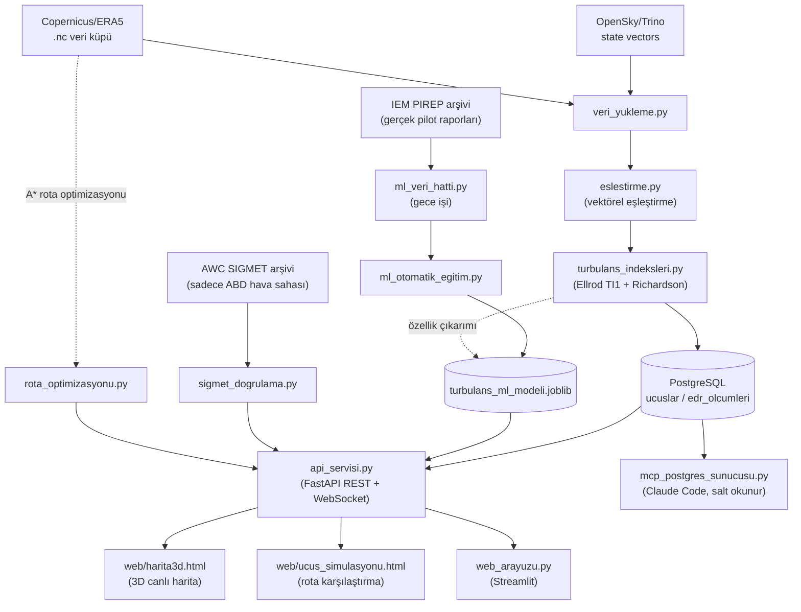

# Türbülans Radar

**Problem.** Seyir irtifasındaki açık hava türbülansı (CAT) radarda görünmez; pilot
raporu (PIREP) gönüllü, gecikmeli ve konumu kabadır; operasyonel ürünler (GTG, WAFS)
NWP alanı üretir ve yerinde EDR ile doğrulanır.

**Araştırma sorusu.** Yalnız açık veriyle (OpenSky ADS-B, ERA5, AWC SIGMET, IEM PIREP)
gerçek bir uçuş izinde seyir türbülansı riski hangi ölçülmüş beceriyle gösterilebilir
ve bu sınır rota kararına nasıl taşınmalıdır?

**Kısa cevap** (ön paket [2026-10-07](docs/sonuclar/2026-10-07/SAYILAR.md); 18 Ekim'de
nihai). Becerisi sınırlı: Ellrod TI1, 80 günde 7.815 seyir PIREP'inde ROC-AUC 0,680
[0,662–0,697]; altın test günlerinde risk eşiğinde (7e-7) yakalama 0,50, yanlış alarm
0,25. Birleşik gösterge TI1'i az ama anlamlı geçiyor (+0,014 [+0,007; +0,020]); ML
modeli geçemedi (+0,008 [−0,006; +0,022]), kapı onu devreye almıyor. Bu yüzden güvenlik
SIGMET'e (sert kısıt) dayanır, TI1 A* rotasında yalnız yumuşak kısıttır.

**Demo.** Kimlik bilgisiz, çalışırken ağsız: [Beş dakikada çalıştır](#beş-dakikada-çalıştır).
Kapsam yalnız CAT ve seyir safhası, doğrulama ABD verisiyle; çıktılar sertifikalı EDR
değildir, sistem karar destek aracıdır.

**Çekirdek ve ekler.** Tezin çekirdeği dört katkıdır ([Katkılar](docs/rapor/KATKILAR.md)):
K1 barometrik irtifayla iz–ERA5 eşleştirmesi (`fizik/eslestirme.py`), K2 seyir
irtifası PIREP etiket hattı ve FL feet hatasının tespiti, K6 TI1 sınırının bağımsız
etiketle ölçülüp ürüne yansıtılması (`fizik/turbulans_indeksleri.py`,
`ml/degerlendirme.py`), K7 SIGMET sert / TI1 yumuşak kısıtlı A* rota
(`rota/rota_optimizasyonu.py`). Sanal PIREP, contrail, IWXXM, n8n, MCP, 3B
simülasyon ve CLI araçlarının çoğu mühendislik ekidir; tezin iddiasını taşımaz.

**Ne yapar.** Gerçek bir uçuşun (OpenSky/Trino) izini ERA5 küpüyle barometrik
irtifada eşleştirir, Ellrod TI1 ve bulk Richardson göstergelerini hesaplar, sonuçları
PostgreSQL'e yazar; FastAPI, harita önyüzleri ve MCP sunucusu üzerinden sunar.

**Önemli sınırlama:** TI1 ve 0–1 gösterge ölçeği (API alanı `edr_proxy`: birleşik
gösterge ölçeği, o yoksa TI1 görsel ölçeği) bir EDR (Eddy Dissipation Rate) değeri
DEĞİLDİR -- ~25-30 km çözünürlüklü reanaliz verisinden hesaplanan bir
araştırma/görselleştirme göstergesidir. TI1 görsel ölçeğinin katsayısı EDR ölçümüne
değil IEM PIREP sınıf koduna uydurulmuştur (bkz.
[Sınırlamalar](#bilinmesi-gerekenler--sınırlamalar), `kalibrasyon.py`); bölgeden
bağımsız, kaba bir ölçektir, sertifikalı bir EDR sensörünün yerini TUTMAZ.
Doğruluk sayılarının tek kaynağı `docs/sonuclar/` paketidir.

Sistemin kullanım sınıfı, veri kaynakları, hata durumlarındaki davranışı ve
bilinen sınırları için bkz. **[Sistem Kartı](docs/SISTEM_KARTI.md)**. Mimari
diyagramlar ve tasarım kararları: [docs/mimari.md](docs/mimari.md),
[docs/adr/](docs/adr/).

## Beş dakikada çalıştır

Kimlik bilgisi (OpenSky, Copernicus) gerektirmez; ilk derleme internet ister
(PyPI, npm, GitHub); çalışma anında dış veri kaynağı yok. Ağ yoksa Esri
karoları gelmez; 3B harita yerel ülke sınırlarıyla çalışır.
Depoyla gelen gerçek veri paketi ([demo/](demo/README.md)): THY322'nin
15 Ocak 2019 rotası ve onu kapsayan ERA5 dilimi (toplam ~300 KB).

**Docker ile (önerilen):**

```bash
git clone <depo-adresi> && cd <depo>
cp .env.demo .env
docker compose --profile demo up -d --build
```

Ölçülen süre (derleme + demo analizi): temiz CI makinesinde 80 sn (GitHub
çalıştırıcısı, 14 Ekim 2026; her CI'da iş özetine yazılır); geliştirici
dizüstünde önbelleksiz derleme ~6,5 dk. Yığın
ayağa kalkınca `demo` servisi uçuşu analiz edip veritabanına yazar
(`docker compose logs demo` özeti gösterir). Sonra tarayıcıda:

- 3B harita: <http://localhost:8000/harita/harita3d.html> -- API anahtarı
  `demo-yerel-yonetici`, listeden THY322'yi seç.
- Rota simülasyonu: <http://localhost:8000/harita/ucus_simulasyonu.html>
  (örn. 41.0, 29.0 → 40.5, 43.5; FL350; 2019-01-15 20:00).
- API belgesi: <http://localhost:8000/docs>

**Docker olmadan (yalnızca analiz ve harita):**

```bash
pip install -e .
turbulans-demo        # ciktilar/turbulans_haritasi_THY322_2019-01-15.html
```

PostgreSQL yoksa sonuç kaydedilmez ama özet ve harita yine üretilir.
Jüri sunumu için demo akışı, sunum planı ve poster: [docs/sunum/](docs/sunum/DEMO_SENARYOSU.md). Demo
anahtarları herkesçe bilinir; bu yığını ağa açmayın. Gerçek kurulum için
aşağıdaki [Kurulum](#kurulum) bölümüne bakın.

## Mimari

```
                         ┌─────────────────┐
  OpenSky/Trino ────────►│  veri_yukleme.py │
  (callsign→icao24→rota) └────────┬─────────┘
                                  │
  Copernicus/ERA5 (.nc) ──────────┤
                                  ▼
                          ┌───────────────┐      ┌────────────────────┐
                          │ eslestirme.py │─────►│ turbulans_indeksleri│
                          │ (TI1+Richard.)│      │ (Ellrod TI1, Ri)    │
                          └───────┬───────┘      └────────────────────┘
                                  │
                    ┌─────────────┼─────────────┐
                    ▼             ▼             ▼
             veritabani.py   harita.py      ucus_analizi /
             (PostgreSQL,    (Folium HTML)  toplu_analiz.py /
              models.py)                    web_arayuzu.py (CLI/UI)
                    │
      ┌─────────────┼─────────────────┐
      ▼             ▼                 ▼
api_servisi.py  mcp_postgres_    (Alembic ile
(FastAPI REST   sunucusu.py      şema yönetimi)
 + WebSocket)   (Claude Code
                 için salt okunur)
```

Aynı mimarinin görsel (GitHub'da otomatik render olan Mermaid) hali -- ML
sınıflandırıcı ve SIGMET doğrulama akışları dahil:



Paket yapısı (`src/turbulans_radar/`, src layout -- `pip install -e .` ile
kurulur, komut satırı araçları `[project.scripts]` ile gelir):

```
turbulans_radar/
  config.py, loglama.py, hata_yardimcisi.py, konsol_kurulumu.py   -> çekirdek: ayarlar, log, hata mesajları
  depo/       models.py, veritabani.py         -> SQLAlchemy ORM + senkron/asenkron PostgreSQL erişimi
              gorev_deposu.py                  -> API analiz görevlerinin kalıcı kaydı
              kup_katalogu.py                  -> hava durumu küplerinin kataloğu (ızgara diskte, meta veri DB'de)
  veri/       veri_yukleme.py                  -> NetCDF yükleme/önbellek, yerel küp seçimi, OpenSky/Trino sorguları
              veri_saglayicilari.py            -> Veri Sağlayıcı katmanı: canlı NOAA GFS (THREDDS) + ERA5 seçimi
              sigmet_saglayici.py              -> canlı AWC SIGMET'leri (ABD + uluslararası, Ankara FIR dahil)
              kisitli_saha_saglayici.py        -> kısıtlı/yasak hava sahaları (GeoJSON içe aktarma, örnek veri)
              veri_indirme.py                  -> ERA5 indirme altyapısı (güvenlik sınırlı, varsayılan kuru deneme)
              kimlik_dogrulama.py              -> .env'den OpenSky kimlik bilgisi
  fizik/      turbulans_indeksleri.py          -> Ellrod TI1, Richardson, TI1 görsel ölçeği
              eslestirme.py                    -> rota <-> hava küpü vektörel eşleştirme, 3 boyutlu kapsam kontrolü
              birim_donusumleri.py             -> irtifa <-> basınç (ISA)
              kalibrasyon.py                   -> EDR ölçekleme katsayısı kalibrasyonu (bootstrap GA)
  rota/       rota_optimizasyonu.py            -> büyük daire vs A* rotası (yanal + irtifa), CZML üretimi
              risk_katmanlari.py               -> A*'ın modüler risk katmanları (TI1 cezası, SIGMET/kısıtlı saha sert kısıtı)
  dogrulama/  rota_backtest.py                 -> A* rotası vs gerçek uçuş izi (otomatik backtest)
              sigmet_dogrulama.py              -> TI1'in tarihsel AWC SIGMET'leriyle karşılaştırması (ABD)
  ml/         turbulans_ml_modeli.py           -> PIREP + ERA5 ile eğitilmiş risk sınıflandırıcısı, versiyonlama
              ml_veri_hatti.py, ml_otomatik_egitim.py, ml_egitimi.py
  analiz/     ucus_analizi.py                  -> uçtan uca uçuş analizi (OpenSky ya da hazır iz -> küp -> DB -> harita)
              toplu_analiz.py                  -> CSV listesindeki uçuşları sırayla analiz
  api/        api_servisi.py, semalar.py       -> FastAPI REST + WebSocket, Pydantic şemaları
  arayuz/     harita.py, web_arayuzu.py        -> Folium zaman kaydırıcılı harita, Streamlit arayüzü
  cli/        ornek_ucus_bul.py, veri_kontrol.py, kimlik_kontrol.py, openapi_disa_aktar.py, mcp_postgres_sunucusu.py
web/                                           -> harita3d.html (MapLibre) + ucus_simulasyonu.html (CesiumJS)
migrations/, alembic.ini                       -> Alembic şema migration'ları
tests/                                         -> pytest (birim + PostgreSQL + gerçek veri + Playwright)
```

## Kurulum

```bash
git clone <bu-repo>
cd files
pip install -e ".[dev]"       # paket + sabitlenmiş bağımlılıklar + komut satırı araçları + test/lint araçları
cp .env.example .env          # OpenSky + PostgreSQL + API_ANAHTARI bilgilerini gir
alembic upgrade head          # veritabanı şemasını kur/güncelle
```

Sadece çalıştırmak (geliştirme araçları olmadan) için `pip install -e .` yeterlidir.

Web arayüzlerinin kütüphanelerini (CesiumJS, MapLibre) yerelden sunmak için
bir kez `turbulans-statik` çalıştır (yaklaşık 30 MB, `web/vendor/`'a; git'e
girmez). Çalıştırılmazsa sayfalar aynı sürümü CDN'den yükler. Aynı komut,
koordinatsız SIGMET'ler için FIR sınır verisini de `veri_dosyalari/`'na
indirir (bkz. "Koordinatsız SIGMET'ler" bölümü); çalıştırılmazsa bu SIGMET'ler
eski (eleme) davranışıyla işlenir. Docker imajı ikisini de derlenirken
kendisi yapar.

`.env`'e girilmesi gerekenler (bkz. `.env.example`): `OPENSKY_USERNAME`/
`OPENSKY_PASSWORD` (OpenSky hesabı, tarihsel veri erişimi onaylanmış
olmalı -- https://opensky-network.org/my-opensky/request-data),
`POSTGRES_*` (host/port/kullanıcı/şifre/veritabanı), `API_ANAHTARI`
(`python -c "import secrets; print(secrets.token_urlsafe(32))"` ile üret).

Hava durumu veri küpünü (`ocak_2019_turbulans.nc`, Copernicus/ERA5'ten
manuel indirilmiş) proje köküne koyman gerekir -- büyük olduğu için
`.gitignore`'da, repoya dahil değildir.

### Docker ile çalıştırma (alternatif)

```bash
docker compose up --build
```

Bu, PostgreSQL'i, API'yi (önce `alembic upgrade head` çalıştırıp) ve uzun
işleri çalıştıran ayrı **worker** servisini tek komutla ayağa kaldırır
(ölçeklemek için: `docker compose up --scale worker=3`). `.env` dosyanın hazır olması gerekir;
`POSTGRES_HOST` konteynerler arası iletişim için otomatik olarak compose
servis adına (`db`) çevrilir. API `http://localhost:8000`'de, Swagger
`http://localhost:8000/docs`'ta olur. Konteyner **otonom** çalışır: canlı
AWC SIGMET'lerini 15 dakikada bir kendisi yeniler
(`SIGMET_OTOMATIK_GUNCELLEME_DAKIKA`), anlık rotalar için canlı GFS verisini
indirir (`canli_veri/` volume'unda saklanır). PostgreSQL ve API portları
yalnızca `127.0.0.1`'e açıktır; ağdaki bir cihaz API'ye erişecekse `.env`'de
`API_YAYIN_ADRESI=0.0.0.0` (anahtarlar düz HTTP'den geçer, yalnızca güvenilen
ağda). Uygulama süreçleri root olmayan `turbulans` (uid 1000) kullanıcısıyla
çalışır: giriş betiği (`otomasyon/konteyner_giris.sh`) yazılabilir bağlı
klasörleri ve model volume'unu bu kullanıcıya sahiplendirip yetkiyi düşürür
(Linux'ta Docker eksik klasörleri root olarak oluşturur). `docker compose exec`
ile açılan komutlar giriş betiğinden geçmez ve root çalışır; dosya yazan bir
komutu `docker compose exec --user turbulans ...` ile çalıştırın.

İşçi durdurulunca (`docker compose stop/up` dahil) çalışan görevi
`GOREV_DURDURMA_BEKLEME_SANIYE` (240) bekler; ML gece işi süren CDS isteğini
bitirip `yarida_kaldi` olarak durur ve zamanlayıcı aynı gün yeniden dener.
Bu yüzden işçinin durması 5 dakikaya kadar sürebilir (`stop_grace_period`).

- **ERA5 arşiv küpleri** imaja dahil değildir (boyut); `ocak_2019_turbulans.nc`,
  `era5_egitim_verisi/` ve `pirep_ham/` API ve işçiye `/veri` altında **salt
  okunur** bağlanır. Proje kökünün tamamı bağlanmaz: `.env`, yedekler ve `.git`
  konteynerden okunamaz. Başka bir klasör için `.env`'de `YEREL_VERI_KOKU`,
  `HAVA_DURUMU_DOSYA_ADI`, `EK_HAVA_DURUMU_KLASOR_ADI`, `ML_PIREP_ARSIV_KLASOR_ADI`.
  Dosya yoksa Docker yerine boş bir klasör açar ve o küp atlanır.
- **Kod salt okunur:** imajdaki kod root'a ait ve 755 izinlidir; uygulama
  kullanıcısı (uid 1000) yalnızca bağlanan veri klasörlerine yazabilir.
- **Uçuşa özel ERA5 dilimleri, ARCO saatlik önbelleği ve OpenSky rota
  önbelleği** proje klasöründeki `era5_ucus_verisi/`, `era5_arco_onbellek/`
  ve `opensky_onbellek/` klasörlerine bağlanır (bind mount): konteyner
  silinse de kalır, yerel CLI ile aynı önbelleği paylaşır ve katalogdaki
  göreli yollar iki tarafta da geçerlidir. Konteynerde OpenSky tarayıcı
  girişi yapılamadığı için önbellekteki rotalar Trino'suz analiz edilir.
- **Copernicus CDS kimliği:** `.env`'de `CDSAPI_RC_DOSYASI` (compose'u
  çalıştıran makinedeki `.cdsapirc` yolu, WSL'de örn.
  `/mnt/c/Users/<kullanici>/.cdsapirc`) verilirse dosya API ve işçiye
  secret olarak `/run/secrets/cdsapirc` (salt okunur) bağlanır ve
  `CDSAPI_RC` oraya ayarlanır; imaja ya da ortam değişkenlerine girmez.
  Verilmezse boş bir dosya bağlanır, yığın yine açılır; CDS başarısız olur
  ve ARCO yedeği (`ARCO_ONBELLEK_MAKS_GB`, varsayılan 20 GB) kullanılır.
- **ML modeli ve sürümleri** proje kökündeki `model_deposu/` klasöründe
  tutulur (konteynerde `/app/model_deposu`'na bağlanır; yerelde
  `MODEL_KLASORU` varsayılanı da `model_deposu`): Docker'daki API/işçi ile
  yerelde çalışan Streamlit ve `turbulans-ml` AYNI aktif modeli ve sürüm
  listesini görür. `/aktiflestir` ile yapılan geri dönüş ve konteyner içinde
  yapılan eğitim konteyner yeniden oluşturulunca kaybolmaz; yedek servisi
  klasörü salt okunur kopyalar. (6 Ekim 2026'ya kadar kullanılan
  `turbulans_modeller` volume'u silinmedi; içeriği bu klasöre kopyalandı.)

## Kullanım

### Tek bir uçuşu analiz etmek (CLI)

```bash
turbulans-ornek-ucus                           # gerçek, o gün kayıtlı bir callsign bul
turbulans-analiz THY1234 2019-01-01            # analiz et -- PostgreSQL'e yazar + harita üretir
```

Her script `--help` ile kullanım bilgisi verir. Sonuç `ucuslar`/
`edr_olcumleri` tablolarına yazılır (aynı uçuş/tarih tekrar analiz
edilirse eski kayıt silinip yenisiyle değiştirilir); harita
`ciktilar/turbulans_haritasi_<uçuş>_<tarih>.html`'e kaydedilir.

### Web arayüzü

```bash
streamlit run src/turbulans_radar/arayuz/web_arayuzu.py
```

Uçuş numarası ve tarihi bir kutuya yazıp "Analiz Et"e basman yeterli;
sonuç tablosu ve harita direkt sayfada görünür. Arkada aynı `turbulans-analiz`
mantığı çalışır -- bu sadece görsel bir ön yüz. Varsayılan uçuş, depoda önbelleği
olan THY322 / 2019-01-15'tir (OpenSky girişi gerektirmez). Sayfa yalnızca
127.0.0.1'de dinler (`.streamlit/config.toml`).

### Birden fazla uçuşu birden analiz etmek

```bash
turbulans-toplu-analiz ucuslar.csv     # en az ucus_numarasi, tarih sütunları
```

Her uçuş kendi kaydını PostgreSQL'e yazar ve kendi haritasını üretir; ayrıca
hepsinin özetini `ciktilar/toplu_analiz_ozeti.csv`'de toplar. Bir uçuşta
hata olursa diğerlerinin analizi durmaz; OpenSky'yi yormamak için uçuşlar
arasına kısa bir bekleme konur.

`POST /api/v1/analiz/toplu` ile n8n'in tetiklediği (onlarca/yüzlerce uçuşluk
olabilen) toplu işlerde harita üretimi otomatik olarak kapatılır
(`harita_uret=False`, bkz. `isci/gorev_iscisi.py`) -- sunucuda kimsenin
açmayacağı bir HTML dosyasıyla `ciktilar/`'ı sınırsız büyütmek yerine sonuç
zaten PostgreSQL'e yazılır ve `GET /ucuslar/{ucus}/{tarih}` (+ csv/geojson)
ile okunur. CLI'dan (`turbulans-toplu-analiz`) çalıştırıldığında harita
üretimi varsayılan olarak açık kalır.

### Veri kalitesini kontrol etmek

```bash
turbulans-veri-kontrol N10VZ 2019-01-15   # önce turbulans-analiz ile analiz etmiş olman gerekir
```

Veri küpünün çözünürlüğünü (grid/zaman adımı) ve PostgreSQL'deki TI1
değerlerinin ne kadar çeşitli olduğunu (çok az benzersiz değer varsa veri
küpü muhtemelen çok kaba) kontrol eder.

## FastAPI servis katmanı

```bash
uvicorn turbulans_radar.api.api_servisi:app --reload --port 8000
# Swagger/OpenAPI: http://localhost:8000/docs
```

### Uç noktalar

Swagger (`/docs`), uç noktaları Uçuşlar/Analiz/Simülasyon/Türbülans Tahmini/Eşikler/Sistem etiketleriyle gruplar.

Sunucuyu ayağa kaldırmadan API'yi keşfetmek için: `openapi.json` (ham OpenAPI
şeması, `/openapi.json` ile AYNI) ve `turbulans_radar.postman_collection.json`
(tüm uç noktaları `X-API-Key` başlığıyla hazır içeren bir Postman
koleksiyonu -- `taban_url`/`api_anahtari` koleksiyon değişkenlerini
doldurman yeterli) repoya dahil. Endpoint eklendikçe/değiştikçe
`turbulans-openapi` ile yeniden üretilebilir -- canlı `/openapi.json`
her zaman en güncel/otoriter kaynaktır, bu iki dosya sadece bir anlık
görüntü (snapshot) kolaylığı sağlar.

| Metod | Yol | Açıklama |
|---|---|---|
| GET | `/saglik` | Sağlık kontrolü (anahtarsız). `?derin=true` ile PostgreSQL'e gerçekten bağlanmayı dener (deploy sonrası kontrol için) |
| GET | `/api/v1/ucuslar` | Kaydedilmiş uçuşları listeler; `{toplam_sayi, ucuslar}` döner (`limit`, 1-500; `ucus_numarasi_arama` kısmi eşleşme, `baslangic_tarih`/`bitis_tarih` ile filtrelenebilir) |
| GET | `/api/v1/ucuslar/{ucus_numarasi}/{tarih}` | Bir uçuşun ölçüm noktaları (`olcum_limit`/`olcum_offset` ile sayfalı) |
| DELETE | `/api/v1/ucuslar/{ucus_numarasi}/{tarih}` | Kayıtlı bir uçuşu (ölçümleriyle birlikte) siler -- bulunamazsa 404, silinirse 204 |
| DELETE | `/api/v1/ucuslar` | Filtreye (`ucus_numarasi_arama`/`baslangic_tarih`/`bitis_tarih`) uyan TÜM uçuşları toplu siler -- filtresiz istek 400 ile reddedilir (yanlışlıkla tüm tabloyu boşaltmayı önlemek için) |
| GET | `/api/v1/ucuslar/{ucus_numarasi}/{tarih}/csv` | Bir uçuşun TÜM ölçümlerini (sayfalama olmadan) CSV olarak indirir |
| GET | `/api/v1/ucuslar/{ucus_numarasi}/{tarih}/geojson` | Bir uçuşun TÜM ölçümlerini bir GeoJSON `FeatureCollection`'ı olarak indirir (QGIS/geopandas vb. için) |
| POST | `/api/v1/analiz/ucus` | Tek bir uçuşu arka planda analiz eder, `gorev_id` döner |
| POST | `/api/v1/analiz/toplu` | Birden fazla uçuşu arka planda analiz eder |
| POST | `/api/v1/analiz/rota` | OpenSky'a bağlanmadan, dışarıdan yüklenen bir ADS-B izini (`noktalar`: `zaman`, `enlem`, `boylam`, `irtifa_m`) analiz edip kaydeder -- tarayıcı girişi gerektirmediği için sunucu/Docker'da da çalışır |
| GET | `/api/v1/analiz/durum/{gorev_id}` | Tetiklenen bir analizin durumunu sorgular |
| GET | `/api/v1/esikler` | TI1 renklendirme eşiklerini döner (web/harita3d.html bunları kullanır) |
| GET | `/api/v1/ucuslar/{ucus_numarasi}/{tarih}/sigmet-dogrulama` | TI1'i gerçek AWC SIGMET'leriyle karşılaştırır |
| GET | `/api/v1/simulasyon/ucak-profilleri` | 3D uçuş simülasyonu için uçak modeli seçim listesi |
| POST | `/api/v1/simulasyon/rota` | Büyük daire vs rüzgar-optimize rota + CZML döner; aktif SIGMET'ler sert kısıt olarak uygulanır (bkz. aşağıdaki bölüm) |
| POST | `/api/v1/sigmet/guncelle` | AWC'den canlı SIGMET'leri çekip veritabanını günceller (n8n/cron periyodik tetikler) |
| GET | `/api/v1/sigmet` | Şu an geçerli SIGMET'ler (kutu/tehlike filtresiyle) -- önyüzlerin yasak bölgeleri çizmesi için |
| GET | `/api/v1/kisitli-sahalar` | Şu an geçerli kısıtlı/yasak hava sahaları (kutu filtresiyle) |
| POST | `/api/v1/kisitli-sahalar?kaynak=...` | GeoJSON FeatureCollection içe aktarır (örn. n8n: NOTAM -> geçici kısıt); `eskileri_kaldir=true` kaynağı tamamen yeniler |
| DELETE | `/api/v1/kisitli-sahalar/{dis_kimlik}` | Bir kısıtlı sahayı siler |
| POST | `/api/v1/veri/canli/hazirla` | Bir bölge/zaman için canlı GFS küpünü arka planda hazırlar (katalogda tazesi varsa onu kullanır), 202 + `gorev_id` döner |
| GET | `/api/v1/veri/kupler` | Hava durumu küpü kataloğu (kaynak, model çalıştırması, kapsam, seviyeler) |
| POST | `/api/v1/backtest/ucuslar/{ucus_numarasi}/{tarih}` | Bir uçuşun gerçek izini büyük daire ve A* rotasıyla karşılaştırıp kaydeder |
| POST | `/api/v1/backtest/toplu` | Backtest'i olmayan uçuşları arka planda karşılaştırır (ör. gecelik bir zamanlayıcıdan), `gorev_id` döner; `?yenile=true` mevcut backtest'leri de en eskiden başlayarak yeniden hesaplar (algoritma değişince bayat sonuç kalmaz) |
| GET | `/api/v1/backtest` | Tüm backtest sonuçları + filo geneli özet |
| POST | `/api/v1/turbulans/tahmin` | Tek nokta için fizik (TI1) + gerçek PIREP verisiyle eğitilmiş ML tahminini karşılaştırmalı döner |
| GET | `/api/v1/turbulans/model-bilgisi` | ML modelinin seçim gerekçesi/metrikleri (recall, F1, ROC-AUC vb.) + eğitim tarihini döner; model henüz eğitilmediyse dürüstçe `egitildi_mi: false` |
| GET | `/api/v1/turbulans/model-versiyonlari` | Şimdiye kadar eğitilmiş TÜM model versiyonlarını (en yeni önce) listeler |
| POST | `/api/v1/turbulans/model-versiyonlari/{versiyon_id}/aktiflestir` | Geçmiş bir model versiyonunu YENİDEN EĞİTİM GEREKMEDEN aktif model yapar (rollback); bilinmeyen `versiyon_id` 404 döner |
| POST | `/api/v1/sanal-pirep/iz` | (yönetici) Havayolu ADS-B beslemesinden bir uçağın izi: seyirdeki irtifa sapmalarını sanal PIREP olarak kaydeder (bkz. "Sanal PIREP") |
| GET | `/api/v1/sanal-pirep` | Koridordaki sanal PIREP olayları ve uzay-zaman kümeleri (`son_saat`, `bitis`, kutu, `sadece_dogrulanmis`) |
| WS | `/ws/uyarilar?bilet=...` | TI1 "orta-şiddetli" eşiği aşılınca ve en az 2 uçağın doğruladığı sanal PIREP'te canlı uyarı yayınlar |
| GET | `/saglik?derin=true` | (anahtarsız) Veritabanı + SIGMET tazeliği, canlı GFS, görev kuyruğu, kısıtlı sahalar, küp önbelleği, yerel kütüphaneler; operasyonel sorunda `durum: bozulmus` |
| GET | `/api/v1/sistem/durum` | Aynı rapor + kaynak başına son hata metinleri (anahtarlı) |
| GET | `/harita/harita3d.html` | 3D/canlı harita önyüzü (statik, tarayıcıda açılır) |
| GET | `/harita/ucus_simulasyonu.html` | 3D uçuş simülasyonu önyüzü (statik, tarayıcıda açılır) |

Örnek:

```bash
curl -X POST http://localhost:8000/api/v1/analiz/ucus \
  -H "X-API-Key: $API_ANAHTARI" -H "Content-Type: application/json" \
  -d '{"ucus_numarasi": "THY1234", "tarih": "2019-01-01"}'

curl http://localhost:8000/api/v1/ucuslar/THY1234/2019-01-01 \
  -H "X-API-Key: $API_ANAHTARI"
```

### Güvenlik ve sağlamlık

- **API anahtarı:** `/api/v1/*` altındaki tüm uç noktalar `X-API-Key`
  başlığı gerektirir (`.env` -> `API_ANAHTARI`), sabit zamanlı
  (`secrets.compare_digest`) karşılaştırılır. Anahtar yanlış/eksikse 401,
  sunucuda hiç tanımlı değilse 503.
- **Roller:** `API_ANAHTARI` yöneticidir (n8n, operasyon). İsteğe bağlı
  `API_PILOT_ANAHTARI` EFB/pilot istemcisi içindir: okuma, rota simülasyonu,
  tahmin ve canlı uyarılar; uçuş silme, kısıtlı saha değişikliği, model
  aktifleştirme, görev tetikleme ve `/sistem/durum` için 403. Kokpitteki
  cihaza sadece pilot anahtarı konur. Web sayfaları anahtarı sadece oturum
  boyunca (`sessionStorage`) tutar.
- **Kişi/cihaz başına anahtar ve rotasyon:** `API_ANAHTARLARI` ile
  `kimlik:rol:anahtar` biçiminde (virgülle) ek anahtarlar tanımlanır, örn.
  `ops-ayse:yonetici:...,efb-tc-jfa:pilot:...`. Rotasyon: yeni anahtarı ekle,
  istemciler geçince eskisini çıkar.
- **Denetim kaydı:** `/api/v1` altındaki her değiştirici istek (POST/PUT/
  PATCH/DELETE; kısıtlı saha silme, model aktifleştirme, toplu silme, rota
  hesabı...) `denetim_kayitlari` tablosuna yazılır: anahtar kimliği, rol,
  yöntem, yol, sonuç kodu, IP, süre. Reddedilen denemeler `kimliksiz` olarak
  görünür; sorgu dizesindeki webhook URL'si maskelenir. Okuma:
  `GET /api/v1/denetim` (yönetici). Saklama: `DENETIM_SAKLAMA_GUN` (180).
- **Hız sınırı ve yük:** Sayaç PostgreSQL'de, tüm API süreçlerince
  paylaşılır; veritabanına ulaşılamazsa istek reddedilmez, süreç içi sayaca
  düşülür. Rota/tahmin uçları istemci başına sınırlı ve süreç başına
  eşzamanlılık tavanlı (`ROTA_HESABI_DAKIKADA_MAKS`, `TAHMIN_DAKIKADA_MAKS`,
  `AGIR_HESAP_MAKS_ESZAMANLI`); anahtarsız `/saglik?derin=true`
  `SAGLIK_ONBELLEK_SANIYE` önbelleklidir.
- **WebSocket bileti:** `/ws/uyarilar` anahtarı URL'de (erişim loglarında)
  taşımamak için `POST /api/v1/ws-bileti`'den alınan 60 sn'lik, sunucu
  anahtarıyla imzalı, tek kullanımlık bilet (`?bilet=`) kullanır; `?api_key=`
  kabul edilmez.
- **API belgeleri:** `/docs`, `/redoc`, `/openapi.json` yalnızca API bu
  makineye bağlıyken (`API_YAYIN_ADRESI` boş/`127.0.0.1`) açıktır; ağa
  açılınca kapanır. `API_BELGELERI_ACIK=true|false` ile zorlanabilir.
- **TLS:** API düz HTTP konuşur. `API_YAYIN_ADRESI=0.0.0.0` ile ağa açılırsa
  anahtarlar açık metin gider (açılışta uyarı loglanır); güvenilmeyen ağda
  önüne TLS sonlandıran bir ters vekil (ör. Caddy) koyun.
- **Konteyner kabuğu:** Uygulama süreçleri uid 1000 ile çalışır, ama
  `docker compose exec` varsayılan olarak root açar; elle komut için
  `docker compose exec -u turbulans api ...` kullanın.
- **Girdi doğrulama:** `tarih` gerçek bir tarih olarak, `ucus_numarasi`
  harf/rakam + en fazla 8 karakter olarak doğrulanır (422 döner).
- **Hata gizliliği:** 500/503 yanıtları ham exception mesajını (SQL,
  bağlantı dizesi vb.) istemciye döndürmez; tam ayrıntı sunucu tarafında
  (stderr, `loglama.py`) loglanır.
- **Hız sınırlama:** `/api/v1/analiz/*`, kendi API'sini kötüye kullanıma
  karşı bellek-içi bir pencere sayaçla korur (varsayılan: 60 saniyede en
  fazla 5 istek, aşılırsa 429) -- dışarıdan tetiklenen aşırı istekle
  OpenSky'yi dolaylı yormamak için. `DELETE /api/v1/ucuslar*` (tekli ve
  toplu silme) da AYNI desenle (kendi ayrı penceresiyle) korunur --
  yanlışlıkla/kötüye kullanımla art arda çok sayıda silme isteğine karşı.
- **Asenkron:** okuma uç noktaları `asyncpg` tabanlı, event loop'u
  bloklamaz. Uzun işler API sürecinde çalışmaz (bkz. aşağıdaki görev kuyruğu).
- **CORS:** varsayılan kapalı; `.env`'deki `CORS_IZIN_VERILEN_KAYNAKLAR`
  (virgülle ayrılmış origin listesi) ile açılır.
- **Görev kuyruğu ve işçiler:** uzun işler (`/analiz/ucus`, `/analiz/rota`,
  `/analiz/toplu`, `/backtest/toplu`, `/veri/canli/hazirla`) PostgreSQL'deki
  `analiz_gorevleri` tablosuna **kuyruk** olarak eklenir ve istek hemen
  `202 {"gorev_id", "durum": "kuyrukta"}` döner; ayrı bir mesaj kuyruğu
  altyapısı gerekmez (`gorev_deposu.py`). İşçiler (`isci/gorev_iscisi.py`)
  sıradaki görevi `FOR UPDATE SKIP LOCKED` ile alır -- birden çok işçi süreci
  aynı görevi iki kez almaz. Eşzamanlılık `GOREV_ISCI_SAYISI` ile sınırlıdır
  (ağır bir toplu iş API'yi yavaşlatmaz). Çalışan görevin işçisi kalp atışı
  gönderir; işçi çökerse ya da yeniden başlarsa görev `GOREV_BAYAT_SANIYE`
  sonra yeniden kuyruğa girer (`GOREV_MAKS_DENEME`'ye kadar), sonra
  `yarida_kaldi` olur. Durumlar: `kuyrukta -> calisiyor -> tamamlandi |
  basarisiz | hata | yarida_kaldi`. Varsayılan olarak API kendi içinde
  gömülü bir işçi başlatır (`GOREV_GOMULU_ISCI`); ayrı süreç için
  `turbulans-isci` (Docker'da `worker` servisi), belirli işlere ayrılmış işçi
  için `GOREV_ISCI_TURLERI`. Bitmiş görevler 7 gün sonra otomatik silinir.
- **Webhook bildirimi:** `bildirim_webhook_url` verilirse, analiz bitince
  sonuç oraya POST edilir -- n8n'in Webhook node'u bunu dinleyip
  `/api/v1/analiz/durum/{gorev_id}`'yi periyodik yoklamaya gerek bırakmaz.
  **SSRF koruması (`webhook.py`):** varsayılan olarak sadece genel (public)
  adreslere gönderilir; hem istek anında (yazılan adres) hem gönderim anında
  (adın ÇÖZÜMLENDİĞİ IP) kontrol edilir, yönlendirme izlenmez. **DNS
  rebinding'e karşı** istek doğrulanan IP'ye sabitlenir (ikinci bir DNS
  sorgusu yapılmaz); Host başlığı ve TLS sertifika doğrulaması orijinal alan
  adıyla yapılır. Aynı
  makinedeki/iç ağdaki n8n için host'u `.env`'deki
  `WEBHOOK_IZIN_VERILEN_HOSTLAR`'a ekle (örn. `localhost,n8n`); liste doluysa
  sadece listedeki host'lara gönderilir.
- **Kayıt garantisi:** API'den tetiklenen analizde sonuç PostgreSQL'e
  yazılamazsa görev `tamamlandi` değil `hata` olur (CLI ise haritayı yine
  üretir, sadece uyarır).
- **WebSocket:** `API_ANAHTARI` sunucuda tanımlı değilse `/ws/uyarilar` de
  bağlantıyı reddeder (REST ile aynı "kapalı başla" davranışı). İşçi başka
  bir süreçte çalışabildiği için canlı uyarılar PostgreSQL `NOTIFY` ile
  (`turbulans_uyarilari` kanalı) API'ye gelir ve oradan istemcilere iletilir.

**Bilinçli olarak eklenmedi:** `veri_indirme.py`'nin gerçek ERA5 indirmesini
tetikleyen bir uç nokta (rate-limit/ban riski), JWT/OAuth2 kullanıcı girişi
(tek kullanıcılı/dahili bir araç için statik anahtar yeterli görüldü, çok
kullanıcılı bir sürüme geçilirse yükseltilebilir).

## 3D/canlı harita önyüzü

```bash
uvicorn turbulans_radar.api.api_servisi:app --reload --port 8000
# tarayıcıda aç: http://localhost:8000/harita/harita3d.html
```

`web/harita3d.html`, build aracı gerektirmeyen tek dosyalık bir MapLibre GL
JS sayfasıdır -- `api_servisi.py` tarafından API ile AYNI origin'de sunulur
(`app.mount("/harita", ...)`), bu yüzden `fetch()`/WebSocket çağrıları
CORS'a takılmaz. Sayfaya uçuş numarası, tarih ve API anahtarını (bir kez
girilir, `localStorage`'da tutulur) yazıp "Yükle"ye basman yeterli:

- Rota, `GET /api/v1/ucuslar/{ucus}/{tarih}`'ten çekilip TI1 şiddetine göre
  renklendirilmiş noktalar + çizgi olarak "globe" (3D küre) projeksiyonunda
  gösterilir; alttaki zaman kaydırıcısı ile rota an be an oynatılabilir.
- `GET /api/v1/ucuslar/{ucus}/{tarih}/sigmet-dogrulama`'dan gelen gerçek
  SIGMET poligonları (varsa) sarı bir katman olarak haritaya eklenir.
- `/ws/uyarilar`'a bağlanıp, bir analiz sırasında orta-şiddetli türbülans
  tespit edilirse ekranda anlık bir uyarı (toast) gösterir.
- Harita karosu (tile), `harita.py`'de daha önce yaşanan "CartoDB anahtar
  istemeye başladı" sorununu tekrarlamamak için YİNE anahtarsız Esri World
  Street Map'i kullanır; MapLibre CDN sürümü (5.8.0) BİLEREK sabitlendi
  (daha yeni sürümler -- 6.x -- klasik `<script>` ile çalışan UMD paketini
  kaldırıp sadece ES module dağıtıyor).

Bu sayfa gerçek bir tarayıcıda (Playwright + headless Chromium) uçtan uca
test EDİLDİ: gerçek bir uçuş (THY322, 2019-01-15, 1614 nokta) analiz edilip
sayfaya API anahtarıyla yüklendi, rota/TI1 renklendirmesi/zaman kaydırıcısı
render oldu (bkz. yukarıdaki ekran görüntüsü niteliğindeki doğrulama). Bu
test GERÇEK bir hata ortaya çıkardı ve düzeltildi: `harita.setProjection`
metodu, önceden sabitlenen MapLibre 4.7.1'de YOKTU (kod içi yorum bunun
var olduğunu YANLIŞ varsayıyordu) -- 5.8.0'a geçildi. Ardından
`setProjection`'ı `Map` constructor'ından hemen sonra çağırmanın "Style is
not done loading" hatası verdiği görüldü; "globe" projeksiyonu artık
doğrudan constructor'ın `projection` seçeneğine taşındı, `harita.on("load",
...)` içinde bir savunmacı ikinci deneme daha bırakıldı.

**Görünüm araçları** (fikirler hook-365/adsb-3d ve kevtoe/worldview'dan, kod alınmadı):

- 3B harita: seviye bandı (FL) filtresi ve "yalnız seyir (FL280–FL420)"
  kısayolu; zaman kaydırıcısında gerçek zaman damgalarıyla oynatma (60×/300×/1200×).
- Rota simülasyonu: SIGMET ve kısıtlı saha hacimleri için seviye bandı filtresi;
  Pareto seçeneklerinden önerilmeyenler kesikli gri çizgiyle çizilir.
- Filtreler yalnızca görünümü değiştirir; rota hesabı tüm kısıtlarla yapılır.

## Canlı SIGMET kısıtı ve modüler risk katmanları

`rota_optimizasyonu.py`'deki A* araması, maliyetini takılabilir **risk
katmanlarından** (`risk_katmanlari.py`) alır. Her katman aynı düğüm/kenar
grafı için yasak düğüm/kenarlar (SERT kısıt) ve saniye cinsinden cezalar
(YUMUŞAK kısıt) üretir; yeni bir risk kaynağı eklemek A*'ı değiştirmez:

| Katman | Tür | Kaynak |
|---|---|---|
| `Ti1CezaKatmani` | yumuşak (ceza) | ERA5'ten hesaplanan Ellrod TI1 >= `TI1_ESIK_ORTA_SIDDETLI` |
| `SigmetKisitKatmani` | **sert (yasak)** | Canlı AWC SIGMET'leri (`sigmetler` tablosu) |
| `KisitliSahaKatmani` | **sert (yasak)** | Çatışma bölgeleri, P/R/D sahaları, NOTAM'lı geçici kısıtlar (`kisitli_hava_sahalari` tablosu) |

SIGMET kısıtı **dört boyutludur**: yatay poligon + irtifa bandı (`taban_ft`/
`tavan_ft`, boş taban = yerden) + uçağın o noktaya VARIŞ zamanında
geçerlilik. Kenar kontrolü, iki ızgara düğümü arasındaki bacağın poligonu
kesip kesmediğine de bakar (seyrek ızgarada küçük bir SIGMET "atlanmasın").
Poligona **yanal ve dikey tampon** eklenir: TS/CONVECTIVE 20 NM, TURB/MTW
10 NM, diğer türler 10 NM, tehlikesi bilinmeyen en büyük tampon; taban altı
ve tavan üstü 1000 ft (`SIGMET_YANAL_TAMPON_NM`, `SIGMET_DIKEY_TAMPON_FT`).
Bunlar **parametrik varsayımdır, kalibre edilmedi**; uygulanan tampon
yanıtta `sigmet_kontrolu.tampon` ve SIGMET başına `yanal_tampon_nm` ile
raporlanır. Varsayılan kaçınılan tehlikeler: `TURB, MTW, TS, CONVECTIVE, VA, TC`
(`SIGMET_KACINILACAK_TEHLIKELER`). Öncelik sırası: (1) SIGMET'e girmemek,
(2) TI1 riskinden kaçınmak, (3) en ucuz yakıt/süre. SIGMET'e girmeyen hiçbir
rota bulunamazsa (örn. varış noktası SIGMET içinde) sistem **öneri yapmaz**:
`guvenli_rota_bulundu_mu: false` ve açıklamada "ÖNERİ YOK". SIGMET kısıtı
hava verisinden bağımsızdır -- ERA5 kapsamı dışında da (rüzgarsız, TAS ile)
uygulanır. Yanıttaki `sigmet_kontrolu` alanı kontrolün durumunu
(`uygulandi` / `aktif_sigmet_yok` / `erisilemedi`), uygulanan SIGMET'leri ve
canlı hesapta son çekim `SIGMET_BAYATLIK_DAKIKA`'dan eskiyse `bayat_mi`
uyarısını taşır; CZML çıktısı SIGMET'leri 3D sahnede yarı saydam kırmızı
hacimler olarak çizer.

**Canlı veri:** `sigmet_saglayici.py`, aviationweather.gov'un iki uç noktasını
(`airsigmet`: ABD iç, `isigmet`: uluslararası -- Ankara FIR/LTAA dahil)
normalize edip `sigmetler` tablosuna upsert eder; akıştan düşen (iptal
edilen) SIGMET'lerin geçerliliği sona erdirilir, süresi dolanlar
`SIGMET_SAKLAMA_GUN` sonra silinir. Yenileme yolları: `POST
/api/v1/sigmet/guncelle` (n8n Schedule Trigger, örn. 10-15 dk),
`turbulans-sigmet` (cron) ya da `SIGMET_OTOMATIK_GUNCELLEME_DAKIKA`
> 0 ile API'nin kendi zamanlayıcısı.

**Sessiz kayıp koruması:** "akışta yok → sonlandır" kuralı, akış
çözümlenemediğinde tüm aktif SIGMET'leri hata vermeden kapatabilirdi (örn.
AWC `coords` alanını yeniden adlandırsa). Bu yüzden her akış önce denetlenir:
boş ya da liste olmayan yanıt veya SIGMET kayıtlarının
`SIGMET_MAKS_COZUMLENEMEYEN_ORAN`'dan (varsayılan %25) fazlasının
çözümlenememesi **kaynak hatası** sayılır. Bu durumda mevcut kayıtlar
sonlandırılmaz, `kaynak_hatalari` alanı doldurulur ve kaynak "başarılı
güncelleme" almaz. Her kaynağın son deneme/son başarılı çekimi
`veri_kaynagi_durumlari` tablosunda tutulur; `bayat_mi` artık en eski son
BAŞARILI çekime bakar ve açıklama hata veren kaynağı adıyla belirtir. Aynı
denetimde canlı akışta sessizce atılan bir biçim de bulundu: `geom: "AREAS"`
(tek SIGMET'te birden fazla poligon) artık alan başına bir kayıt olarak
saklanıyor. Okunamayan irtifa değeri daha geniş bir yasak banda, okunamayan
tehlike türü `BILINMIYOR`'a çevrilir ve bu tür SIGMET'lerden her zaman
kaçınılır.

**Koordinatsız SIGMET'ler (FIR yedeği):** AWC bazı SIGMET'leri ("ENTIRE FIR"
ya da metinle tarif edilmiş, koordinat listesi boş gelen alanlar) hiç poligon
vermeden yayınlıyor -- bunlar eskiden sessizce elenip A* tarafından hiç
görülmüyordu. `veri/fir_sinirlari.py`, VATSIM'in FIR sınır verisiyle
(`turbulans-statik` indirir; bkz. Kurulum) bu SIGMET'i FIR'ın TAMAMINA
genişletir -- kısmi bir alanı FIR'a büyütmek, hiç uygulamamaktan daha
muhafazakârdır. FIR bilinmiyorsa (sınır verisi yoksa ya da kod eşleşmiyorsa)
eski davranış (eleme) korunur. Bu genişletmeler `_akis_sagligini_denetle`
tarafından da "çözümlenemeyen" gibi sayılır -- AWC koordinatları TOPTAN
kaldırırsa (madde 1'in koruduğu senaryo) FIR yedeği bunu maskeleyip akışı
"sağlıklı" göstermez.

## Kısıtlı / yasak hava sahaları

A*'ın yanal ızgarası büyük daireden 400 km'ye kadar sapabildiği için, hava
durumundan kaçarken planlı rotanın hiç kullanmadığı bir çatışma bölgesine ya
da yasak sahaya rota önerebiliyordu. `KisitliSahaKatmani` bu alanları SIGMET
ile aynı dört boyutlu mantıkla (poligon + irtifa bandı + geçerlilik penceresi)
**sert kısıt** olarak uygular; boş geçerlilik sınırı süresiz, boş taban/tavan
yer/sınırsız demektir. Öncelik sırası: (1) SIGMET'e ve kısıtlı sahaya
girmemek, (2) TI1 riskinden kaçınmak, (3) en ucuz yakıt/süre.

- **Uç nokta koridoru:** kalkış ya da varış noktasını İÇEREN sahada (örn.
  varış ülkesi) uçuşun planlı rotasına yetkili olduğu varsayılır: sadece
  büyük dairenin ±`KISITLI_SAHA_UC_KORIDORU_KM` (100) km çevresi serbest, sahanın
  geri kalanına sapma önerilmez. Bu sahalar `muaf_tutulanlar`'da raporlanır.
- **Gerçek veri (openAIP):** `OPENAIP_API_ANAHTARI` (openaip.net'ten ücretsiz)
  tanımlıysa `turbulans-kisitli-saha openaip --ulke TR` ya da
  `POST /api/v1/kisitli-sahalar/openaip` (yönetici, kuyruğa girer) ülkenin
  AIP'ten derlenmiş Restricted/Prohibited sahalarını çeker (`OPENAIP_SAHA_TURLERI`
  ile Danger/TRA/TSA eklenebilir) ve `openaip` kaynağını tam yeniler; boş yanıt
  mevcut veriyi silmez. Alanlar resmi OpenAPI şemasından doğrulandı; FL/metre
  limitleri feet'e çevrilir, zemine göre (AGL) üst limitlere arazi payı eklenir,
  NOTAM'la etkinleşen sahalar sürekli etkin sayılır. **Lisans:** openAIP verisi
  CC BY-NC 4.0 (ticari olmayan kullanım, atıf; tüm kaynaklar için bkz.
  [docs/VERI_KAYNAKLARI_VE_LISANSLAR.md](docs/VERI_KAYNAKLARI_VE_LISANSLAR.md)). Herkese açık dışa aktarım
  dosyaları artık anahtarsız indirilemiyor.
- **Otomatik yenileme:** `OPENAIP_OTOMATIK_GUNCELLEME_SAAT` > 0 ise API bu
  aralıkla yenilemeyi işçi kuyruğuna ekler (son denemeye göre; bekleyen bir
  openAIP görevi varsa eklemez, birden fazla API kopyası çoğaltmaz). Her
  deneme `veri_kaynagi_durumlari`'na yazılır; iki aralık boyunca başarı yoksa
  `/saglik?derin=true` kısıtlı sahaları `bayat` raporlar. Alternatif: n8n.
- **Üretim profili:** `.env.uretim.example` -- örnek veri kapalı
  (`KISITLI_SAHA_ORNEK_VERI_YUKLE=false`), openAIP günlük, SIGMET 10 dk,
  işçi ayrı serviste, kişi başına anahtarlar.
- **Veri:** GeoJSON FeatureCollection (Polygon/MultiPolygon; `kimlik`, `ad`,
  `tur` = `CATISMA`/`YASAK`/`KISITLI`/`TEHLIKELI`/`GECICI`, `taban_ft`,
  `tavan_ft`, `baslangic`, `bitis`, `aciklama`). İçe aktarma:
  `turbulans-kisitli-saha ice-aktar sahalar.geojson --kaynak aip` ya da
  `POST /api/v1/kisitli-sahalar?kaynak=notam` (n8n bir NOTAM akışından geçici
  kısıtları bu uçla iter). İç halkalar (delikler) muhafazakâr olarak yok sayılır.
- **Aktivasyon zamanları (askerî sahalar):** Bir saha geçerlilik süresi içinde
  yalnızca belirli zamanlarda aktif olabilir. `aktif_araliklar` NOTAM ile duyurulan
  aktivasyonları (`[{"baslangic": "...Z", "bitis": "...Z"}]`), `haftalik_takvim`
  AIP'teki "MON-FRI 0600-1500" türü takvimi tutar
  (`[{"gunler": ["PZT", "CUM"], "baslangic": "06:00", "bitis": "15:00"}]`, UTC;
  bitiş başlangıçtan küçükse gece yarısını aşar). İkisi de yoksa saha her zaman
  aktiftir. A*, uçağın o noktaya varış zamanı (± belirsizlik payı) aktif bir
  zamana denk geliyorsa sahayı yasak sayar.
- **Örnek veri:** paketle gelen `ornek_kisitli_sahalar.geojson`, Natural Earth
  1:50m (kamu malı) ülke sınırlarından **Suriye ve Irak'ı** "çatışma bölgesi"
  olarak içerir. `KISITLI_SAHA_ORNEK_VERI_YUKLE=true` (varsayılan) iken API
  açılışında, tabloda bu kaynaktan kayıt yoksa yüklenir. **Resmi FIR/CZIB sınırı
  değildir**; yanıt açıklaması örnek veri kullanıldığını belirtir. Gerçek
  kullanımda kapatılıp güncel AIP ENR 5.1, EASA CZIB ve NOTAM verisi aktarılmalıdır.
- **Örnek:** Malatya → Musul (FL340): büyük daire Suriye'nin kuzeydoğu ucunu
  13 nokta/bacakta kesiyor; A* 60 km yanal sapmayla Suriye'ye girmeyen rotayı
  buluyor, Irak varış ülkesi olduğu için muaf. Koridoru tamamen kesen bir saha
  varsa sistem "ÖNERİ YOK" der.
- 3D simülasyonda kısıtlı sahalar mor yarı saydam hacimler olarak çizilir.

## ATS yolları, kapsam ve ayırma göstergesi (hoca geri bildirimi)

Doç. Dr. Fulya Aybek Çetek'in önerileri ve proje ekibinin analizi:
[docs/hoca_geri_bildirim_analizi.md](docs/hoca_geri_bildirim_analizi.md).

- **Kapsam ve kullanım zamanı:**
  - Her rota yanıtı `kapsam` (yalnız seyir safhası, ToC–ToD) ve `planlama_ufku`
    (geçmiş analiz ya da uçuş öncesi planlama, kalkışa kalan saat) taşır.
  - Uçuşun SIGMET yayın ufkunun (4 sa) ötesindeki kısmı için `sigmet_ufuk_disi`
    uyarısı verilir.
- **FRATURK serbest rota ağı:**
  - `POST /api/v1/simulasyon/rota` gövdesinde `"arama_uzayi": "ats"`, ya da
    arayüzde "Arama uzayı → FRATURK serbest rota (FL305+, 20:00–02:00 UTC)".
  - Rota, `ats_verisi/ats_agi.json` ağında graf tabanlı A* ile aranır. Ağ, AIP
    Türkiye ENR 4.4 noktaları ve ENR 4.1 VOR/NDB'lerinden `turbulans-aip-ats` ile kurulur ve yalnız FRA
    DCT kenarlarından oluşur; ATS yolları (ENR 3.1/3.2) ağda yoktur. Depoya
    konmaz: [docs/veri_hazirlama/ATS_AGI_HAZIRLAMA.md](docs/veri_hazirlama/ATS_AGI_HAZIRLAMA.md).
  - Ağ yoksa istek 400 döner. Varsayılan `koridor` modu değişmedi.
  - Ağ otomatik hazırlanabilir: `turbulans-aip-ats --indir` (AIP Türkiye ENR 4.4,
    FL305–FL660 FRA). Kısıtlı sahalar için `turbulans-aip-sahalar --indir` (ENR 5.1).
  - FRA yalnızca AIP ENR 1.3'teki saatlerde (20:00–02:00 UTC, AIRAC 01/26)
    kullanılır. Her FRA kenarına girişin pencere içinde, kenar sonuna varışın
    (belirsizlik payıyla) 02:00'den önce olması gerekir (§5.5.2.1); olmuyorsa
    ATS modu nedenini söyleyen 400 döner.
  - İsteğe bağlı `kalkis_meydani`/`varis_meydani` (ICAO): ToC/ToD o meydanın
    AIP FRA bağlantı noktalarına (D/A) bağlanır, ör. LTCI → DYB/EZS/ERZ.
    Verilmezse ToC yalnız D/E, ToD yalnız A/X rollü noktalara (FIR içinde önce
    D/A) bağlanır; her iki durumda da `ats.uyarilar` neyin yaklaşık olduğunu söyler. DCT kenarları FIR
    içinde ve sınıra 5 NM'den uzak kalmalı (§5.2.1.6, §5.2.5); sınır VATSIM'in
    yaklaşık çizimidir.
- **Ayırma göstergesi:** `turbulans-ayirma UCUS TARIH [--sorgu-izni]`.
  - Gerçek iz, büyük daire ve önerilen rota; aynı zaman penceresinde uçmuş
    trafiğin ADS-B izleriyle karşılaştırılır.
  - Minimalar varsayımdır: yatay 5 NM, dikey 1000 ft.
  - Yalnızca göstergedir; rota kararına girmez.
  - OpenSky'a uçuş başına en fazla bir sorgu gider (en fazla 3 saatlik pencere,
    10 sn örnekleme); varsayılan yalnızca önbelleği okur.

## Canlı hava verisi: Veri Sağlayıcı katmanı (NOAA GFS)

ERA5 bir reanalizdir, birkaç gün gecikmeyle yayınlanır -- "şimdi" için rota
çizemez. `veri_saglayicilari.py` bu yüzden hava verisini kaynaktan bağımsız
bir **Veri Sağlayıcı** arayüzüyle alır; her sağlayıcı küpü ERA5 ile AYNI
ortak şemaya (u/v/t, `valid_time`, `pressure_level` hPa, boylam -180..180)
normalize eder, böylece eşleştirme, risk katmanları ve A* kaynağı bilmez.

- **Seçim sırası** (`veri_kupunu_sec`): önce yerel arşiv küpleri (ERA5); hiçbiri
  noktaları kapsamıyorsa ve zaman canlı penceredeyse (şimdi
  -`CANLI_GECMIS_SAAT` / +`CANLI_TAHMIN_UFKU_SAAT`) canlı sağlayıcı; ikisi de
  yoksa `None` (uydurma veri yok). Rota simülasyonu, `/turbulans/tahmin` ve
  son 48 saatteki uçuş analizleri bunu kullanır; yanıttaki
  `ruzgar_verisi_kaynagi` `gfs_tahmin` / `era5_gercek` / `era5_kapsam_disi` olur.
- **`GfsThreddsSaglayici`:** NOAA GFS 0.25°, UCAR THREDDS NetCDF Subset
  Service'ten her basınç seviyesi (varsayılan 200/250/300 hPa) paralel ayrı
  istekle NetCDF olarak alınır -- GRIB2/ecCodes gerektirmez (ecCodes'un
  Windows/Python 3.14 için hazır paketi yok). Türkiye bölgesi, 3 seviye,
  birkaç saatlik pencere: ~250 KB, ~15 sn.
- **Katalog ve yeniden kullanım:** indirilen küp `CANLI_VERI_KLASORU`'na
  yazılır, `hava_durumu_kupleri` tablosuna kaydedilir (`kup_katalogu.py`);
  aynı bölge/zamanı kapsayan ve `CANLI_KUP_TAZELIK_SAAT` içinde indirilmiş
  bir küp varsa yeniden indirilmez. Geçerliliği `CANLI_KUP_SAKLAMA_SAAT`
  önce bitmiş canlı küpler (dosya + kayıt) otomatik silinir.
- **Önceden ısıtma:** `POST /api/v1/veri/canli/hazirla` (örn. n8n her GFS
  döngüsünden sonra sık kullanılan bölgeler için) ilk rota isteğinin indirme
  süresini beklemesini önler.
- Yeni bir sağlayıcı (örn. ECMWF Open Data -- GRIB2, Docker/Linux'ta)
  `VeriSaglayici` arayüzünü uygulayarak eklenir.

### Küp seçimi ve bellek (GB boyutlu arşive hazırlık)

- **Seçim katalogdan:** noktaları kapsayan yerel küp, dosyalar açılmadan
  `hava_durumu_kupleri` kataloğundan (bölge/zaman kesişimi) bulunur; sadece
  aday küpler yüklenir. Katalogda henüz olmayan dosya ya da veritabanına
  erişilemediğinde dosyanın yalnızca koordinatları okunur (önbellekli).
  Eskiden ilk seçimde TÜM yerel küpler belleğe yükleniyordu (16 küp, 92 MB).
- **Pencereli okuma:** `KUP_TAM_YUKLEME_ESIGI_MB`'den (256) büyük küplerden
  sadece noktaların çevresi okunur (rota için A* koridoru kadar pay, eşleştirme
  için 1°; 1° ve 6 saatlik sınırlara hizalı). İzmir-Van rotası için pencere
  1.2 MB (tüm Türkiye küpü 69 MB); TI1 sonuçları tam küple birebir aynı
  (testle doğrulanıyor).
- **Bütçeli önbellek:** yüklenen tüm küp/pencereler `KUP_ONBELLEK_MAKS_MB`
  (2048) bütçeli bir LRU önbellekte; bütçe aşılınca en uzun süre kullanılmayan
  atılır (eskiden hiçbir küp atılmıyordu). NetCDF/HDF5 erişimi (okuma, GFS
  yazma) tek kilitle sıraya alınır; önbellek isabetleri yüklemeyi beklemez.

## Otomatik doğrulama: gerçek uçuşlarla backtest

`rota_backtest.py`, analiz edilmiş her uçuşun gerçek izini (OpenSky, gerçek
irtifasıyla) aynı giriş/çıkış noktaları için **büyük daire** ve **A***
rotasıyla AYNI ölçütle karşılaştırır: gerçek iz, diğer rotalarla aynı nokta
sayısına kümülatif mesafe boyunca yeniden örneklenir; TI1 aynı hava küpüyle
ve aynı kodla hesaplanır; aktif SIGMET ihlalleri aynı katmanla sayılır.
Karşılaştırma, hava küpünün kapsadığı **en uzun kesintisiz seyir bloğu**
üzerinde yapılır (15 dk'dan uzun veri boşluğu bloğu böler -- OpenSky
kapsamasının olmadığı bölümler uydurma bir rotayla doldurulmaz). Sonuçlar
`rota_backtestleri` tablosuna yazılır (uçuş başına en son çalıştırma);
`GET /api/v1/backtest` filo geneli özeti döner; komut satırından
`turbulans-backtest --hepsi`. Ölçümler artık irtifayı da
saklıyor (`edr_olcumleri.irtifa_m`).

Depodaki gerçek uçuşla (15 Ocak 2019, Türkiye ERA5 küpü, A320 profili;
6 Ekim 2026'da yasal FL kuralı ve çevreleyen katman fiziğiyle yeniden
üretildi) -- riskli oran: TI1 >= eşik nokta oranı. Büyük daire ve A* rotası,
gerçek seyir irtifasının bu yöndeki en yakın yasal FL'sinde hesaplanır:

| Uçuş | Seyir (gerçek → yasal) | Karşılaştırılan bölüm | Riskli oran (gerçek / büyük daire / A*) | A* stratejisi |
|---|---|---|---|---|
| THY322 | FL300 → FL290 (doğu) | 116 km | 0.19 / 0.32 / 0.00 | yanal (+0,4 dk) |

Önceki tablodaki THY72C ve THY606 veritabanında artık olmadığı için
yeniden üretilemedi; eski değerleri (basınç seviyesinden türetilen dikey
alternatifler, eski fizik) geçersiz sayılmalıdır.

### Bağımsız kanıt: TI1'i TI1 ile ölçmemek

Yukarıdaki "riskli oran" döngüseldir: A* rotası TI1'i düşürecek şekilde
seçiliyor, başarı da yine TI1 ile ölçülüyor. Bu yüzden her backtest ayrıca
A*'ın ve TI1 hesabının hiç görmediği gerçek dünya kanıtıyla ölçülür
(`dogrulama/bagimsiz_kanit.py`); kaynak bir uçuşu kapsamıyorsa değer `None`
kalır, "sıfır" sayılmaz:

| Kaynak | İçerik | Kapsam |
|---|---|---|
| `sigmet_arsivi` | Sistemin kendi SIGMET arşivi (`sigmetler`), TURB/MTW | Küresel (Türkiye dahil), arşivin başladığı andan itibaren, `SIGMET_SAKLAMA_GUN` geriye |
| `iem_sigmet` | IEM'in AWC SIGMET arşivi (2005-) | ABD sorumluluk sahası |
| `iem_pirep` | IEM PIREP/AIREP arşivi; rota tüpünde (50 km, ±2000 ft, ±1 sa) türbülans raporları ve orta ve üstü (MOG) olanlar | Pratikte Kuzey Amerika + Kuzey Pasifik |

Bağımsızlık için A* backtest'te TURB/MTW SIGMET'lerini **görmez** (oraj,
volkanik kül, tropikal siklon SIGMET'leri ve kısıtlı sahalar sert kısıt
olarak kalır). MOG tanımı ML etiketleriyle aynıdır (1254 etiketli PIREP'te
ikili sınıflama %100 örtüşüyor). Sonuçlar `*_turb_sigmet`, `*_pirep_raporu`,
`*_mog_pirep` ve `kanit_kaynaklari` sütunlarında; filo özeti azalan/artan
maruziyetli uçuş oranlarını verir.

- 2019 Türkiye uçuşları için hiçbir kaynak kapsama sağlamıyor (IEM'in
  "Türkiye" kutusundaki PIREP'leri yanlış konumlanmış ABD raporları) --
  kanıt alanları dürüstçe boş.
- **Canlı örnek (26 Eylül 2026):** OpenSky'dan alınan gerçek bir uçuş
  (PUE502, FL350, Brezilya, 1744 km'lik seyir) canlı GFS ile analiz edilip
  backtest edildi; sistemin kendi arşivindeki aktif TURB SIGMET'lerine
  maruziyet (nokta + bacak): gerçek iz 30, büyük daire 28, A* 33. GFS tabanlı
  TI1 aynı bölgede hiç riskli nokta görmedi (üç rotada da 0.00). Yani bu
  uçuşta TI1 katmanı, tahmincilerin FL340-410 için yayınladığı türbülansı
  yakalayamadı -- döngüsel ölçümün gizleyeceği bir kör nokta. Canlı sistemde
  bu SIGMET'lerden sert kısıt olarak yine kaçınılır; backtest yalnızca TI1'in
  bağımsız becerisini ölçer. A*'ın 28'den 33'e çıkması, backtest'te TURB/MTW
  SIGMET'lerini görmeyen ve TI1'de risk bulmayan A*'ın rotayı başka bir ölçütle
  (süre/rüzgâr ya da kalan sert kısıtlar) ayırıp SIGMET alanında daha uzun kalmasından
  gelir; hangi ölçüt olduğu, kayıt veritabanında kalmadığı için yeniden üretilemedi.
- Bu bulgu tek bir uçuşla sınırlı kalmayıp **her rota yanıtına** taşınır:
  `POST /simulasyon/rota` ve `POST /turbulans/tahmin` yanıtlarında ayrı bir
  `ti1_guvenilirlik_notu` alanı (`fizik/turbulans_indeksleri.
  TI1_GUVENILIRLIK_NOTU`) her zaman bulunur ve iki web arayüzünde de
  gösterilir -- TI1'in tek başına doğrulanmadığı bir dipnot olarak değil,
  arayüzün elinin altında bir uyarı olarak.

Karşılaştırılan bölümler kısa: THY322'nin OpenSky izinde Doğu Anadolu'da
65 dk'lık bir veri boşluğu var; THY606 (İstanbul-Kahire) ve THY72C
(İstanbul-Dakar) küpün dışına çıkıyor. Filo özeti, n8n ile daha çok uçuş
analiz edildikçe (`POST /api/v1/backtest/toplu`) anlamlı hale gelir. N10VZ
(Teksas) küp dışında olduğu için dürüstçe atlanır.

## 3D uçuş simülasyonu (normal rota vs türbülanstan-kaçınma rota)

```bash
uvicorn turbulans_radar.api.api_servisi:app --reload --port 8000
# tarayıcıda aç: http://localhost:8000/harita/ucus_simulasyonu.html
```

`web/ucus_simulasyonu.html`, `web/harita3d.html` ile AYNI desende (tek
dosyalık, build aracı yok, `api_servisi.py` API ile aynı origin'den sunar)
ama CesiumJS tabanlı bir 3D küre sayfasıdır. Başlangıç/bitiş enlem-boylamı,
irtifa, tarih-saat ve uçak modelini girip "Simüle Et"e basınca:

- `POST /api/v1/simulasyon/rota` (bkz. `rota_optimizasyonu.py`) iki GERÇEK
  rota hesaplar: **normal rota** (iki nokta arası büyük daire) ve **optimize
  rota**. Optimize rotanın önceliği ÖNCE GÜVENLİK, SONRA MALİYET:
  1. Normal rota üzerinde, projenin ANA analiz koduyla (Ellrod TI1 --
     `eslestirme.py`/`turbulans_indeksleri.py`, gerçek ERA5 verisiyle) riskli
     türbülans var mı bakılır.
  2. **Riskli türbülans YOKSA**, optimize rota normal rotayla **birebir
     aynıdır** -- uydurma bir sapma gösterilmez.
  3. **Riskli türbülans VARSA**, adım 3'te açıklanan **A\* (A-star) graf
     araması** o bölgeyi TAMAMEN atlatan, ERA5 rüzgarına göre de en ucuz olan
     yolu bulur; ızgarada riski tam ortadan kaldıran bir yol yoksa, riski en
     aza indiren yol dürüstçe seçilir ("tamamen güvenli" diye yalan
     söylenmez).
  - Bu sıralamanın nedeni: türbülansın kendisi doğrudan çok fazla yakıt
    yaktırmaz (asıl yakıt belirleyicisi rüzgardır) -- türbülanstan kaçınmak
    genelde yol uzatıp FAZLADAN yakıt gerektirir (gerçek uçuşlarda da böyle);
    değeri güvenlik/konfordur. Bu yüzden "optimize rota her zaman ucuzdur"
    varsayılmaz, sonuç panelinde bazen "ekstra yakıt: güvenlik için sapmanın
    bedeli" olarak dürüstçe gösterilir.
- **A\* araması (bkz. `_a_yildiz_ile_rota_ara`):** Büyük daire etrafında,
  rotaya dik yönde kaydırılmış aday konumlardan oluşan bir IZGARA kurulur
  (bkz. `_YanalIzgara`); ızgaranın her düğümünün TI1'i projenin ana
  analiz koduyla (`eslestirme.py`) tek bir vektörel çağrıda hesaplanır. Her
  kenarın maliyeti gerçek ERA5 rüzgarına göre uçuş süresi + (riskli
  türbülans içeriyorsa) büyük bir ceza olarak tanımlanır; A*, kalan mesafe
  tabanlı **admissible** (asla aşırı tahmin etmeyen) bir sezgiselle
  başlangıçtan bitişe TOPLAM MALİYETİ EN AZA indiren yolu **garantili
  optimal** şekilde bulur. Erken sürümde ızgara çok kaba (100 km/adım) olduğu
  için A*'ın rotanın hemen başında/sonunda ani bir sıçrama yapıp onu
  koruduğu (eski, daha basit "birkaç aday dene" yaklaşımından bile daha uzun
  bir rota) gerçek veriyle tespit edildi -- ızgara inceltilip (20 km/adım)
  başlangıca/bitişe yakın erişilebilir sapma bir "zarf" ile kademelendirilerek
  düzeltildi.
- **Sapma sınırları mesafe ve açıyla tanımlı:** sabit "20 km/adım" kısa
  rotada gerçek dışı keskin sapmalara (480 km'lik İstanbul-Antalya'da 12
  km'lik bacakta 59°), uzun rotada gereksiz dar koridora (8000 km'lik
  İstanbul-New York'ta kalkıştan 600 km sonra en fazla 60 km -- SIGMET'lerden
  kaçılabilecekken "öneri yok") yol açıyordu. Artık her bacağın büyük daire
  yönüne göre açısı en fazla `ROTA_MAKS_SAPMA_ACISI_DERECE` (30°), toplam
  sapma en fazla `ROTA_MAKS_YANAL_SAPMA_KM` (400 km); ızgara aralığı en fazla
  `ROTA_YANAL_IZGARA_KM` (20 km), kısa rotada açı sınırına göre daralır.
  Ölçümler (İzmir-Van, ERA5 TI1 + 50 SIGMET): A* 58 ms, tam rota kararı
  0.29 sn; İstanbul-New York (1481 düğüm, 18 büyük SIGMET): A* 70 ms, en dik
  bacak 16.7°, 140 km sapmayla güvenli rota.
- **Çok faktörlü karşılaştırma -- irtifa değişimi (tırmanma/alçalma):**
  Riskli türbülanstan kaçınmanın YANAL sapma dışında ikinci bir GERÇEK
  stratejisi daha var: aynı yatay rotada kalıp aynı yönün bir üst/alt yasal
  uçuş seviyesine geçmek (bazı CAT katmanları irtifaya bağlıdır). Seviyeler
  yarım daire kuralından gelir (`rota/ucus_seviyeleri.py`: manyetik iz
  000–179° tek, 180–359° çift FL; RVSM'de 2000 ft, FL410 üstünde 4000 ft;
  manyetik sapma sabit +5°E VARSAYIM; tip tavanı `azami_fl`). Kurala aykırı
  girilen seviye en yakın yasal FL'ye yuvarlanır ve yanıtta uyarı verilir.
  Rüzgâr ve TI1 o FL'ye en yakın / çevreleyen basınç seviyesinden okunur;
  yer hızı rüzgâr üçgeniyle (GS = √(TAS² − Xw²) + Hw) hesaplanır. Seyir
  başı ve sonu planlanan seviyede olduğu için geçici seviyeye gidiş ve
  planlanan seviyeye dönüş birlikte maliyetlenir (bir tırmanma + bir alçalma,
  1500 ft/dk). Yakıt varsayılan olarak OpenAP ile hesaplanır
  (`rota/performans_modeli.py`): yakıt akışı kütleye, TAS'a, irtifaya ve düşey
  hıza bağlıdır, kütle seyir boyunca azalır, alçalış kredi verir; NOx da
  hesaplanır. Seyir başı kütlesi MTOW x `ROTA_SEYIR_KUTLE_ORANI` (0,85,
  kalibre edilmedi). Daha yüksek seviye bu yüzden daha az yakıt gösterebilir.
  `ROTA_YAKIT_MODELI=sabit` eski tabloya döner (tırmanmada +%50, alçalmaya kredi
  yok; seviyeye bağlı seyir yakıt akışı yok). TAS iki modelde de sabittir.
  `rota_simulasyonu_olustur`, yanal A* yolu ile irtifa değişimi adayları
  arasından TOPLAM maliyeti (seyir yakıtı + seviye geçiş bedeli) en düşük,
  güvenliği sağlayan seçeneği seçer. Seçilen
  strateji (`kacinma_stratejisi`: "yanal"/"irtifa_yukari"/"irtifa_asagi") ve
  optimize rotanın kendi irtifası (`irtifa_ft`) yanıtta ayrı alanlar olarak
  döner; sonuç panelinde de gösterilir.
- Her iki rota, gerçek bir 3D uçak modeliyle (`web/models/ucak.glb` --
  CesiumJS'in kendi resmi örnek verisi, Apache 2.0 lisanslı) zaman-senkronize
  CZML animasyonu olarak sahneye eklenir (mavi = normal, yeşil = optimize);
  Cesium'un yerleşik zaman çizelgesi/oynatma kontrolleriyle izlenebilir.
- Sonuç panelinde süre, mesafe, tahmini yakıt, **tahmini CO2 emisyonu**
  (`CO2_KG_PER_KG_YAKIT = 3.16` -- ICAO/IPCC'nin standart, halka açık jet
  yakıtı emisyon katsayısı) VE riskli türbülans nokta sayısı (normal vs
  optimize) ayrı ayrı karşılaştırılır.
- **Dinamik rota güncelleme:** "🔄 Uçuş sırasında yeniden hesapla" butonu,
  simülasyon oynarken uçağın O ANKİ (Cesium'un kendi interpolasyonuyla
  bulunan) konumunu yeni başlangıç noktası alıp AYNI hedefe, AYNI gerçek
  backend'i (A* + irtifa karşılaştırması) yeniden çağırır -- uydurma bir
  "canlı meteorolojik değişiklik" simülasyonu değil, gerçek bir yeniden
  planlama çağrısıdır.
- **Kabin içi bildirim çerçevelemesi:** Riskli türbülans tespit edildiğinde,
  zaten var olan `/ws/uyarilar` WebSocket uyarı mantığının simülasyon
  sayfasındaki karşılığı olarak, gerçek TI1 şiddetine dayalı (ama arayüz
  çerçevelemesi illüstratif) bir "kabin ekibine bildirim" mesajı gösterilir.

**Kapsam/dürüstlük sınırlaması:** Gerçek ERA5 rüzgar/türbülans verisi SADECE
`config.HAVA_DURUMU_DOSYASI` küpünün (bu depodaki varsayılan veri:
Türkiye/Doğu Akdeniz, Ocak 2019 -- enlem 36-42, boylam 26-45) ve
`config.EK_HAVA_DURUMU_KLASORU`'ndaki küplerin (varsayılan
`era5_egitim_verisi/`: Kuzeydoğu ABD, enlem 40-50, boylam -80/-70,
2018-2020'nin seçili günleri) kapsadığı bölge/tarih/irtifa için var; rotayı
en iyi kapsayan küp otomatik seçilir. İrtifa, küpün basınç seviyelerinden
(200-300 hPa) `DIKEY_KAPSAM_TOLERANSI_HPA`'dan (50) fazla uzaksa -- yaklaşık
FL265 altı/FL445 üstü -- kapsam dışı sayılır. Seçilen başlangıç/bitiş/tarih/
irtifa bu aralığın dışındaysa, kod
`sigmet_dogrulama.py`'deki AYNI ilkeyle SESSİZCE uydurma bir "iyileşme"
göstermez -- `ruzgar_verisi_kaynagi: "era5_kapsam_disi"` döner, iki rota da
sadece uçağın hava hızıyla (rüzgarsız/türbülanssız) hesaplanır ve arayüzde bu
açıkça belirtilir. Bu veri kümesiyle demo yapmak için başlangıç/bitiş
noktalarını bu bölgenin içinde ve tarihi Ocak 2019 içinde seçmen gerekir
(sayfa varsayılan olarak İstanbul↔Antalya, 5 Ocak 2019, 29000ft ile açılır --
bu rotada gerçek bir türbülans noktası tespit edilip tamamen atlatılıyor) --
gerçek dünyadaki uçuş rotanı/tarihini görmek istersen, kendi ERA5 veri
küpünü indirip `HAVA_DURUMU_DOSYASI` ortam değişkeniyle o dosyayı gösterebilirsin.

Cesium ion hesabı/token'ı GEREKTİRMEZ: harita.py/harita3d.html'de anahtarsız
Esri tile'a geçilme ilkesiyle aynı şekilde, burada da Cesium'un varsayılan
ion terrain/imagery'si yerine anahtarsız Esri World Street Map (imagery) +
düz elipsoid (terrain) kullanılır.

Bu sayfa (diğer statik önyüzlerin aksine) gerçek bir tarayıcıda (Playwright +
headless Chromium) uçtan uca test EDİLDİ: API anahtarı girme, uçak profili
listesinin yüklenmesi, "Simüle Et"e tıklama, sonuç panelinin dolması ve
haritanın gerçekten render olması otomatik olarak doğrulandı. Bu test bir
GERÇEK hatayı ortaya çıkardı ve düzeltildi: CesiumJS 1.104+'ta `Viewer`'ın
`imageryProvider` kurucu seçeneği artık sessizce HİÇBİR KATMAN EKLEMİYOR
(deprecated) -- internetteki birçok eski örnek hâlâ bunu kullanıyor. Doğru
yol `baseLayer`'a bir `Cesium.ImageryLayer` örneği vermek (bkz. sayfadaki
kod içi not). Ayrıca `viewer.flyTo(dataSource)`'un, zamana bağlı (dinamik)
konumlu varlıklarda TÜM rotayı değil sadece varlığın O ANKİ tekil konumunu
kapsadığı fark edildi -- kamera artık sunucudan gelen ham koordinatlardan
hesaplanan bir dikdörtgene uçuyor, CZML'nin `path` özelliği de (sadece o ana
kadar uçulmuş izi gösterdiği için) ayrı, zamana bağlı olmayan statik bir ön
izleme çizgisiyle tamamlandı.

## Makine öğrenmesi tabanlı türbülans sınıflandırıcısı

TI1/Richardson sayısı fizik FORMÜLÜNE dayanır; komisyon rubriğinin "minimum
gereksinim" maddesi olarak bunun yanına, GERÇEK gözlem verisiyle etiketli,
çalışan bir ML sınıflandırıcısı eklendi.

**Neden bu depodaki Türkiye/Ocak-2019 verisiyle değil?** Bu veri kümesi için
gerçek, doğrulanmış türbülans etiketi yok (ne SIGMET -- sadece ABD hava
sahası, ne PIREP/AMDAR). Uydurma etiketle model eğitmek yerine (bu tam
olarak projenin başında düzeltilen "uydurma katsayı" hatasının bir
versiyonu olurdu), ABD hava sahasına özgü, halka açık **IEM PIREP arşivinden**
(mesonet.agron.iastate.edu) 2018-2020 arası gerçek pilot türbülans raporları
+ eşleşen gerçek **ERA5** verisi indirilip (gece işi: `ml/ml_veri_hatti.py`) GERÇEK bir eğitim kümesi kuruldu:

- Güncel model `ml_ornekleri` tablosundaki seyir irtifası PIREP'leriyle,
  dondurulmuş altın test günleri ayrı tutularak eğitilir ve değerlendirilir
  (aşağıda "ML veri hattı ve gece otomasyonu"). İlk 167 örneklik sonuçlar
  hatalı veriye dayandığı için bölüm sonundaki tarihçeye taşındı.
- Özellikler bilinçli olarak **bölgeden bağımsız** tutuldu (enlem/boylam
  KASITLI OLARAK dışarıda bırakıldı -- yoksa model ABD'nin bölgesel hava
  düzenine ezberler, Türkiye gibi hiç görmediği bir bölgede anlamsızlaşırdı):
  `ti1_indeksi`, `richardson_sayisi`, `ruzgar_hizi_ms`, `basinc_hpa`.
- `POST /api/v1/turbulans/tahmin`, tek bir nokta için hem fizik (TI1) hem
  ML olasılığını karşılaştırmalı döner. Model dosyası (`*.joblib`) repoya
  DAHİL DEĞİL (üretilmiş/büyük artefakt, `.gitignore`) -- gece işi ya da
  `turbulans-ml` ile yeniden üretilebilir. Model henüz
  üretilmediyse `turbulans_riski_tahmin_et` uydurma bir tahmin dönmez,
  dürüstçe `None` döner.
- `ml_egitimi.py`, seçilen modeli (`*.joblib`) kaydederken YANINDA
  `turbulans_ml_modeli_bilgisi.json`'ı da yazar (seçilen model adı, test
  metrikleri, özellik listesi, eğitim tarihi) -- bu da repoya dahil değil
  (üretilmiş artefakt). `GET /api/v1/turbulans/model-bilgisi`, bu dosyayı
  okuyup döner; henüz eğitilmediyse `egitildi_mi: false` ile dürüstçe
  bildirir.
- **Model versiyonlama/rollback:** her `ml_egitimi.py` çalıştırması,
  aktif modelin YANINDA `model_versiyonlari/` klasörüne KALICI bir kopya +
  manifest kaydı bırakır (repoya dahil değil, üretilmiş artefakt).
  `GET /api/v1/turbulans/model-versiyonlari` geçmiş TÜM versiyonları listeler,
  `POST /api/v1/turbulans/model-versiyonlari/{versiyon_id}/aktiflestir` ise
  yeniden eğitim gerekmeden geçmiş bir versiyona döner -- örn. yeni bir
  eğitim çalıştırması beklenenden kötü çıkarsa.

Veri indirme ve eğitim komutları: [ML veri hattı ve gece otomasyonu](#ml-veri-hattı-ve-gece-otomasyonu).

### Tarihçe (hatalı veri): 167 örneklik ilk model

Bu bölümdeki sayılar FL feet hatalı PIREP CSV'sine dayanır (yerdeki raporlar);
yalnızca tarihçe olarak tutulur, sonuç olarak kullanılmaz. Güncel değerlendirme
protokolü için aşağıdaki "Aktivasyon kapısı" paragrafına bakın.

- 167 gerçek, etiketli örnek (57 pozitif orta-şiddetli+ türbülans / 110
  negatif, 42 farklı gün) -- FL300-400 arası, projenin
  `TI1_ESIK_ORTA_SIDDETLI` eşiğiyle AYNI ikili eşik felsefesiyle etiketlendi.
  (Önceki sürümde 179 örnek vardı; 12'si, aralıklı indirilmiş ERA5
  küplerinin zaman BOŞLUĞUNA düşüp günlerce uzaktaki bir saatin havasıyla
  eşleşen PIREP'lerdi -- artık kapsam dışı sayılıyor.)
- Üç sınıflandırıcı (Lojistik Regresyon, Random Forest, Gradient Boosting)
  eğitilip **recall'a** göre karşılaştırıldı (accuracy değil -- havacılık
  güvenliğinde kaçırılan gerçek türbülans/false negative en kritik hata
  türüdür).
- **Değerlendirme: gün bazında gruplu 5-kat çapraz doğrulama, 5 tekrar**
  (ortalama ± std). Aynı günün PIREP'leri aynı hava sistemine ait, birbirine
  çok benzer örneklerdir; eski tek rastgele %75/%25 bölme onları hem
  eğitime hem teste koyuyordu ve metrikleri şişiriyordu (eski rapor: RF
  recall 0.750 / ROC-AUC 0.843 -- gruplanmamış çapraz doğrulama da aynı
  ~0.84'ü veriyor, gün bazında gruplayınca ~0.66'ya iniyor). Aşağıdaki
  sonuçlar, modelin HİÇ GÖRMEDİĞİ günlerdeki performansıdır:

  | Model | Accuracy | Precision | Recall | F1 | ROC-AUC |
  |---|---|---|---|---|---|
  | Lojistik Regresyon | 0.637 ± 0.033 | 0.473 ± 0.041 | 0.540 ± 0.044 | 0.504 ± 0.042 | 0.644 ± 0.043 |
  | **Random Forest (seçildi)** | **0.655 ± 0.034** | **0.496 ± 0.044** | **0.554 ± 0.077** | **0.522 ± 0.053** | **0.656 ± 0.043** |
  | Gradient Boosting | 0.607 ± 0.041 | 0.422 ± 0.058 | 0.414 ± 0.080 | 0.417 ± 0.067 | 0.558 ± 0.056 |

  Random Forest en yüksek recall'u (57 gerçek türbülans vakasının ~%55'ini
  yakalıyor) nedeniyle seçildi; havacılıkta bir false negative (kaçırılan
  gerçek türbülans) bir false positive'den (gereksiz uyarı) çok daha
  pahalıya mal olur. Nihai model TÜM 167 örnekle eğitilip kaydedilir.
- **Dürüst yorum:** ROC-AUC ~0.66, şansın (0.5) üzerinde ama ZAYIF bir
  ayırt edicilik -- 167 örnek ve ~25-30 km çözünürlüklü reanaliz verisiyle
  beklenen bir sınır. Karşılaştırma için aynı veride SADECE Ellrod TI1'in
  ROC-AUC'si 0.44 (tek başına ayırt edici değil); model, TI1 + Richardson +
  rüzgar + basınç birleşimiyle bundan daha iyi. Model tahmini bir karar
  aracı değil, fizik göstergesinin yanında ek bir işarettir.

> **Önemli veri hatası (2026-09-30'da bulundu):** yukarıdaki 167 örneğin
> kaynağı `pirep_ust_seviye_siniflandirilmis.csv` "FL 300-400" filtresiyle
> üretilmişti; ancak IEM'in `FL` sütunu **feet** cinsindendir (FL360 →
> 36000). Filtre bu yüzden 300-400 **feet**'teki (pist/son yaklaşma,
> windshear) raporları seçmiş, `ml_egitimi.py` de bunları `FL*100` ile
> 30.000-40.000 ft sayıp 200-300 hPa ERA5'le eşleştirmişti. Aynı CSV
> `EDR_OLCEKLENDIRME_KATSAYISI` (0.23) kalibrasyonunda da kullanıldı. Katsayı
> doğru irtifalı veriyle 0.40'a yeniden kalibre edildi (aşağıya bakın); model
> yeni veriyle en az 60 gün eşleşince yeniden eğitilir, o zamana kadar
> güvenilir sayılmamalıdır. Doğru veride TI1'in tek başına ROC-AUC'si 0.69'dur
> (eski veride 0.44).

### ML veri hattı ve gece otomasyonu

Eğitim verisi artık `ml_ornekleri` tablosunda tutulur (`ml/ml_veri_hatti.py`):

1. **Arşiv:** `ML_PIREP_ARSIV_KLASORU` (varsayılan `pirep_ham/`, Docker'da
   `/veri/pirep_ham`) içindeki ham IEM CSV'lerinden **seyir irtifasındaki**
   (`ML_MIN_IRTIFA_FT`-`ML_MAKS_IRTIFA_FT`, varsayılan 28.000-42.000 ft)
   ve türbülans alanı dolu PIREP'ler alınır; gün başına en fazla
   `ML_GUNLUK_MAKS_PIREP` (100) örnek, sabit tohumla rastgele seçilir. Arşiv
   dosyaları değişmedikçe ikinci kez okunmaz.
2. **Yeni PIREP (artımlı):** IEM'den imleçten (`ML_IEM_BASLANGIC`, sonra
   `veri_kaynagi_durumlari`'ndaki `ml_iem_pirep` kaydı) başlayarak gün gün,
   gece başına en fazla `ML_IEM_GECELIK_MAKS_GUN` gün, ERA5'in yayınlandığı
   güne kadar çekilir. Hata olursa imleç ilerlemez, sonraki gece aynı günden
   devam edilir. Eşleşme bekleyen PIREP `ML_IEM_MAKS_BEKLEYEN`'i (5000; 0 =
   sınırsız) aşarsa o gece IEM'e hiç gidilmez: gece ~300-800 eşleşme
   yapılırken kuyruğu büyütmek yalnızca gereksiz dış istek olur.
3. **Eşleştirme:** bekleyen PIREP'ler gün ve boylama göre hacim sınırlı
   (`ML_GRUP_MAKS_HUCRE_SAAT`) gruplara ayrılır; her grup için CDS'ten tek
   saatlik bir ERA5 dilimi indirilip özellikler çıkarılır. Maliyet PIREP
   değil grup sayısıyla ölçeklenir; günler mevsimlere yayılan sabit karışık
   sırayla işlenir. Başarısız grup `ML_MAKS_DENEME` geceye kadar yeniden
   denenir, sonra `hata` olur. ARCO yedeği burada kullanılmaz (saat başına
   ~324 MB).
   **Pencere deposu** (`ML_DEPO_KLASORU`, varsayılan `ml_ozellik_deposu/`):
   dilim silinmeden önce her PIREP'in çevresindeki pencere (±1°, ±1 saat,
   150-350 hPa arası 7 seviye, u/v/t + bağıl nem) gün bölümlemeli NetCDF'e
   yazılır; yolu `ml_ornekleri.pencere_dosyasi`'nda tutulur. İstek sayısı
   değişmez, yalnızca istek boyutu büyür. Mevcut özellikler kalibrasyon
   tutarlılığı için yine 300/250/200 hPa'dan hesaplanır; yeni bir özellik
   CDS'e gitmeden depodan hesaplanabilir (bkz.
   [ADR 0002](docs/adr/0002-era5-pencere-deposu.md)):

   ```bash
   turbulans-ml-depo --ozet                  # dosya, boyut, pencereli/penceresiz örnek
   turbulans-ml-depo --dogrula 200           # depodan yeniden hesapla, DB ile kıyasla
   turbulans-ml-depo --eksikleri-kuyruga-al  # depo öncesi eşleşmiş örnekleri yeniden indir
   ```
4. **Eğitim (champion/challenger, `ml/ml_otomatik_egitim.py`):** en az
   `ML_MIN_ORNEK` örnek ve `ML_MIN_GUN` farklı gün varsa, dondurulmuş altın
   test günleri (`ml/altin_test_gunleri.json`; yoksa en son `ML_HOLDOUT_ORANI`
   gün) ayrılır. Bu günler hiçbir sürümün eğitimine girmez; yayına giren model
   de yalnızca eğitim günleriyle eğitilir ve sürüm kaydına `egitim_gunleri`
   yazılır. Aday, eğitim günlerinde gün bazlı gruplu CV ROC-AUC'siyle seçilir;
   Lojistik Regresyon ile farkı en iyi modelin kat standart hatasından küçükse
   Lojistik Regresyon seçilir (1-SE kuralı). Gradient Boosting sınıf dengeli
   ağırlıkla eğitilir. Özellikler: `ti1_indeksi`, `richardson_sayisi`,
   `ruzgar_hizi_ms`, `basinc_hpa` ve tahmin anında aynı küpten hesaplanan
   `dusey_ruzgar_kaymasi`, `yatay_deformasyon`, `yatay_diverjans`,
   `ti2_indeksi`. Kapı iki aşamalıdır: (1) holdout'ta ROC-AUC tek başına
   TI1'i en az `ML_TI1_AUC_USTUNLUGU` geçmeli **ve** gün bazlı eşleştirilmiş
   bootstrap ile farkın %95 güven aralığının alt sınırı 0'ın üstünde olmalı
   (test günleri her gece yeni adaylarla yeniden kullanıldığı için nokta farkı
   şansla geçilebilirdi); (2) aktif model varsa ona karşı da aynı kural
   (`ML_SAMPIYON_AUC_USTUNLUGU`, 0,02). Altın günleri eğitiminde görmüş aktif
   model karşılaştırmada yok sayılır. Aksi halde yalnızca versiyon olarak (`aktiflestirildi:
   false`, karar gerekçesiyle) saklanır ve elle `/aktiflestir` ile açılabilir.
   Ek özelliklerden önce kaydedilen MADIS EDR örnekleri için
   `turbulans-madis ozellik-tamamla` eksik özellikleri pencere deposundan
   hesaplar (kayıtlı değerler değişmez).

**CDS kotası kod seviyesinde:** her gerçek CDS isteğinden önce
`hiz_siniri_sayaclari` üzerinden süreçler arası günlük sayaç artırılır;
`CDS_GUNLUK_MAKS_ISTEK` (150, UTC gece yarısı sıfırlanır) aşılırsa istek
gönderilmez. ML gecesi ayrıca `ML_GECE_MAKS_CDS_ISTEK` (30) ile sınırlıdır;
API 150'nin üstünü reddeder (422), istenen değer bu sınıra indirilir.
Veritabanına ulaşılamazsa sayım süreç içinde tutulur.

**Günlük veri bütçesi:** istek sayısı ban korumasıdır, veri miktarını
sınırlamaz (CDS dosyası 1-20 MB). Gece işinin CDS ve MADIS indirmeleri
gerçek bayt olarak aynı tabloda UTC günü başına toplanır
(`depo/veri_butcesi.py`); `GUNLUK_VERI_BUTCESI_MB` (500, 0 = kapalı)
dolacaksa yeni grup/gün indirilmez (`durdurma: gunluk_veri_butcesi`).
Bugünkü kullanım `GET /api/v1/ml/durum` → `veri_bugun_mb`. Elle başlatılan
uçuş analizleri bütçeye tabi değildir.

**Tetikleme:** `POST /api/v1/ml/gece-isi` (yönetici; gövde isteğe bağlı:
`iem_guncelle`, `maks_cds_istek`, `ardindan_egitim`) `ml_veri` görevini
kuyruğa alır; bu görev bitince `ml_egitim` görevini zincirler. Aynı anda
ikinci bir ML işi kuyruğa alınmaz (409); iki işçi aynı işi alsa bile
dağıtık kilit yalnızca birini çalıştırır. Durum: `GET /api/v1/ml/durum`
(örnek sayıları, eşleşmiş gün sayısı ve 60 gün barajı, bugünkü CDS kullanımı,
IEM imleci, aktif model sürümü, son ML görevleri).

**Aktivasyon kapısı:** aday modelin olasılıkları gün bazında gruplu çapraz
doğrulamayla sigmoid (Platt) yöntemiyle kalibre edilir. Aday, altın test
günlerinde (1) TI1'i ve (2) varsa aktif modeli eşleştirilmiş ROC-AUC farkıyla
geçmelidir: nokta farkı ≥ 0,02 **ve** gün bazlı bootstrap %95 GA alt sınırı > 0
([ADR 0004](docs/adr/0004-champion-challenger-ti1-kapisi.md)); aksi halde
yalnızca sürüm olarak saklanır. Test raporu ROC-AUC, POD, POFD, Peirce, Brier
ve Brier becerisini içerir (`ml/degerlendirme.py`). POD/POFD/Peirce her iki skor
için de eğitim günlerinde Peirce'ı maksimize eden eşikle (`esikler`), Brier
referansı tek değişkenli lojistik "kalibre TI1" ile hesaplanır. Her metrik gün
bazlı blok bootstrap %95 güven aralığıyla raporlanır ([deney protokolü](docs/deney_protokolu.md)).

**Veri dondurma (18 Ekim 2026):** `turbulans-ml --dondurma-raporu docs/sonuclar/2026-10-18`
o günkü `ml_ornekleri` ile bir kez eğitip değerlendirir ve sürüm kaydını klasöre
yazar. Sonuç ne çıkarsa raporlanır; "model TI1'i geçemedi" de geçerli bir bulgudur.

**Belirsizlik ("emin değilim" diyebilen çıktı):** eğitimde gün gruplu kat dışı
olasılıklardan konformal bir eşik hesaplanıp modelle saklanır (`ml/belirsizlik.py`).
`POST /api/v1/turbulans/tahmin` olasılığın yanında `ml_risk_durumu` döner:
`yuksek_risk`, `dusuk_risk` ya da veri iki sınıfı bu güven düzeyinde ayıramıyorsa
`belirsiz`. Hedef kapsama `1 - ML_KONFORMAL_ALFA` (%90); altın test günlerinde
ölçülen kapsama ve belirsiz oranı sürüm kaydında ve 3B haritanın model panelinde
görünür. Kapsama yalnızca ERA5 girdisinde doğrulanmıştır: yanıt `veri_kaynagi`
içerir, canlı GFS'de `ml_konformal_hedef_kapsama` `null` ve `ml_konformal_notu`
"doğrulanmadı" döner. `ml_riski_var_mi` eşiği `ML_KARAR_ESIGI` (risk iştahı)
verilmişse odur; verilmezse modelin eğitim günlerindeki Peirce eşiği, o da yoksa 0,5.

**Doğrulama, EDR kalibrasyonu ve sürüm yönetimi (CLI):**

```bash
turbulans-ml-degerlendirme          # aktif model + tek başına TI1 referansı, güvenilirlik tablosu
turbulans-ml-degerlendirme --kesme 2026-10-18 --cikti docs/sonuclar/2026-10-18  # sonuç paketi (Madde 8)
turbulans-performans rota            # rota kararı ve A* süresi, sabit senaryolar
turbulans-edr-kalibrasyon           # TI1 görsel ölçeği katsayısı (EDR değildir), gün bazlı bootstrap GA
turbulans-ml --listele               # kayıtlı model sürümleri (aktif edildi / saklandı + gerekçe)
turbulans-ml --geri-al VERSIYON_ID   # tek komutla geri alma
turbulans-ml --muhurle               # sha256 kaydı olmayan modellere özet ekler (bütünlük doğrulaması)
turbulans-ml --kayma                 # aktif modelin eğitim verisine göre özellik kayması (PSI/KS)
turbulans-ml --altin-gunleri-dondur  # altın test günlerini bir kez seçer (dosya varsa yazmaz)
turbulans-ml --dondurma-raporu KLASOR  # bir kez eğit + değerlendir, sonucu KLASOR'e yaz
```

`turbulans-edr-kalibrasyon`, `EDR_OLCEKLENDIRME_KATSAYISI`'nı ml_ornekleri'ndeki
doğru irtifalı PIREP'lerle yeniden uydurur: en son günler test için ayrılır,
güven aralığı gün bazlı bootstrap ile hesaplanır (aynı günün raporları
bağımsız değildir), eski (0.23) ve yeni katsayının test hatası karşılaştırılır.
Eski değer `EDR_OLCEKLENDIRME_KATSAYISI_ESKI` olarak saklanır. Bu "TI1 görsel
ölçeği" EDR değildir; PIREP şiddet sınıfının beklenen değerine uyan görsel bir
ölçektir. Bayrağı `TI1_GORSEL_OLCEK_PIREP_SINIFINA_UYDURULDU`'dur (eski adı
`EDR_OLCEKLENDIRME_KATSAYISI_KALIBRE_EDILDI`).

**Ek özellikler:** eşleştirme her nokta için düşey rüzgar kayması, yatay
deformasyon, yatay diverjans ve Ellrod-Knox TI2'yi (VWS × (DEF + yakınsama))
da üretir; bunlar `ml_ornekleri`'ne kaydedilir ve modelde kullanılır (bkz.
yukarıdaki 4. adım). Dağ dalgası ve konveksiyon özellikleri için ERA5'ten ek alanlar
gerekir: yüzey jeopotansiyeli (`geopotential`, tek seviye; arazi) ve CAPE
(`convective_available_potential_energy`, tek seviye).

**n8n kurulumu (isteğe bağlı):** Bu projenin kendi kurulumunda n8n
kullanılmıyor; gece işini API'nin zamanlayıcısı (`ML_GECE_ISI_SAATI`)
tetikliyor. n8n tercih edilirse zamanlayıcıyı kapatın (`ML_GECE_ISI_SAATI=`)
ve `otomasyon/n8n_gece_isi.json`'ı n8n'de *Import from file*
ile içe aktar. Bir *Header Auth* kimlik bilgisi oluştur (Name: `X-API-Key`,
Value: yönetici anahtarı) ve "Gece işini tetikle" düğümüne bağla. API adresi
`TURBULANS_API_URL` ortam değişkeninden okunur (yoksa `http://localhost:8000`;
n8n'de `N8N_BLOCK_ENV_ACCESS_IN_NODE=false` gerekir). Akış her gece 02:00
UTC'de tetikler; ağ hatasında 3 kez yeniden dener; 202/409 dışındaki yanıtta
"Stop and Error" ile çalıştırmayı hatalı bitirir — bildirim için n8n'de bir
*Error Workflow* tanımla.

## İz bulutu (contrail) duyarlılığı (M9)

Hava küpünde ERA5 bağıl nemi (`r`) varsa her nokta için kalıcı iz bulutu
duyarlılığı hesaplanır (`fizik/iz_bulutu.py`): T ≤ −40 °C ve buza göre bağıl
nem ≥ %100. ERA5 bağıl nemi −23 °C'nin altında buza göre verilir (ECMWF ERA5
belgeleri), bu yüzden dönüşüm gerekmez.

- Uçuşa özel ERA5 dilimi nemi de indirir (`ERA5_UCUS_EK_DEGISKENLER`; istek sayısı
  aynı, dosya ~%30 büyük). Eşleşmeye `buz_bagil_nem_yuzde` ve `iz_bulutu_duyarli`
  sütunları, rota yanıtına ve seçeneklere `iz_bulutu_nokta_sayisi` eklenir.
- Nem içermeyen küplerde (yerel arşiv küpleri, GFS) değer `null`'dır; GFS'nin nem
  tanımı doğrulanmadığı için orada hesaplanmaz.
- Yalnızca göstergedir, rota maliyetine girmez. ERA5 buzda aşırı doymayı az
  gösterir (bkz. ACP 25, 157, 2025); sonuç gözlenmiş iz bulutu değildir.

## Sanal PIREP: ADS-B'den canlı türbülans olayı (M6)

Türbülansın en doğrudan sensörü onu yaşayan uçaktır. Seyir fazındaki bir uçağın
atanmış seviyesinden ani irtifa sapması (ADS-B barometrik irtifa + düşey hız)
"sanal PIREP" olarak kaydedilir; aynı bölgede birden çok uçağın işareti kümelenir.
Yöntem, eşiklerin dayanağı ve bedeli: [docs/adr/0011](docs/adr/0011-sanal-pirep.md).

- **Girdi:** işçideki her uçuş/rota analizinin izi (OpenSky'a ek sorgu yok) ve
  havayolu beslemesi için `POST /api/v1/sanal-pirep/iz`.
- **Uyarı:** en az `SANAL_PIREP_BILDIRIM_MIN_UCAK` (2) farklı uçağın doğruladığı
  olaylar `/ws/uyarilar`'a `tip: "sanal_pirep"` olarak gider; gecikme
  `bildirim_zamani - bitis` olarak her olayda saklanır.
- **Sınır:** sapma ham büyüklüktür, EDR ya da şiddet sınıfı değildir; eşikler
  kalibre edilmemiştir. Sinyal ML eğitim etiketi olarak kullanılmaz.
- **ERA5 uyum etiketi:** işçi izinde ERA5 TI1 varsa bildirim `era5_uyumu`
  (`uyumlu` / `uyumsuz` / `bilinmiyor`) ve `era5_ti1` taşır. Etiket olayı elemez ve
  kalıcı kayıtta yoktur; ATC/TCAS kaynaklı sapmaları ayırt etmeye yardım eder,
  başarımı ölçülmedi.
- **Doğrulama (POD/POFD):** `turbulans-sanal-pirep dogrula --pozitif 50 --negatif 50`
  ml_ornekleri PIREP'lerini çevrelerindeki ADS-B izleriyle karşılaştırır. Varsayılan
  yalnızca önbelleği okur; `--maks-yeni-sorgu N` (en fazla 20) PIREP başına tek OpenSky
  sorgusu atar ve sonucu `opensky_onbellek/pirep_cevresi/` altına yazar.
- Tek bir izi denemek: `turbulans-sanal-pirep iz opensky_onbellek/UCUS_TARIH.parquet`.

### Denetimsiz karşılaştırma tabanı

`turbulans-anomali-tabani` aynı önbellek izlerinde Isolation Forest ve LOF'u
kural tabanlı dedektörle eşit alarm bütçesiyle kıyaslar (POD/POFD/Peirce, Wilson
aralığı; OpenSky'a sorgu yok). İlk ölçüm (16 PIREP): kural POD 1/8, POFD 0/8;
IF 2/8–3/8; LOF 5/8–5/8. Denetimsiz yöntemler ayırt edici çıkmadı; ön bulgu,
ayrıntı [ADR 0011](docs/adr/0011-sanal-pirep.md).

### Canlı ADS-B oturumu (sanal PIREP için)

`POST /api/v1/sanal-pirep/canli-oturum` (yönetici) ya da `turbulans-canli-adsb`
bir bölgeyi (varsayılan merkez 39°K 35°D, 250 NM) süreli olarak (varsayılan
15 dk, en fazla 60) 10 sn'de bir sorgular; oturum sonunda her uçağın izi sanal
PIREP hattından geçer. Geçmiş analiz için değil, canlı gözlem içindir.

- Kaynak zinciri: adsb.fi açık veri (saniyede 1 istek, yalnızca kişisel/ticari
  olmayan kullanım, adsb.fi'ye atıf ve bağlantı zorunlu), sonra ADSB.lol (ODbL
  1.0). airplanes.live genel API'si Nisan 2026'da kapandığı için yok.
- Koruma: varsayılan kapalı (`CANLI_ADSB_ETKIN`), istekler arası en az 5 sn,
  günde en fazla 1000 istek, aynı anda tek oturum, 429'da sağlayıcı 5 dk atlanır,
  tanıtıcı `User-Agent`.
- Oturum özeti kullanılan kaynağın atıf metnini döner; sunum ve raporda
  kullanılırsa atıf verilmelidir.

## Nesnel türbülans etiketi: MADIS uçak EDR ölçümleri (M1)

Pilot raporuna (PIREP) ek olarak, uçakların kendi ölçtüğü türbülans (EDR)
NOAA MADIS'in herkese açık ACARS arşivinden alınır ve ERA5 pencere deposuyla
eşleştirilir (CDS'e ek istek yok). Ayrıntı ve kısıtlar: [ADR 0012](docs/adr/0012-madis-edr-etiketi.md).

- Gece işi, penceresi olan PIREP günlerinden gece başına en fazla birini
  indirir (24 saatlik dosya, aralarında 5 sn; günde en fazla 48 dosya).
- `turbulans-madis gun 2019-06-12` tek günü işler, `turbulans-madis ozet` EDR
  sınıflarını ve PIREP-EDR karşılaştırmasını verir.
- `turbulans-madis degerlendir` TI1'i ve (doğru veriyle eğitilmiş) aktif
  modeli ölçülen EDR'ye karşı değerlendirir: hedef "hafif ve üstü", ROC-AUC,
  POD/POFD, gün bazlı bootstrap GA (en az 5 gün; daha azsa `on_sonuc`).
- Şiddet sınıfları ICAO tepe EDR eşikleriyle: hafif 0,1, orta 0,4, şiddetli 0,7.
- Public veri QC'siz ön veridir ('Z'); yeniden dağıtılmaz, depoya konmaz.

## SIGMET/AIRMET doğrulaması

Bu depodaki örnek veri kümesi (Türkiye/Doğu Akdeniz, Ocak 2019) için gerçek
PIREP/AMDAR gözlem verisi yok (bkz. `kalibrasyon.py`; ML sınıflandırıcısı
için ABD hava sahasından indirilen gerçek IEM PIREP verisi ayrı bir konu --
bkz. [Makine öğrenmesi tabanlı türbülans sınıflandırıcısı](#makine-öğrenmesi-tabanlı-türbülans-sınıflandırıcısı))
-- ama SIGMET'ler (Significant Meteorological Information) de gerçek,
operasyonel "burada tehlikeli hava durumu var" uyarılarıdır ve halka açık,
ücretsiz bir arşivden çekilebilirler. `sigmet_dogrulama.py`, hesaplanan TI1
"orta-şiddetli" noktalarını, Iowa Environmental Mesonet'in (IEM) 2005'ten
bugüne arşivlediği ABD Aviation Weather Center (AWC) SIGMET kayıtlarıyla
karşılaştırır -- gerçek zaman/konum eşleşmesi (poligon içi + geçerlilik
penceresi) kontrol edilir, sadece TÜRBÜLANSLA ilgili SIGMET'ler (metninde
"TURB" geçenler) dikkate alınır.

```bash
python -m turbulans_radar.dogrulama.sigmet_dogrulama THY1234 2019-01-01
# veya API üzerinden:
curl http://localhost:8000/api/v1/ucuslar/THY1234/2019-01-01/sigmet-dogrulama \
  -H "X-API-Key: $API_ANAHTARI"
```

**ÖNEMLİ SINIRLAMA:** Bu arşiv SADECE ABD'nin meteorolojik sorumluluk
sahasını (CONUS + New York/Oakland/Anchorage Oceanic FIR'ları gibi ABD
kontrolündeki okyanus bölgeleri) kapsar. Bu depodaki örnek veri kümesi
(Türkiye/Doğu Akdeniz, Ocak 2019) için GERÇEKTEN eşleşen bir SIGMET
bulunmaz -- bu bir hata değil, beklenen ve dürüst bir sonuçtur
(`sigmetle_ortusen_nokta_sayisi=0` döner). Özellik, ABD hava sahasında
geçen herhangi bir uçuş/tarih için gerçek anlamda doğrulama sağlar (bkz.
modülün kendi docstring'indeki örnek: Anchorage FIR, 2019-01-15, gerçek bir
"OCNL SEV TURB" SIGMET'i ile doğrulandı).

## IWXXM dışa aktarımı (M7, kısmi)

`GET /api/v1/sigmet/{id}/iwxxm` saklanan SIGMET'i ICAO/WMO IWXXM 2025-2 XML'ine
yeniden kodlar (`veri/iwxxm.py`; yapı WMO'nun resmi örneği wmo-im/iwxxm
`sigmet-A6-1a-TS.xml`'i, olgu kodları WMO 49-2 SigWxPhenomena listesini izler).

- Çıktı resmi XSD'ye (schemas.wmo.int/iwxxm/2025-2) göre doğrulandı (xmlschema,
  2 Ekim 2026; tam, eksik alanlı ve gerçek AWC örnek kaydıyla). Schematron kuralları
  ayrıca çalıştırılmadı.
- Mesaj `permissibleUsage="NON-OPERATIONAL"` (TEST): AWC verisinin yeniden
  kodlamasıdır, yetkili MWO yayını değildir. Kaynakta MWO kodu olmadığı için FIR
  kodu kullanılır; eksik seri numarası ve gözlem/tahmin ayrımı varsayımları
  `permissibleUsageSupplementary`'de yazılıdır.
- WMO koduna kesin eşlenemeyen olgular (ABD'ye özgü CONVECTIVE, niteleyicisi
  bilinmeyen TS) 422 döner.

## İzleme ve çevrimdışı kullanım

Ölçülmüş gecikme, verim ve görev hızı değerleri (hedeflerle birlikte):
[docs/PERFORMANS_RAPORU.md](docs/PERFORMANS_RAPORU.md). Ölçüm tekrarlanabilir:
`turbulans-performans hepsi` (bölümler: `analiz`, `api`, `gorev`, `gece`).

- **Prometheus (`GET /metrics`):** yönetici anahtarı ister (`X-API-Key` ya
  da `Authorization: Bearer <anahtar>`, Prometheus `scrape_config` ->
  `authorization`). Zaman serileri: `turbulans_http_istekleri_total` ve
  `turbulans_http_istek_suresi_saniye` (etiket: route şablonu, ham yol değil),
  `turbulans_rota_hesabi_suresi_saniye` (A* dağılımı),
  `turbulans_hiz_siniri_reddi_total`, `turbulans_agir_hesap_reddi_total`,
  `turbulans_gorev_kuyrugu{durum}`, `turbulans_gorev_kuyrugu_en_eski_bekleme_saniye`,
  `turbulans_sigmet_yas_saniye`, `turbulans_ws_baglanti_sayisi`. Örnek alarmlar:
  SIGMET yaşı > 1800 sn, A* p95 > 5 sn, en eski bekleme > 120 sn.
- **Yapılandırılmış log:** `LOG_BICIMI=json` ile satır başına bir JSON
  nesnesi (`zaman` UTC, `seviye`, `kaynak`, `mesaj`, `hata`) -- Loki/ELK
  alanları ayrıştırmadan sorgular.
- **`GET /saglik?derin=true`** (anahtarsız, monitoring için): PostgreSQL
  erişilemezse 503. Erişilebilirse HTTP 200 ve bağımlılık başına durum:
  `sigmet` (son BAŞARILI çekimin yaşı `SIGMET_BAYATLIK_DAKIKA`'yı aşarsa
  `bayat`, bir AWC kaynağı hata veriyorsa `hata`), `canli_gfs` (son indirme
  başarılı mı), `gorev_kuyrugu` (en eski bekleyen görev 2 dakikadan eskiyse
  `birikiyor` -- işçi yok ya da yetişemiyor), `kisitli_sahalar`,
  `kup_onbellegi`, `statik_dosyalar`. Operasyonel bir sorun genel durumu
  `bozulmus` yapar; yapılandırma eksikleri (`cdn_yedegi`, `ornek_veri`,
  `veri_yok`) `uyarilar`'da listelenir. Dış servislerin ham hata metinleri
  anahtarsız uçta gösterilmez; `GET /api/v1/sistem/durum` (anahtarlı) aynı
  raporu hata ayrıntılarıyla verir.
- **Canlı veri alınamadığında** rota yanıtı artık "kapsam dışı" değil
  `ruzgar_verisi_kaynagi: canli_veri_alinamadi` ve açıklamada UYARI döner;
  her GFS indirmesinin sonucu `veri_kaynagi_durumlari`'na yazılır.
- **Kütüphaneler yerelden:** `web/harita3d.html` ve `web/ucus_simulasyonu.html`
  MapLibre/CesiumJS'i önce API'nin kendisinden (`web/vendor/`, bkz.
  `turbulans-statik`) yükler, yoksa CDN'e düşer. Paketler npm'den koda
  sabitlenmiş sha512 bütünlük değeriyle doğrulanarak indirilir (değiştirilmiş
  paket kurulmaz); kesintili bağlantıda indirme kaldığı yerden devam eder.
- **Çevrimdışı altlık harita:** Cesium sahnesinin altlığı paketle gelen
  NaturalEarthII dokusu, MapLibre haritasınınki sunucudan gelen sade ülke
  sınırları (`web/veri/ulke_sinirlari.geojson`, Natural Earth, kamu malı).
  Esri sokak haritası üstte ek katmandır: bağlantı yoksa karoları gelmez ama
  harita boş kalmaz.

## n8n ile periyodik otomasyon

**İsteğe bağlıdır; bu projenin kendi kurulumunda n8n çalışmıyor.** Docker
yığını iki düzenli işi kendisi yürütür: canlı SIGMET yenilemesi
(`SIGMET_OTOMATIK_GUNCELLEME_DAKIKA`, 15 dk) ve ML gece işi
(`ML_GECE_ISI_SAATI`, o saatten sonraki ilk açılışta). Aşağıdaki tablo, bu
işleri ya da diğerlerini dış bir zamanlayıcıdan (n8n, cron) tetiklemek
isteyenler içindir; aynı iş için iki zamanlayıcıyı birlikte açmayın.

Otomasyon tarafı projenin Python iç yapısını bilmez; her iş, n8n'de bir
**Schedule Trigger** + **HTTP Request** node çiftidir. Tüm isteklere
`X-API-Key` başlığı eklenir (anahtarı n8n'de bir Credential ya da ortam
değişkeni olarak tut, iş akışına düz metin yazma):

| İş | Sıklık | HTTP Request | Not |
|---|---|---|---|
| Canlı SIGMET yenileme | 10-15 dk | `POST /api/v1/sigmet/guncelle` | A*'ın sert kısıtı bu tabloyu kullanır; son çekim 30 dk'dan eskiyse canlı rota yanıtları `bayat_mi` uyarısı taşır. Alternatif: `SIGMET_OTOMATIK_GUNCELLEME_DAKIKA` ile API'nin kendi zamanlayıcısı (Docker'da varsayılan 15 dk) -- ikisini aynı anda açmaya gerek yok. |
| Canlı GFS önceden ısıtma (isteğe bağlı) | 6 saatte bir, döngülerden ~4 sa sonra | `POST /api/v1/veri/canli/hazirla` (gövde: bölge kutusu, `saat_sayisi`) | Kuyruğa girer (202); küp özeti görevin `ozet` alanında. Sık kullanılan bölgenin ilk rota isteği indirme süresini beklemez. |
| Toplu uçuş analizi | ihtiyaca göre | `POST /api/v1/analiz/toplu` | `bildirim_webhook_url` ile bitince n8n Webhook node'una bildirim ya da `GET /api/v1/analiz/durum/{gorev_id}` yoklaması. |
| Toplu backtest (isteğe bağlı) | günlük | `POST /api/v1/backtest/toplu?limit=50` | Yeni analiz edilen uçuşları A* rotasıyla karşılaştırır; özet `GET /api/v1/backtest`. |
| ML gece işi | her gece (örn. 02:00 UTC) | `POST /api/v1/ml/gece-isi` | Yeni IEM PIREP'leri + CDS ile ERA5 eşleştirmesi (gecelik/günlük CDS sınırlı) + champion/challenger eğitim. 409 dönerse önceki gece işi sürüyordur; sonuç `GET /api/v1/analiz/durum/{gorev_id}` (eğitim görevinin kimliği `ozet[0].egitim_gorev_id`). Alternatif: `ML_GECE_ISI_SAATI` (UTC, `SS:DD`) ile API'nin kendi zamanlayıcısı (Docker'da varsayılan 23:07 UTC = 02:07 TSİ); API o saatte kapalıysa aynı gün açılınca bir kez telafi eder. İkisini aynı anda açmayın. |

Uzun işlerde n8n asla beklemez: istek 202 + `gorev_id` döner. Sonuç için
ya `bildirim_webhook_url` (n8n Webhook node'u) verilir ya da `GET
/api/v1/analiz/durum/{gorev_id}` durum `kuyrukta`/`calisiyor` olduğu sürece
yoklanır. API sadece `.env`'den beslenen, `uvicorn`/Docker ile başlatılan
bağımsız bir HTTP servisidir.

## Claude Code'dan veritabanına MCP ile bağlanmak

Proje kökündeki `.mcp.json`, `mcp_postgres_sunucusu.py`'yi Claude Code'a
tanıtır (ilk kullanımda onay istenir). Sunucu **salt okunur** -- sadece
`tablolari_listele`, `ucuslar_listesi`, `ucus_detayi` ve
`salt_okunur_sorgu_calistir` (sadece tek bir `SELECT`, yazma ifadeleri
reddedilir) araçlarını sunar. Bağlantı bilgileri `.mcp.json`'da DEĞİL,
`.env`'de tutulur; `MCP_POSTGRES_HOST/PORT/USER/PASSWORD` verilirse
`POSTGRES_*` yerine onlar kullanılır.

Claude Code Windows'ta çalışıp veritabanı Docker'da (WSL) ise: Windows'ta
yerel bir PostgreSQL 5432'yi tutuyorsa `localhost:5432` o sunucuya gider ve
MCP eski/başka bir veritabanını okur. Docker veritabanı bu yüzden
`127.0.0.1:5433`'e de açılır. Kelime filtresinin yanında veritabanı düzeyinde
de yazmayı engellemek için salt okunur bir rol kullanın (bir kez):

```bash
docker compose exec db psql -U postgres -d Turbulence-db \
  -c "CREATE ROLE turbulans_okuyucu LOGIN PASSWORD '<güçlü şifre>'" \
  -c "GRANT pg_read_all_data TO turbulans_okuyucu" \
  -c "ALTER ROLE turbulans_okuyucu SET default_transaction_read_only = on"
```

`.env`: `MCP_POSTGRES_PORT=5433`, `MCP_POSTGRES_USER=turbulans_okuyucu`,
`MCP_POSTGRES_PASSWORD=<aynı şifre>`. Değişiklikten sonra Claude Code'u
yeniden başlatın.

## Veritabanı şeması (Alembic)

```bash
alembic upgrade head       # şemayı kur/güncelle
alembic current             # hangi migration'da olduğunu gösterir
alembic revision --autogenerate -m "kisa aciklama"   # yeni migration
```

Bağlantı bilgisi `alembic.ini`'ye yazılmaz; `migrations/env.py`, tıpkı
`veritabani.py` gibi, `.env`'den okur.

### Veritabanı yedeği

Docker yığınındaki `yedek` servisi (`otomasyon/db_yedekle.sh`) o UTC günü
yedek yoksa iki dosya üretir (depoya konmaz):

- `db_yedekleri/turbulans_YYYYAAGG.dump`: `pg_dump -Fc`; `pg_restore -l` ile okunamazsa yerine konmaz.
- `db_yedekleri/dosyalar_YYYYAAGG.tar.gz`: veritabanında olmayan, yeniden
  indirmesi pahalı dosyalar (`ml_ozellik_deposu/`, `madis_edr/`,
  `opensky_onbellek/`, model sürümleri volume'u); `tar -tz` ile okunamazsa
  yerine konmaz.
- **Disk dışı kopya (isteğe bağlı):** `docker-compose.override.yml` (depoya
  girmez) yedek servisine `/dis_yedek` bağlarsa, yeni yedekler oraya da
  kopyalanır ve aynı saklama süresi uygulanır. Örnek: bir OneDrive klasörü
  (`- /mnt/c/Users/<kullanici>/OneDrive/TurbulansRadar_Yedekleri:/dis_yedek`);
  OneDrive'a giriş yapılmamışsa klasör buluta eşitlenmez.
- **Disk dışı kopyanın şifrelenmesi:** `.env`'de `YEDEK_PAROLA_DOSYASI`
  (depo dışında, tek satırlık parola dosyası; WSL yolu) verilirse kopyalar gpg
  AES256 ile `*.gpg` olarak yazılır ve aynı yedeğin şifresiz kopyası silinir.
  Yerel `db_yedekleri/` hızlı geri yükleme için şifresiz kalır; diski Windows
  Cihaz Şifrelemesi/BitLocker korur. **Parolayı bir parola yöneticisine de
  kaydedin** -- kaybolursa şifreli kopyalar açılamaz. Açmak:
  `gpg --batch --pinentry-mode loopback --passphrase-file <parola> -o turbulans_YYYYAAGG.dump -d turbulans_YYYYAAGG.dump.gpg`.

Başarısız deneme (ör. açılışta veritabanı henüz hazır değil)
`YEDEK_YENIDEN_DENEME_SANIYE` (60) sonra tekrarlanır; eskiden bir saat
bekleniyordu ve kısa açık kalan günlerde yedek hiç alınmıyordu. Başarıdan
sonra saatte bir bakılır; her türden en yeni `DB_YEDEK_SAKLA_GUN` (7) dosya
tutulur. Durum: `docker compose logs yedek`. Bilgisayar arızasına karşı
disk dışı kopyayı (yukarıda) açık tutun.

Geri yükleme (önce API ve işçiyi durdurun; mevcut tablolar silinip yedekle değiştirilir):

```bash
docker compose stop api worker
docker compose exec -T db sh -c 'pg_restore -U "$POSTGRES_USER" -d "$POSTGRES_DB" --clean --if-exists --no-owner' < db_yedekleri/turbulans_20261002.dump
sh otomasyon/uygulama_rolu_olustur.sh   # geri yüklenen tablolar postgres'e ait olur; sahipliği uygulama rolüne geri ver
docker compose start api worker
```

### Uygulama veritabanı rolü

API, işçi ve demo `postgres` süper kullanıcısıyla değil, yalnızca kendi
veritabanının ve tablolarının sahibi olan `turbulans_uygulama` rolüyle
bağlanır: migration çalıştırabilir, kendi tablolarına yazabilir; başka
veritabanlarına, rollere ve sunucu dosyalarına (`COPY ... PROGRAM`,
`pg_read_file`) erişemez. Süper kullanıcı şifresi yalnızca `db` ve `yedek`
servislerinde kalır; API/işçi konteynerlerinde MCP okuyucu şifresi de boştur.

```bash
# .env: UYGULAMA_POSTGRES_USER=turbulans_uygulama, UYGULAMA_POSTGRES_PASSWORD=<güçlü şifre>
sh otomasyon/uygulama_rolu_olustur.sh "Turbulence-db-test"   # önce test veritabanında
sh otomasyon/uygulama_rolu_olustur.sh                         # sonra asıl veritabanı
docker compose up -d api worker
```

Betik tekrar çalıştırılabilir (şifre değişikliği için de). `UYGULAMA_*` boşsa
servisler eski davranışla `POSTGRES_USER`'la bağlanır (CI, demo). Testler
`<POSTGRES_DB>-test` veritabanını oluşturabilmek için `.env`'deki
`POSTGRES_USER` ile çalışır.

## Testleri çalıştırmak

```bash
pip install -e ".[dev]"
pytest tests/
```

`test_eslestirme.py` gerçek `.nc` dosyasını, `test_veritabani.py`/
`test_api_servisi.py` gerçek bir PostgreSQL bağlantısını bulamazsa
otomatik atlanır (skip) -- CI'da Postgres bir servis konteyneriyle
sağlanır, `.nc` dosyası (büyük olduğu için) sağlanmaz.

Testler katmanlara ayrılır; `tests/conftest.py` her testi kullandığı
fixture'lara göre otomatik işaretler (bkz. `pytest.ini` `markers`):

| Katman | Gereksinim | Çalıştırma |
|---|---|---|
| `birim` | Hiçbiri (sahte istemci/veri, geçici klasör) | `pytest -m birim` (saniyeler) |
| `veritabani` | Gerçek PostgreSQL | `pytest -m veritabani` |
| `gercek_veri` | Gerçek ERA5 küpü, eğitilmiş model, PIREP verisi | `pytest -m gercek_veri` |
| `tarayici` | Playwright + Chromium (aşağıya bakın) | `pytest -m tarayici` |
| `ag` | Gerçek dış servis (Copernicus CDS; kimlik: `CDSAPI_RC` / `~/.cdsapirc`) | `pytest -m ag` |

`ag` testleri kota harcadığı için varsayılan çalıştırmada **hariçtir**
(`pytest.ini`: `-m "not ag"`); `-m` verilince bu varsayılan ezilir.
Katmanlar birleştirilebilir, örn. `pytest -m "birim or veritabani"`.

Yerelde testler geliştirme veritabanına değil, otomatik oluşturulan ayrı bir
`<POSTGRES_DB>-test` veritabanına bağlanır (adı `POSTGRES_TEST_DB` ile
değiştirilebilir; CI'da `CI` tanımlı olduğundan kendi veritabanı kullanılır).
Böylece çalışan Docker işçisi testlerin görevlerini almaz, geliştirme verisi
kirlenmez.

Windows'ta Smart App Control yerelde `postgres.exe` ve pandas'ın derlenmiş
modüllerini engelleyebilir; bu durumda testleri WSL2 içinde çalıştırın
(Postgres için `docker compose up -d db`).

`test_web_harita3d.py`/`test_web_ucus_simulasyonu.py`, gerçek bir tarayıcıda
(Playwright + headless Chromium) uçtan uca çalışır -- `tests/conftest.py`,
`api_servisi.py`'yi ayrı bir alt süreçte (subprocess) canlı olarak ayağa
kaldırır (bkz. o dosyadaki "neden ayrı süreç" notu). `playwright` ana test
işini yavaşlatmasın diye ayrı `requirements-tarayici.txt`'dedir; kurulu
değilse bu testler yerelde atlanır. CI'daki ayrı `tarayici` işi Chromium'u
kurup testleri çalıştırır, atlanan test olursa başarısız olur ve ekran
görüntülerini (`arayuz-ekran-goruntuleri` artifact'ı) saklar. Yerelde:

```bash
pip install -r requirements-tarayici.txt && playwright install --with-deps chromium
TARAYICI_EKRAN_KLASORU=ekran_goruntuleri pytest -m tarayici -v
```

## Geliştirme araçları

```bash
ruff check .              # lint
ruff format .              # biçimlendir
pre-commit install         # her commit'te otomatik çalıştır
```

`.github/workflows/ci.yml`, her push/PR'da lint ve testleri (gerçek bir
PostgreSQL servis konteyneriyle) Python 3.12 (üretim, kilit dosyasıyla) ve
3.14 (geliştirme) için çalıştırır. `guvenlik` işi tüm git geçmişini
`gitleaks` ile (Türkçe değişken adlarını da tanıyan `.gitleaks.toml`) tarar,
sahte bir sırrın yakalandığını doğrular, kilit dosyalarını `pip-audit` ile
denetler ve CycloneDX SBOM üretir. Commit, dal ve sır kuralları:
[CONTRIBUTING.md](CONTRIBUTING.md).

### Bağımlılık kilidi

Üretim ortamı Python 3.12'dir (`.python-version`, Docker imajı).
`requirements.txt` doğrudan bağımlılıkları sabitler; `requirements.lock` ise
bunların Linux/3.12 için **tüm geçişli bağımlılıklarıyla hash'li** çözümüdür.
Docker ve CI (3.12) `pip install --require-hashes -r requirements.lock` ile
kurar: her derleme bit bit aynı paketleri alır, yayında değiştirilmiş bir
paket kurulmaz. `requirements.txt` değişince kilit yeniden üretilir
(`tests/test_bagimlilik_kilidi.py` unutulursa yakalar):

```bash
python -m uv pip compile requirements.txt --python-version 3.12 \
  --python-platform x86_64-manylinux_2_28 --generate-hashes --no-header -o requirements.lock
```

Uçuşa özel ERA5 indirmesi için gereken paketler (`cdsapi`, `gcsfs`, `zarr`)
isteğe bağlıdır (`pip install -e ".[era5]"`) ve Docker imajına ayrı, hash'li
`requirements-era5.lock` ile kurulur. Bu kilit, ortak paketlerde ana kilitle
aynı sürümü tutması için ana kilidin pinleri kısıt verilerek üretilir
(`requirements.lock`'taki `paket==sürüm` satırları `ana_kisit.txt`'ye alınır):

```bash
python -m uv pip compile requirements-era5.txt -c ana_kisit.txt --python-version 3.12 \
  --python-platform x86_64-manylinux_2_28 --generate-hashes --no-header -o requirements-era5.lock
```

## Bilinmesi gerekenler / sınırlamalar

- **TI1 ve gösterge ölçeği EDR değildir** -- yukarıya bakın.
- **Seviye seçimi barometrik irtifayla yapılır:** seyirde altimetre 1013,25
  hPa'ya ayarlı olduğu için ADS-B baro irtifası doğrudan ISA basınç
  irtifasıdır; GPS (geo) irtifası sıcaklığa bağlı olarak yüzlerce metre sapar
  (THY322'de medyan 225 m). Baro yoksa geo'ya düşülür ve `irtifa_kaynagi`
  sütunu işaretlenir.
- **ERA5 çözünürlüğünde Richardson < 0.25 neredeyse hiç görülmez:** 1000
  eşleşmiş seyir PIREP'inde en küçük Ri 0.32 idi; "dinamik kararsızlık"
  bayrağı bu çözünürlükte pratikte tetiklenmez. Ri yine de ayırt edici bir
  özelliktir (düşük Ri ile tek başına ROC-AUC 0.65).
- **Kapsam kontrolü üç boyutludur:** yatay (küp sınırı ±1°), zaman (EN
  YAKIN gerçek zaman adımına en fazla 3 saat -- aralıklı indirilmiş küplerde
  boşluktaki günler kapsam dışıdır) ve irtifa (bkz. `DIKEY_KAPSAM_TOLERANSI_
  HPA`). Kalkış/iniş ve yerdeki noktalar ile irtifası bilinmeyen noktalar bu
  yüzden TI1 almaz (haritada gri); seviye seçiminde `baro_irtifa_m`
  önceliklidir, yoksa `geo_irtifa_m` kullanılır.
- `flights_data4` tablosunda `callsign` alanı 8 karakter, boşlukla
  doldurulmuş (padded) saklanır; eşleştirme bunu otomatik yapar.
- Yatay deformasyon hesabı için veri kübünün ilgili zaman dilimindeki tüm
  enlem/boylam grid'ine ihtiyaç var (tek nokta yetmiyor).
- `config.EDR_OLCEKLENDIRME_KATSAYISI` (0.27) seyir irtifasındaki gerçek IEM
  PIREP'leri + saatlik ERA5 ile (`ml_ornekleri`, 6218 örnek, 64 gün, Madde 2
  fiziği) `turbulans-edr-kalibrasyon` kullanılarak kalibre edildi: gün bazlı
  bootstrap %95 GA `[0.25, 0.28]`; son 13 günlük zamansal testte MSE 0.076
  (önceki 0.40: 0.082). Tanh ölçeği sabit ortalama tahmininden (MSE 0.067) daha iyi tahmin
  etmez: bir görselleştirme ölçeğidir, risk için ML olasılığı kullanılmalıdır.
  ABD hava sahası verisine dayanan, bölgeden bağımsız kaba bir kalibrasyondur;
  veri büyüdükçe yeniden çalıştırılmalıdır. Eski 0.23 değeri hatalı irtifa
  filtresiyle seçilmiş 300-400 feet'teki PIREP'lerle uydurulmuştu.
- Proje gerçek bir uçuşla (OpenSky/Trino + gerçek `.nc` verisi) uçtan uca
  test edildi.
- `docker compose up --build` WSL2 (Ubuntu, Docker Engine) üzerinde
  uçtan uca denendi: imaj derlenir, API sağlıklı açılır, işçi konteyneri
  CDS'ten gerçek ERA5 dilimi indirir ve `docker compose down` sonrası
  önbellekler korunur.
- `sigmet_dogrulama.py`, SADECE ABD Aviation Weather Center'ın sorumlu
  olduğu hava sahaları için gerçek veri döner -- bu depodaki örnek veri
  kümesi (Türkiye) için örtüşme çıkmaması beklenen bir durumdur (yukarıya
  bakın).
- `web/harita3d.html` ve `web/ucus_simulasyonu.html`, ikisi de gerçek bir
  tarayıcıda (Playwright + headless Chromium) uçtan uca test EDİLDİ --
  ikisinde de gerçek hatalar bulunup düzeltildi: `ucus_simulasyonu.html`
  için CesiumJS'in `imageryProvider` seçeneğinin artık sessizce hiçbir
  katman eklememesi (bkz. "3D uçuş simülasyonu" bölümü), `harita3d.html`
  için MapLibre 4.7.1'de `setProjection` metodunun HİÇ olmaması ve
  constructor'dan hemen sonra çağrılınca "Style is not done loading"
  vermesi (bkz. yukarıdaki "3D/canlı harita önyüzü" bölümü). Uçak
  "modelleri" arasındaki performans farkı (seyir hızı/yakıt akışı) halka
  açık, tipik değerlerdir -- resmi üretici performans verisi DEĞİLDİR.

## Değişiklik geçmişi

Projenin geçmiş halinden bugüne kadarki tüm önemli değişiklikler için bkz.
[CHANGELOG.md](CHANGELOG.md).

## Lisans

Kaynak kodu: [MIT](LICENSE). Kullanılan dış verilerin (OpenSky, ERA5, IEM,
NOAA, openAIP, ...) lisansları, atıf metinleri ve ticari kullanım durumu:
[docs/VERI_KAYNAKLARI_VE_LISANSLAR.md](docs/VERI_KAYNAKLARI_VE_LISANSLAR.md).
OpenSky verisi yalnızca araştırma ve ticari olmayan kullanım içindir.
