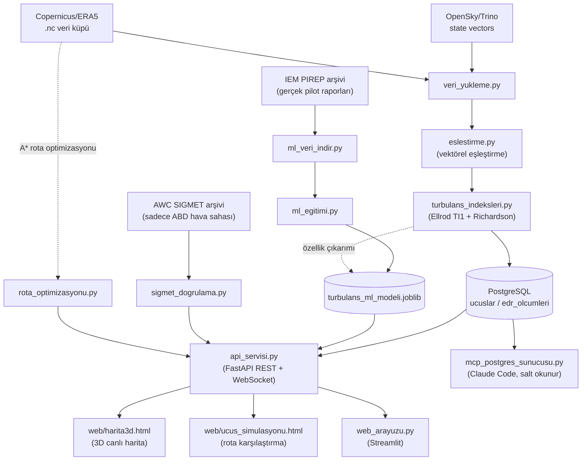

# Türbülans Radar

Gerçek bir uçuşun (OpenSky/Trino) rotasını, gerçek bir hava durumu veri
küpüyle (Copernicus/ERA5) eşleştirip Ellrod TI1 indeksi ve bulk Richardson
sayısıyla türbülans şiddeti/dinamik kararsızlık tahmini üreten uçtan uca bir
sistem. Sonuçlar PostgreSQL'e yazılır, zaman kaydırıcılı bir Folium
haritasında görselleştirilir, bir FastAPI servisi ve MCP sunucusu üzerinden
JSON/veritabanı olarak dışarıya açılır.

**Önemli sınırlama:** TI1/EDR proxy, sertifikalı bir EDR (Eddy Dissipation
Rate) değeri DEĞİLDİR -- ~25-30 km çözünürlüklü reanaliz verisinden
hesaplanan bir araştırma/görselleştirme göstergesidir. Ölçeklendirme
katsayısı artık gerçek IEM PIREP + ERA5 gözlemleriyle kalibre edildi (bkz.
[Sınırlamalar](#bilinmesi-gerekenler--sınırlamalar), `kalibrasyon.py`) --
ama bu bölgeden bağımsız, kaba bir kalibrasyondur, sertifikalı bir EDR
sensörünün yerini TUTMAZ.

Sistemin kullanım sınıfı, veri kaynakları, hata durumlarındaki davranışı ve
bilinen sınırları için bkz. **[Sistem Kartı](docs/SISTEM_KARTI.md)**.

## Mimari

```
                         ┌─────────────────┐
  OpenSky/Trino ────────►│  veri_yukleme.py │
  (callsign→icao24→rota) └────────┬─────────┘
                                  │
  Copernicus/ERA5 (.nc) ──────────┤
                                  ▼
                          ┌───────────────┐      ┌────────────────────┐
                          │ eslestirme.py │─────►│ turbulans_indeksleri│
                          │ (TI1+Richard.)│      │ (Ellrod TI1, Ri)    │
                          └───────┬───────┘      └────────────────────┘
                                  │
                    ┌─────────────┼─────────────┐
                    ▼             ▼             ▼
             veritabani.py   harita.py      main.py /
             (PostgreSQL,    (Folium HTML)  toplu_analiz.py /
              models.py)                    web_arayuzu.py (CLI/UI)
                    │
      ┌─────────────┼─────────────────┐
      ▼             ▼                 ▼
api_servisi.py  mcp_postgres_    (Alembic ile
(FastAPI REST   sunucusu.py      şema yönetimi)
 + WebSocket)   (Claude Code
                 için salt okunur)
```

Aynı mimarinin görsel (GitHub'da otomatik render olan Mermaid) hali -- ML
sınıflandırıcı ve SIGMET doğrulama akışları dahil:



Paket yapısı (`src/turbulans_radar/`, src layout -- `pip install -e .` ile
kurulur, komut satırı araçları `[project.scripts]` ile gelir):

```
turbulans_radar/
  config.py, loglama.py, hata_yardimcisi.py, konsol_kurulumu.py   -> çekirdek: ayarlar, log, hata mesajları
  depo/       models.py, veritabani.py         -> SQLAlchemy ORM + senkron/asenkron PostgreSQL erişimi
              gorev_deposu.py                  -> API analiz görevlerinin kalıcı kaydı
              kup_katalogu.py                  -> hava durumu küplerinin kataloğu (ızgara diskte, meta veri DB'de)
  veri/       veri_yukleme.py                  -> NetCDF yükleme/önbellek, yerel küp seçimi, OpenSky/Trino sorguları
              veri_saglayicilari.py            -> Veri Sağlayıcı katmanı: canlı NOAA GFS (THREDDS) + ERA5 seçimi
              sigmet_saglayici.py              -> canlı AWC SIGMET'leri (ABD + uluslararası, Ankara FIR dahil)
              kisitli_saha_saglayici.py        -> kısıtlı/yasak hava sahaları (GeoJSON içe aktarma, örnek veri)
              veri_indirme.py                  -> ERA5 indirme altyapısı (güvenlik sınırlı, varsayılan kuru deneme)
              kimlik_dogrulama.py              -> .env'den OpenSky kimlik bilgisi
  fizik/      turbulans_indeksleri.py          -> Ellrod TI1, Richardson, EDR proxy
              eslestirme.py                    -> rota <-> hava küpü vektörel eşleştirme, 3 boyutlu kapsam kontrolü
              birim_donusumleri.py             -> irtifa <-> basınç (ISA)
              kalibrasyon.py                   -> EDR ölçekleme katsayısı kalibrasyonu (bootstrap GA)
  rota/       rota_optimizasyonu.py            -> büyük daire vs A* rotası (yanal + irtifa), CZML üretimi
              risk_katmanlari.py               -> A*'ın modüler risk katmanları (TI1 cezası, SIGMET/kısıtlı saha sert kısıtı)
  dogrulama/  rota_backtest.py                 -> A* rotası vs gerçek uçuş izi (otomatik backtest)
              sigmet_dogrulama.py              -> TI1'in tarihsel AWC SIGMET'leriyle karşılaştırması (ABD)
  ml/         turbulans_ml_modeli.py           -> PIREP + ERA5 ile eğitilmiş risk sınıflandırıcısı, versiyonlama
              ml_egitimi.py, ml_veri_indir.py, pirep_kalibrasyon_verisi_uret.py
  analiz/     ucus_analizi.py                  -> uçtan uca uçuş analizi (OpenSky ya da hazır iz -> küp -> DB -> harita)
              toplu_analiz.py                  -> CSV listesindeki uçuşları sırayla analiz
  api/        api_servisi.py, semalar.py       -> FastAPI REST + WebSocket, Pydantic şemaları
  arayuz/     harita.py, web_arayuzu.py        -> Folium zaman kaydırıcılı harita, Streamlit arayüzü
  cli/        ornek_ucus_bul.py, veri_kontrol.py, kimlik_kontrol.py, openapi_disa_aktar.py, mcp_postgres_sunucusu.py
web/                                           -> harita3d.html (MapLibre) + ucus_simulasyonu.html (CesiumJS)
migrations/, alembic.ini                       -> Alembic şema migration'ları
tests/                                         -> pytest (birim + PostgreSQL + gerçek veri + Playwright)
```

## Kurulum

```bash
git clone <bu-repo>
cd files
pip install -e ".[dev]"       # paket + sabitlenmiş bağımlılıklar + komut satırı araçları + test/lint araçları
cp .env.example .env          # OpenSky + PostgreSQL + API_ANAHTARI bilgilerini gir
alembic upgrade head          # veritabanı şemasını kur/güncelle
```

Sadece çalıştırmak (geliştirme araçları olmadan) için `pip install -e .` yeterlidir.

`.env`'e girilmesi gerekenler (bkz. `.env.example`): `OPENSKY_USERNAME`/
`OPENSKY_PASSWORD` (OpenSky hesabı, tarihsel veri erişimi onaylanmış
olmalı -- https://opensky-network.org/my-opensky/request-data),
`POSTGRES_*` (host/port/kullanıcı/şifre/veritabanı), `API_ANAHTARI`
(`python -c "import secrets; print(secrets.token_urlsafe(32))"` ile üret).

Hava durumu veri küpünü (`ocak_2019_turbulans.nc`, Copernicus/ERA5'ten
manuel indirilmiş) proje köküne koyman gerekir -- büyük olduğu için
`.gitignore`'da, repoya dahil değildir.

### Docker ile çalıştırma (alternatif)

```bash
docker compose up --build
```

Bu, PostgreSQL'i, API'yi (önce `alembic upgrade head` çalıştırıp) ve uzun
işleri çalıştıran ayrı **worker** servisini tek komutla ayağa kaldırır
(ölçeklemek için: `docker compose up --scale worker=3`). `.env` dosyanın hazır olması gerekir;
`POSTGRES_HOST` konteynerler arası iletişim için otomatik olarak compose
servis adına (`db`) çevrilir. API `http://localhost:8000`'de, Swagger
`http://localhost:8000/docs`'ta olur. Konteyner **otonom** çalışır: canlı
AWC SIGMET'lerini 15 dakikada bir kendisi yeniler
(`SIGMET_OTOMATIK_GUNCELLEME_DAKIKA`), anlık rotalar için canlı GFS verisini
indirir (`canli_veri/` volume'unda saklanır). ERA5 `.nc` dosyaları imaja
dahil değildir (boyut); geçmiş tarihli analizler için konteynere volume
olarak bağlanmaları gerekir. PostgreSQL portu yalnızca `127.0.0.1`'e açıktır.
CI, her push'ta imajı derleyip içinde API uygulamasının yüklendiğini doğrular.

## Kullanım

### Tek bir uçuşu analiz etmek (CLI)

```bash
python -m turbulans_radar.cli.ornek_ucus_bul   # gerçek, o gün kayıtlı bir callsign bul
turbulans-analiz THY1234 2019-01-01            # analiz et -- PostgreSQL'e yazar + harita üretir
```

Her script `--help` ile kullanım bilgisi verir. Sonuç `ucuslar`/
`edr_olcumleri` tablolarına yazılır (aynı uçuş/tarih tekrar analiz
edilirse eski kayıt silinip yenisiyle değiştirilir); harita
`ciktilar/turbulans_haritasi_<uçuş>_<tarih>.html`'e kaydedilir.

### Web arayüzü

```bash
streamlit run src/turbulans_radar/arayuz/web_arayuzu.py
```

Uçuş numarası ve tarihi bir kutuya yazıp "Analiz Et"e basman yeterli;
sonuç tablosu ve harita direkt sayfada görünür. Arkada aynı `main.py`
mantığı çalışır -- bu sadece görsel bir ön yüz.

### Birden fazla uçuşu birden analiz etmek

```bash
turbulans-toplu-analiz ucuslar.csv     # en az ucus_numarasi, tarih sütunları
```

Her uçuş kendi kaydını PostgreSQL'e yazar ve kendi haritasını üretir; ayrıca
hepsinin özetini `ciktilar/toplu_analiz_ozeti.csv`'de toplar. Bir uçuşta
hata olursa diğerlerinin analizi durmaz; OpenSky'yi yormamak için uçuşlar
arasına kısa bir bekleme konur.

### Veri kalitesini kontrol etmek

```bash
python -m turbulans_radar.cli.veri_kontrol N10VZ 2019-01-15   # önce turbulans-analiz ile analiz etmiş olman gerekir
```

Veri küpünün çözünürlüğünü (grid/zaman adımı) ve PostgreSQL'deki TI1
değerlerinin ne kadar çeşitli olduğunu (çok az benzersiz değer varsa veri
küpü muhtemelen çok kaba) kontrol eder.

## FastAPI servis katmanı

```bash
uvicorn turbulans_radar.api.api_servisi:app --reload --port 8000
# Swagger/OpenAPI: http://localhost:8000/docs
```

### Uç noktalar

Swagger (`/docs`), uç noktaları Uçuşlar/Analiz/Simülasyon/Türbülans Tahmini/Eşikler/Sistem etiketleriyle gruplar.

Sunucuyu ayağa kaldırmadan API'yi keşfetmek için: `openapi.json` (ham OpenAPI
şeması, `/openapi.json` ile AYNI) ve `turbulans_radar.postman_collection.json`
(tüm uç noktaları `X-API-Key` başlığıyla hazır içeren bir Postman
koleksiyonu -- `taban_url`/`api_anahtari` koleksiyon değişkenlerini
doldurman yeterli) repoya dahil. Endpoint eklendikçe/değiştikçe
`turbulans-openapi` ile yeniden üretilebilir -- canlı `/openapi.json`
her zaman en güncel/otoriter kaynaktır, bu iki dosya sadece bir anlık
görüntü (snapshot) kolaylığı sağlar.

| Metod | Yol | Açıklama |
|---|---|---|
| GET | `/saglik` | Sağlık kontrolü (anahtarsız). `?derin=true` ile PostgreSQL'e gerçekten bağlanmayı dener (deploy sonrası kontrol için) |
| GET | `/api/v1/ucuslar` | Kaydedilmiş uçuşları listeler; `{toplam_sayi, ucuslar}` döner (`limit`, 1-500; `ucus_numarasi_arama` kısmi eşleşme, `baslangic_tarih`/`bitis_tarih` ile filtrelenebilir) |
| GET | `/api/v1/ucuslar/{ucus_numarasi}/{tarih}` | Bir uçuşun ölçüm noktaları (`olcum_limit`/`olcum_offset` ile sayfalı) |
| DELETE | `/api/v1/ucuslar/{ucus_numarasi}/{tarih}` | Kayıtlı bir uçuşu (ölçümleriyle birlikte) siler -- bulunamazsa 404, silinirse 204 |
| DELETE | `/api/v1/ucuslar` | Filtreye (`ucus_numarasi_arama`/`baslangic_tarih`/`bitis_tarih`) uyan TÜM uçuşları toplu siler -- filtresiz istek 400 ile reddedilir (yanlışlıkla tüm tabloyu boşaltmayı önlemek için) |
| GET | `/api/v1/ucuslar/{ucus_numarasi}/{tarih}/csv` | Bir uçuşun TÜM ölçümlerini (sayfalama olmadan) CSV olarak indirir |
| GET | `/api/v1/ucuslar/{ucus_numarasi}/{tarih}/geojson` | Bir uçuşun TÜM ölçümlerini bir GeoJSON `FeatureCollection`'ı olarak indirir (QGIS/geopandas vb. için) |
| POST | `/api/v1/analiz/ucus` | Tek bir uçuşu arka planda analiz eder, `gorev_id` döner |
| POST | `/api/v1/analiz/toplu` | Birden fazla uçuşu arka planda analiz eder |
| POST | `/api/v1/analiz/rota` | OpenSky'a bağlanmadan, dışarıdan yüklenen bir ADS-B izini (`noktalar`: `zaman`, `enlem`, `boylam`, `irtifa_m`) analiz edip kaydeder -- tarayıcı girişi gerektirmediği için sunucu/Docker'da da çalışır |
| GET | `/api/v1/analiz/durum/{gorev_id}` | Tetiklenen bir analizin durumunu sorgular |
| GET | `/api/v1/esikler` | TI1 renklendirme eşiklerini döner (web/harita3d.html bunları kullanır) |
| GET | `/api/v1/ucuslar/{ucus_numarasi}/{tarih}/sigmet-dogrulama` | TI1'i gerçek AWC SIGMET'leriyle karşılaştırır |
| GET | `/api/v1/simulasyon/ucak-profilleri` | 3D uçuş simülasyonu için uçak modeli seçim listesi |
| POST | `/api/v1/simulasyon/rota` | Büyük daire vs rüzgar-optimize rota + CZML döner; aktif SIGMET'ler sert kısıt olarak uygulanır (bkz. aşağıdaki bölüm) |
| POST | `/api/v1/sigmet/guncelle` | AWC'den canlı SIGMET'leri çekip veritabanını günceller (n8n/cron periyodik tetikler) |
| GET | `/api/v1/sigmet` | Şu an geçerli SIGMET'ler (kutu/tehlike filtresiyle) -- önyüzlerin yasak bölgeleri çizmesi için |
| GET | `/api/v1/kisitli-sahalar` | Şu an geçerli kısıtlı/yasak hava sahaları (kutu filtresiyle) |
| POST | `/api/v1/kisitli-sahalar?kaynak=...` | GeoJSON FeatureCollection içe aktarır (örn. n8n: NOTAM -> geçici kısıt); `eskileri_kaldir=true` kaynağı tamamen yeniler |
| DELETE | `/api/v1/kisitli-sahalar/{dis_kimlik}` | Bir kısıtlı sahayı siler |
| POST | `/api/v1/veri/canli/hazirla` | Bir bölge/zaman için canlı GFS küpünü arka planda hazırlar (katalogda tazesi varsa onu kullanır), 202 + `gorev_id` döner |
| GET | `/api/v1/veri/kupler` | Hava durumu küpü kataloğu (kaynak, model çalıştırması, kapsam, seviyeler) |
| POST | `/api/v1/backtest/ucuslar/{ucus_numarasi}/{tarih}` | Bir uçuşun gerçek izini büyük daire ve A* rotasıyla karşılaştırıp kaydeder |
| POST | `/api/v1/backtest/toplu` | Backtest'i olmayan uçuşları arka planda karşılaştırır (n8n gece tetiklemesi), `gorev_id` döner |
| GET | `/api/v1/backtest` | Tüm backtest sonuçları + filo geneli özet |
| POST | `/api/v1/turbulans/tahmin` | Tek nokta için fizik (TI1) + gerçek PIREP verisiyle eğitilmiş ML tahminini karşılaştırmalı döner |
| GET | `/api/v1/turbulans/model-bilgisi` | ML modelinin seçim gerekçesi/metrikleri (recall, F1, ROC-AUC vb.) + eğitim tarihini döner; model henüz eğitilmediyse dürüstçe `egitildi_mi: false` |
| GET | `/api/v1/turbulans/model-versiyonlari` | Şimdiye kadar eğitilmiş TÜM model versiyonlarını (en yeni önce) listeler |
| POST | `/api/v1/turbulans/model-versiyonlari/{versiyon_id}/aktiflestir` | Geçmiş bir model versiyonunu YENİDEN EĞİTİM GEREKMEDEN aktif model yapar (rollback); bilinmeyen `versiyon_id` 404 döner |
| WS | `/ws/uyarilar?api_key=...` | TI1 "orta-şiddetli" eşiği aşılınca canlı uyarı yayınlar |
| GET | `/harita/harita3d.html` | 3D/canlı harita önyüzü (statik, tarayıcıda açılır) |
| GET | `/harita/ucus_simulasyonu.html` | 3D uçuş simülasyonu önyüzü (statik, tarayıcıda açılır) |

Örnek:

```bash
curl -X POST http://localhost:8000/api/v1/analiz/ucus \
  -H "X-API-Key: $API_ANAHTARI" -H "Content-Type: application/json" \
  -d '{"ucus_numarasi": "THY1234", "tarih": "2019-01-01"}'

curl http://localhost:8000/api/v1/ucuslar/THY1234/2019-01-01 \
  -H "X-API-Key: $API_ANAHTARI"
```

### Güvenlik ve sağlamlık

- **API anahtarı:** `/api/v1/*` altındaki tüm uç noktalar `X-API-Key`
  başlığı gerektirir (`.env` -> `API_ANAHTARI`), sabit zamanlı
  (`secrets.compare_digest`) karşılaştırılır. Anahtar yanlış/eksikse 401,
  sunucuda hiç tanımlı değilse 503.
- **Girdi doğrulama:** `tarih` gerçek bir tarih olarak, `ucus_numarasi`
  harf/rakam + en fazla 8 karakter olarak doğrulanır (422 döner).
- **Hata gizliliği:** 500/503 yanıtları ham exception mesajını (SQL,
  bağlantı dizesi vb.) istemciye döndürmez; tam ayrıntı sunucu tarafında
  (stderr, `loglama.py`) loglanır.
- **Hız sınırlama:** `/api/v1/analiz/*`, kendi API'sini kötüye kullanıma
  karşı bellek-içi bir pencere sayaçla korur (varsayılan: 60 saniyede en
  fazla 5 istek, aşılırsa 429) -- dışarıdan tetiklenen aşırı istekle
  OpenSky'yi dolaylı yormamak için. `DELETE /api/v1/ucuslar*` (tekli ve
  toplu silme) da AYNI desenle (kendi ayrı penceresiyle) korunur --
  yanlışlıkla/kötüye kullanımla art arda çok sayıda silme isteğine karşı.
- **Asenkron:** okuma uç noktaları `asyncpg` tabanlı, event loop'u
  bloklamaz. Uzun işler API sürecinde çalışmaz (bkz. aşağıdaki görev kuyruğu).
- **CORS:** varsayılan kapalı; `.env`'deki `CORS_IZIN_VERILEN_KAYNAKLAR`
  (virgülle ayrılmış origin listesi) ile açılır.
- **Görev kuyruğu ve işçiler:** uzun işler (`/analiz/ucus`, `/analiz/rota`,
  `/analiz/toplu`, `/backtest/toplu`, `/veri/canli/hazirla`) PostgreSQL'deki
  `analiz_gorevleri` tablosuna **kuyruk** olarak eklenir ve istek hemen
  `202 {"gorev_id", "durum": "kuyrukta"}` döner; ayrı bir mesaj kuyruğu
  altyapısı gerekmez (`gorev_deposu.py`). İşçiler (`isci/gorev_iscisi.py`)
  sıradaki görevi `FOR UPDATE SKIP LOCKED` ile alır -- birden çok işçi süreci
  aynı görevi iki kez almaz. Eşzamanlılık `GOREV_ISCI_SAYISI` ile sınırlıdır
  (ağır bir toplu iş API'yi yavaşlatmaz). Çalışan görevin işçisi kalp atışı
  gönderir; işçi çökerse ya da yeniden başlarsa görev `GOREV_BAYAT_SANIYE`
  sonra yeniden kuyruğa girer (`GOREV_MAKS_DENEME`'ye kadar), sonra
  `yarida_kaldi` olur. Durumlar: `kuyrukta -> calisiyor -> tamamlandi |
  basarisiz | hata | yarida_kaldi`. Varsayılan olarak API kendi içinde
  gömülü bir işçi başlatır (`GOREV_GOMULU_ISCI`); ayrı süreç için
  `turbulans-isci` (Docker'da `worker` servisi), belirli işlere ayrılmış işçi
  için `GOREV_ISCI_TURLERI`. Bitmiş görevler 7 gün sonra otomatik silinir.
- **Webhook bildirimi:** `bildirim_webhook_url` verilirse, analiz bitince
  sonuç oraya POST edilir -- n8n'in Webhook node'u bunu dinleyip
  `/api/v1/analiz/durum/{gorev_id}`'yi periyodik yoklamaya gerek bırakmaz.
  URL doğrulanır (sadece `http(s)`, link-local/ayrılmış IP'ler -- örn. bulut
  metadata adresi -- reddedilir); `.env`'deki `WEBHOOK_IZIN_VERILEN_HOSTLAR`
  doluysa sadece o host'lara gönderilir (SSRF koruması).
- **Kayıt garantisi:** API'den tetiklenen analizde sonuç PostgreSQL'e
  yazılamazsa görev `tamamlandi` değil `hata` olur (CLI ise haritayı yine
  üretir, sadece uyarır).
- **WebSocket:** `API_ANAHTARI` sunucuda tanımlı değilse `/ws/uyarilar` de
  bağlantıyı reddeder (REST ile aynı "kapalı başla" davranışı). İşçi başka
  bir süreçte çalışabildiği için canlı uyarılar PostgreSQL `NOTIFY` ile
  (`turbulans_uyarilari` kanalı) API'ye gelir ve oradan istemcilere iletilir.

**Bilinçli olarak eklenmedi:** `veri_indirme.py`'nin gerçek ERA5 indirmesini
tetikleyen bir uç nokta (rate-limit/ban riski), JWT/OAuth2 kullanıcı girişi
(tek kullanıcılı/dahili bir araç için statik anahtar yeterli görüldü, çok
kullanıcılı bir sürüme geçilirse yükseltilebilir).

## 3D/canlı harita önyüzü

```bash
uvicorn turbulans_radar.api.api_servisi:app --reload --port 8000
# tarayıcıda aç: http://localhost:8000/harita/harita3d.html
```

`web/harita3d.html`, build aracı gerektirmeyen tek dosyalık bir MapLibre GL
JS sayfasıdır -- `api_servisi.py` tarafından API ile AYNI origin'de sunulur
(`app.mount("/harita", ...)`), bu yüzden `fetch()`/WebSocket çağrıları
CORS'a takılmaz. Sayfaya uçuş numarası, tarih ve API anahtarını (bir kez
girilir, `localStorage`'da tutulur) yazıp "Yükle"ye basman yeterli:

- Rota, `GET /api/v1/ucuslar/{ucus}/{tarih}`'ten çekilip TI1 şiddetine göre
  renklendirilmiş noktalar + çizgi olarak "globe" (3D küre) projeksiyonunda
  gösterilir; alttaki zaman kaydırıcısı ile rota an be an oynatılabilir.
- `GET /api/v1/ucuslar/{ucus}/{tarih}/sigmet-dogrulama`'dan gelen gerçek
  SIGMET poligonları (varsa) sarı bir katman olarak haritaya eklenir.
- `/ws/uyarilar`'a bağlanıp, bir analiz sırasında orta-şiddetli türbülans
  tespit edilirse ekranda anlık bir uyarı (toast) gösterir.
- Harita karosu (tile), `harita.py`'de daha önce yaşanan "CartoDB anahtar
  istemeye başladı" sorununu tekrarlamamak için YİNE anahtarsız Esri World
  Street Map'i kullanır; MapLibre CDN sürümü (5.8.0) BİLEREK sabitlendi
  (daha yeni sürümler -- 6.x -- klasik `<script>` ile çalışan UMD paketini
  kaldırıp sadece ES module dağıtıyor).

Bu sayfa gerçek bir tarayıcıda (Playwright + headless Chromium) uçtan uca
test EDİLDİ: gerçek bir uçuş (THY322, 2019-01-15, 1614 nokta) analiz edilip
sayfaya API anahtarıyla yüklendi, rota/TI1 renklendirmesi/zaman kaydırıcısı
render oldu (bkz. yukarıdaki ekran görüntüsü niteliğindeki doğrulama). Bu
test GERÇEK bir hata ortaya çıkardı ve düzeltildi: `harita.setProjection`
metodu, önceden sabitlenen MapLibre 4.7.1'de YOKTU (kod içi yorum bunun
var olduğunu YANLIŞ varsayıyordu) -- 5.8.0'a geçildi. Ardından
`setProjection`'ı `Map` constructor'ından hemen sonra çağırmanın "Style is
not done loading" hatası verdiği görüldü; "globe" projeksiyonu artık
doğrudan constructor'ın `projection` seçeneğine taşındı, `harita.on("load",
...)` içinde bir savunmacı ikinci deneme daha bırakıldı.

## Canlı SIGMET kısıtı ve modüler risk katmanları

`rota_optimizasyonu.py`'deki A* araması, maliyetini takılabilir **risk
katmanlarından** (`risk_katmanlari.py`) alır. Her katman aynı düğüm/kenar
grafı için yasak düğüm/kenarlar (SERT kısıt) ve saniye cinsinden cezalar
(YUMUŞAK kısıt) üretir; yeni bir risk kaynağı eklemek A*'ı değiştirmez:

| Katman | Tür | Kaynak |
|---|---|---|
| `Ti1CezaKatmani` | yumuşak (ceza) | ERA5'ten hesaplanan Ellrod TI1 >= `TI1_ESIK_ORTA_SIDDETLI` |
| `SigmetKisitKatmani` | **sert (yasak)** | Canlı AWC SIGMET'leri (`sigmetler` tablosu) |
| `KisitliSahaKatmani` | **sert (yasak)** | Çatışma bölgeleri, P/R/D sahaları, NOTAM'lı geçici kısıtlar (`kisitli_hava_sahalari` tablosu) |

SIGMET kısıtı **dört boyutludur**: yatay poligon + irtifa bandı (`taban_ft`/
`tavan_ft`, boş taban = yerden) + uçağın o noktaya VARIŞ zamanında
geçerlilik. Kenar kontrolü, iki ızgara düğümü arasındaki bacağın poligonu
kesip kesmediğine de bakar (seyrek ızgarada küçük bir SIGMET "atlanmasın").
Varsayılan kaçınılan tehlikeler: `TURB, MTW, TS, CONVECTIVE, VA, TC`
(`SIGMET_KACINILACAK_TEHLIKELER`). Öncelik sırası: (1) SIGMET'e girmemek,
(2) TI1 riskinden kaçınmak, (3) en ucuz yakıt/süre. SIGMET'e girmeyen hiçbir
rota bulunamazsa (örn. varış noktası SIGMET içinde) sistem **öneri yapmaz**:
`guvenli_rota_bulundu_mu: false` ve açıklamada "ÖNERİ YOK". SIGMET kısıtı
hava verisinden bağımsızdır -- ERA5 kapsamı dışında da (rüzgarsız, TAS ile)
uygulanır. Yanıttaki `sigmet_kontrolu` alanı kontrolün durumunu
(`uygulandi` / `aktif_sigmet_yok` / `erisilemedi`), uygulanan SIGMET'leri ve
canlı hesapta son çekim `SIGMET_BAYATLIK_DAKIKA`'dan eskiyse `bayat_mi`
uyarısını taşır; CZML çıktısı SIGMET'leri 3D sahnede yarı saydam kırmızı
hacimler olarak çizer.

**Canlı veri:** `sigmet_saglayici.py`, aviationweather.gov'un iki uç noktasını
(`airsigmet`: ABD iç, `isigmet`: uluslararası -- Ankara FIR/LTAA dahil)
normalize edip `sigmetler` tablosuna upsert eder; akıştan düşen (iptal
edilen) SIGMET'lerin geçerliliği sona erdirilir, süresi dolanlar
`SIGMET_SAKLAMA_GUN` sonra silinir. Yenileme yolları: `POST
/api/v1/sigmet/guncelle` (n8n Schedule Trigger, örn. 10-15 dk),
`turbulans-sigmet` (cron) ya da `SIGMET_OTOMATIK_GUNCELLEME_DAKIKA`
> 0 ile API'nin kendi zamanlayıcısı.

**Sessiz kayıp koruması:** "akışta yok → sonlandır" kuralı, akış
çözümlenemediğinde tüm aktif SIGMET'leri hata vermeden kapatabilirdi (örn.
AWC `coords` alanını yeniden adlandırsa). Bu yüzden her akış önce denetlenir:
boş ya da liste olmayan yanıt veya SIGMET kayıtlarının
`SIGMET_MAKS_COZUMLENEMEYEN_ORAN`'dan (varsayılan %25) fazlasının
çözümlenememesi **kaynak hatası** sayılır. Bu durumda mevcut kayıtlar
sonlandırılmaz, `kaynak_hatalari` alanı doldurulur ve kaynak "başarılı
güncelleme" almaz. Her kaynağın son deneme/son başarılı çekimi
`veri_kaynagi_durumlari` tablosunda tutulur; `bayat_mi` artık en eski son
BAŞARILI çekime bakar ve açıklama hata veren kaynağı adıyla belirtir. Aynı
denetimde canlı akışta sessizce atılan bir biçim de bulundu: `geom: "AREAS"`
(tek SIGMET'te birden fazla poligon) artık alan başına bir kayıt olarak
saklanıyor. Okunamayan irtifa değeri daha geniş bir yasak banda, okunamayan
tehlike türü `BILINMIYOR`'a çevrilir ve bu tür SIGMET'lerden her zaman
kaçınılır.

## Kısıtlı / yasak hava sahaları

A*'ın yanal ızgarası büyük daireden 400 km'ye kadar sapabildiği için, hava
durumundan kaçarken planlı rotanın hiç kullanmadığı bir çatışma bölgesine ya
da yasak sahaya rota önerebiliyordu. `KisitliSahaKatmani` bu alanları SIGMET
ile aynı dört boyutlu mantıkla (poligon + irtifa bandı + geçerlilik penceresi)
**sert kısıt** olarak uygular; boş geçerlilik sınırı süresiz, boş taban/tavan
yer/sınırsız demektir. Öncelik sırası: (1) SIGMET'e ve kısıtlı sahaya
girmemek, (2) TI1 riskinden kaçınmak, (3) en ucuz yakıt/süre.

- **Uç nokta muafiyeti:** kalkış ya da varış noktasını İÇEREN saha kısıt
  olarak uygulanmaz (uçuşun o sahaya yetkili olduğu varsayılır, örn. varış
  ülkesi) ve yanıttaki `kisitli_saha_kontrolu.muaf_tutulanlar`'da raporlanır.
- **Veri:** GeoJSON FeatureCollection (Polygon/MultiPolygon; `kimlik`, `ad`,
  `tur` = `CATISMA`/`YASAK`/`KISITLI`/`TEHLIKELI`/`GECICI`, `taban_ft`,
  `tavan_ft`, `baslangic`, `bitis`, `aciklama`). İçe aktarma:
  `turbulans-kisitli-saha ice-aktar sahalar.geojson --kaynak aip` ya da
  `POST /api/v1/kisitli-sahalar?kaynak=notam` (n8n bir NOTAM akışından geçici
  kısıtları bu uçla iter). İç halkalar (delikler) muhafazakâr olarak yok sayılır.
- **Örnek veri:** paketle gelen `ornek_kisitli_sahalar.geojson`, Natural Earth
  1:50m (kamu malı) ülke sınırlarından **Suriye ve Irak'ı** "çatışma bölgesi"
  olarak içerir. `KISITLI_SAHA_ORNEK_VERI_YUKLE=true` (varsayılan) iken API
  açılışında, tabloda bu kaynaktan kayıt yoksa yüklenir. **Resmi FIR/CZIB sınırı
  değildir**; yanıt açıklaması örnek veri kullanıldığını belirtir. Gerçek
  kullanımda kapatılıp güncel AIP ENR 5.1, EASA CZIB ve NOTAM verisi aktarılmalıdır.
- **Örnek:** Malatya → Musul (FL340): büyük daire Suriye'nin kuzeydoğu ucunu
  13 nokta/bacakta kesiyor; A* 60 km yanal sapmayla Suriye'ye girmeyen rotayı
  buluyor, Irak varış ülkesi olduğu için muaf. Koridoru tamamen kesen bir saha
  varsa sistem "ÖNERİ YOK" der.
- 3D simülasyonda kısıtlı sahalar mor yarı saydam hacimler olarak çizilir.

## Canlı hava verisi: Veri Sağlayıcı katmanı (NOAA GFS)

ERA5 bir reanalizdir, birkaç gün gecikmeyle yayınlanır -- "şimdi" için rota
çizemez. `veri_saglayicilari.py` bu yüzden hava verisini kaynaktan bağımsız
bir **Veri Sağlayıcı** arayüzüyle alır; her sağlayıcı küpü ERA5 ile AYNI
ortak şemaya (u/v/t, `valid_time`, `pressure_level` hPa, boylam -180..180)
normalize eder, böylece eşleştirme, risk katmanları ve A* kaynağı bilmez.

- **Seçim sırası** (`veri_kupunu_sec`): önce yerel arşiv küpleri (ERA5); hiçbiri
  noktaları kapsamıyorsa ve zaman canlı penceredeyse (şimdi
  -`CANLI_GECMIS_SAAT` / +`CANLI_TAHMIN_UFKU_SAAT`) canlı sağlayıcı; ikisi de
  yoksa `None` (uydurma veri yok). Rota simülasyonu, `/turbulans/tahmin` ve
  son 48 saatteki uçuş analizleri bunu kullanır; yanıttaki
  `ruzgar_verisi_kaynagi` `gfs_tahmin` / `era5_gercek` / `era5_kapsam_disi` olur.
- **`GfsThreddsSaglayici`:** NOAA GFS 0.25°, UCAR THREDDS NetCDF Subset
  Service'ten her basınç seviyesi (varsayılan 200/250/300 hPa) paralel ayrı
  istekle NetCDF olarak alınır -- GRIB2/ecCodes gerektirmez (ecCodes'un
  Windows/Python 3.14 için hazır paketi yok). Türkiye bölgesi, 3 seviye,
  birkaç saatlik pencere: ~250 KB, ~15 sn.
- **Katalog ve yeniden kullanım:** indirilen küp `CANLI_VERI_KLASORU`'na
  yazılır, `hava_durumu_kupleri` tablosuna kaydedilir (`kup_katalogu.py`);
  aynı bölge/zamanı kapsayan ve `CANLI_KUP_TAZELIK_SAAT` içinde indirilmiş
  bir küp varsa yeniden indirilmez. Geçerliliği `CANLI_KUP_SAKLAMA_SAAT`
  önce bitmiş canlı küpler (dosya + kayıt) otomatik silinir.
- **Önceden ısıtma:** `POST /api/v1/veri/canli/hazirla` (örn. n8n her GFS
  döngüsünden sonra sık kullanılan bölgeler için) ilk rota isteğinin indirme
  süresini beklemesini önler.
- Yeni bir sağlayıcı (örn. ECMWF Open Data -- GRIB2, Docker/Linux'ta)
  `VeriSaglayici` arayüzünü uygulayarak eklenir.

### Küp seçimi ve bellek (GB boyutlu arşive hazırlık)

- **Seçim katalogdan:** noktaları kapsayan yerel küp, dosyalar açılmadan
  `hava_durumu_kupleri` kataloğundan (bölge/zaman kesişimi) bulunur; sadece
  aday küpler yüklenir. Katalogda henüz olmayan dosya ya da veritabanına
  erişilemediğinde dosyanın yalnızca koordinatları okunur (önbellekli).
  Eskiden ilk seçimde TÜM yerel küpler belleğe yükleniyordu (16 küp, 92 MB).
- **Pencereli okuma:** `KUP_TAM_YUKLEME_ESIGI_MB`'den (256) büyük küplerden
  sadece noktaların çevresi okunur (rota için A* koridoru kadar pay, eşleştirme
  için 1°; 1° ve 6 saatlik sınırlara hizalı). İzmir-Van rotası için pencere
  1.2 MB (tüm Türkiye küpü 69 MB); TI1 sonuçları tam küple birebir aynı
  (testle doğrulanıyor).
- **Bütçeli önbellek:** yüklenen tüm küp/pencereler `KUP_ONBELLEK_MAKS_MB`
  (2048) bütçeli bir LRU önbellekte; bütçe aşılınca en uzun süre kullanılmayan
  atılır (eskiden hiçbir küp atılmıyordu). NetCDF/HDF5 erişimi (okuma, GFS
  yazma) tek kilitle sıraya alınır; önbellek isabetleri yüklemeyi beklemez.

## Otomatik doğrulama: gerçek uçuşlarla backtest

`rota_backtest.py`, analiz edilmiş her uçuşun gerçek izini (OpenSky, gerçek
irtifasıyla) aynı giriş/çıkış noktaları için **büyük daire** ve **A***
rotasıyla AYNI ölçütle karşılaştırır: gerçek iz, diğer rotalarla aynı nokta
sayısına kümülatif mesafe boyunca yeniden örneklenir; TI1 aynı hava küpüyle
ve aynı kodla hesaplanır; aktif SIGMET ihlalleri aynı katmanla sayılır.
Karşılaştırma, hava küpünün kapsadığı **en uzun kesintisiz seyir bloğu**
üzerinde yapılır (15 dk'dan uzun veri boşluğu bloğu böler -- OpenSky
kapsamasının olmadığı bölümler uydurma bir rotayla doldurulmaz). Sonuçlar
`rota_backtestleri` tablosuna yazılır (uçuş başına en son çalıştırma);
`GET /api/v1/backtest` filo geneli özeti döner; komut satırından
`turbulans-backtest --hepsi`. Ölçümler artık irtifayı da
saklıyor (`edr_olcumleri.irtifa_m`).

Depodaki gerçek uçuşlarla (15 Ocak 2019, Türkiye ERA5 küpü, A320 profili)
ilk sonuçlar -- riskli oran: TI1 >= eşik nokta oranı:

| Uçuş | Seyir | Karşılaştırılan bölüm | Riskli oran (gerçek / büyük daire / A*) | A* stratejisi |
|---|---|---|---|---|
| THY72C | FL320 | 258 km | 0.68 / 0.17 / 0.00 | tırmanma (+5 dk) |
| THY322 | FL300 | 260 km | 0.15 / 0.24 / 0.00 | tırmanma (+2 dk) |
| THY606 | FL380 | 101 km | 0.00 / 0.00 / 0.00 | yok (risk yok) |

### Bağımsız kanıt: TI1'i TI1 ile ölçmemek

Yukarıdaki "riskli oran" döngüseldir: A* rotası TI1'i düşürecek şekilde
seçiliyor, başarı da yine TI1 ile ölçülüyor. Bu yüzden her backtest ayrıca
A*'ın ve TI1 hesabının hiç görmediği gerçek dünya kanıtıyla ölçülür
(`dogrulama/bagimsiz_kanit.py`); kaynak bir uçuşu kapsamıyorsa değer `None`
kalır, "sıfır" sayılmaz:

| Kaynak | İçerik | Kapsam |
|---|---|---|
| `sigmet_arsivi` | Sistemin kendi SIGMET arşivi (`sigmetler`), TURB/MTW | Küresel (Türkiye dahil), arşivin başladığı andan itibaren, `SIGMET_SAKLAMA_GUN` geriye |
| `iem_sigmet` | IEM'in AWC SIGMET arşivi (2005-) | ABD sorumluluk sahası |
| `iem_pirep` | IEM PIREP/AIREP arşivi; rota tüpünde (50 km, ±2000 ft, ±1 sa) türbülans raporları ve orta ve üstü (MOG) olanlar | Pratikte Kuzey Amerika + Kuzey Pasifik |

Bağımsızlık için A* backtest'te TURB/MTW SIGMET'lerini **görmez** (oraj,
volkanik kül, tropikal siklon SIGMET'leri ve kısıtlı sahalar sert kısıt
olarak kalır). MOG tanımı ML etiketleriyle aynıdır (1254 etiketli PIREP'te
ikili sınıflama %100 örtüşüyor). Sonuçlar `*_turb_sigmet`, `*_pirep_raporu`,
`*_mog_pirep` ve `kanit_kaynaklari` sütunlarında; filo özeti azalan/artan
maruziyetli uçuş oranlarını verir.

- 2019 Türkiye uçuşları için hiçbir kaynak kapsama sağlamıyor (IEM'in
  "Türkiye" kutusundaki PIREP'leri yanlış konumlanmış ABD raporları) --
  kanıt alanları dürüstçe boş.
- **Canlı örnek (26 Eylül 2026):** OpenSky'dan alınan gerçek bir uçuş
  (PUE502, FL350, Brezilya, 1744 km'lik seyir) canlı GFS ile analiz edilip
  backtest edildi; sistemin kendi arşivindeki aktif TURB SIGMET'lerine
  maruziyet (nokta + bacak): gerçek iz 30, büyük daire 28, A* 33. GFS tabanlı
  TI1 aynı bölgede hiç riskli nokta görmedi (üç rotada da 0.00). Yani bu
  uçuşta TI1 katmanı, tahmincilerin FL340-410 için yayınladığı türbülansı
  yakalayamadı -- döngüsel ölçümün gizleyeceği bir kör nokta. Canlı sistemde
  bu SIGMET'lerden sert kısıt olarak yine kaçınılır; backtest yalnızca TI1'in
  bağımsız becerisini ölçer.

Karşılaştırılan bölümler kısa: THY322'nin OpenSky izinde Doğu Anadolu'da
65 dk'lık bir veri boşluğu var; THY606 (İstanbul-Kahire) ve THY72C
(İstanbul-Dakar) küpün dışına çıkıyor. Filo özeti, n8n ile daha çok uçuş
analiz edildikçe (`POST /api/v1/backtest/toplu`) anlamlı hale gelir. N10VZ
(Teksas) küp dışında olduğu için dürüstçe atlanır.

## 3D uçuş simülasyonu (normal rota vs türbülanstan-kaçınma rota)

```bash
uvicorn turbulans_radar.api.api_servisi:app --reload --port 8000
# tarayıcıda aç: http://localhost:8000/harita/ucus_simulasyonu.html
```

`web/ucus_simulasyonu.html`, `web/harita3d.html` ile AYNI desende (tek
dosyalık, build aracı yok, `api_servisi.py` API ile aynı origin'den sunar)
ama CesiumJS tabanlı bir 3D küre sayfasıdır. Başlangıç/bitiş enlem-boylamı,
irtifa, tarih-saat ve uçak modelini girip "Simüle Et"e basınca:

- `POST /api/v1/simulasyon/rota` (bkz. `rota_optimizasyonu.py`) iki GERÇEK
  rota hesaplar: **normal rota** (iki nokta arası büyük daire) ve **optimize
  rota**. Optimize rotanın önceliği ÖNCE GÜVENLİK, SONRA MALİYET:
  1. Normal rota üzerinde, projenin ANA analiz koduyla (Ellrod TI1 --
     `eslestirme.py`/`turbulans_indeksleri.py`, gerçek ERA5 verisiyle) riskli
     türbülans var mı bakılır.
  2. **Riskli türbülans YOKSA**, optimize rota normal rotayla **birebir
     aynıdır** -- uydurma bir sapma gösterilmez.
  3. **Riskli türbülans VARSA**, adım 3'te açıklanan **A\* (A-star) graf
     araması** o bölgeyi TAMAMEN atlatan, ERA5 rüzgarına göre de en ucuz olan
     yolu bulur; ızgarada riski tam ortadan kaldıran bir yol yoksa, riski en
     aza indiren yol dürüstçe seçilir ("tamamen güvenli" diye yalan
     söylenmez).
  - Bu sıralamanın nedeni: türbülansın kendisi doğrudan çok fazla yakıt
    yaktırmaz (asıl yakıt belirleyicisi rüzgardır) -- türbülanstan kaçınmak
    genelde yol uzatıp FAZLADAN yakıt gerektirir (gerçek uçuşlarda da böyle);
    değeri güvenlik/konfordur. Bu yüzden "optimize rota her zaman ucuzdur"
    varsayılmaz, sonuç panelinde bazen "ekstra yakıt: güvenlik için sapmanın
    bedeli" olarak dürüstçe gösterilir.
- **A\* araması (bkz. `_a_yildiz_ile_rota_ara`):** Büyük daire etrafında,
  rotaya dik yönde kaydırılmış aday konumlardan oluşan bir IZGARA kurulur
  (bkz. `_YanalIzgara`); ızgaranın her düğümünün TI1'i projenin ana
  analiz koduyla (`eslestirme.py`) tek bir vektörel çağrıda hesaplanır. Her
  kenarın maliyeti gerçek ERA5 rüzgarına göre uçuş süresi + (riskli
  türbülans içeriyorsa) büyük bir ceza olarak tanımlanır; A*, kalan mesafe
  tabanlı **admissible** (asla aşırı tahmin etmeyen) bir sezgiselle
  başlangıçtan bitişe TOPLAM MALİYETİ EN AZA indiren yolu **garantili
  optimal** şekilde bulur. Erken sürümde ızgara çok kaba (100 km/adım) olduğu
  için A*'ın rotanın hemen başında/sonunda ani bir sıçrama yapıp onu
  koruduğu (eski, daha basit "birkaç aday dene" yaklaşımından bile daha uzun
  bir rota) gerçek veriyle tespit edildi -- ızgara inceltilip (20 km/adım)
  başlangıca/bitişe yakın erişilebilir sapma bir "zarf" ile kademelendirilerek
  düzeltildi.
- **Sapma sınırları mesafe ve açıyla tanımlı:** sabit "20 km/adım" kısa
  rotada gerçek dışı keskin sapmalara (480 km'lik İstanbul-Antalya'da 12
  km'lik bacakta 59°), uzun rotada gereksiz dar koridora (8000 km'lik
  İstanbul-New York'ta kalkıştan 600 km sonra en fazla 60 km -- SIGMET'lerden
  kaçılabilecekken "öneri yok") yol açıyordu. Artık her bacağın büyük daire
  yönüne göre açısı en fazla `ROTA_MAKS_SAPMA_ACISI_DERECE` (30°), toplam
  sapma en fazla `ROTA_MAKS_YANAL_SAPMA_KM` (400 km); ızgara aralığı en fazla
  `ROTA_YANAL_IZGARA_KM` (20 km), kısa rotada açı sınırına göre daralır.
  Ölçümler (İzmir-Van, ERA5 TI1 + 50 SIGMET): A* 58 ms, tam rota kararı
  0.29 sn; İstanbul-New York (1481 düğüm, 18 büyük SIGMET): A* 70 ms, en dik
  bacak 16.7°, 140 km sapmayla güvenli rota.
- **Çok faktörlü karşılaştırma -- irtifa değişimi (tırmanma/alçalma):**
  Riskli türbülanstan kaçınmanın YANAL sapma dışında ikinci bir GERÇEK
  stratejisi daha var: aynı yatay rotada kalıp bir üst/alt basınç seviyesine
  geçmek (bazı CAT katmanları irtifaya bağlıdır). Tırmanma/alçalma KENDİ
  İÇİNDE de bir yakıt/süre maliyeti taşır (tırmanma seyrin ÜZERİNDE, alçalma
  ALTINDA bir yakıt akışıyla modellenir -- bkz. `_irtifa_degisimi_maliyeti`,
  halka açık tipik jet performansı mertebeleri, resmi performans verisi
  DEĞİL). `rota_simulasyonu_olustur`, yanal A* yolu ile irtifa değişimi
  adayları arasından TOPLAM maliyeti (temel seyir yakıtı + tırmanma/alçalma
  bedeli) en düşük, güvenliği sağlayan seçeneği seçer -- bazen irtifa
  değiştirmek yanal sapmadan hem daha güvenli HEM daha ucuz çıkar. Seçilen
  strateji (`kacinma_stratejisi`: "yanal"/"irtifa_yukari"/"irtifa_asagi") ve
  optimize rotanın kendi irtifası (`irtifa_ft`) yanıtta ayrı alanlar olarak
  döner; sonuç panelinde de gösterilir.
- Her iki rota, gerçek bir 3D uçak modeliyle (`web/models/ucak.glb` --
  CesiumJS'in kendi resmi örnek verisi, Apache 2.0 lisanslı) zaman-senkronize
  CZML animasyonu olarak sahneye eklenir (mavi = normal, yeşil = optimize);
  Cesium'un yerleşik zaman çizelgesi/oynatma kontrolleriyle izlenebilir.
- Sonuç panelinde süre, mesafe, tahmini yakıt, **tahmini CO2 emisyonu**
  (`CO2_KG_PER_KG_YAKIT = 3.16` -- ICAO/IPCC'nin standart, halka açık jet
  yakıtı emisyon katsayısı) VE riskli türbülans nokta sayısı (normal vs
  optimize) ayrı ayrı karşılaştırılır.
- **Dinamik rota güncelleme:** "🔄 Uçuş sırasında yeniden hesapla" butonu,
  simülasyon oynarken uçağın O ANKİ (Cesium'un kendi interpolasyonuyla
  bulunan) konumunu yeni başlangıç noktası alıp AYNI hedefe, AYNI gerçek
  backend'i (A* + irtifa karşılaştırması) yeniden çağırır -- uydurma bir
  "canlı meteorolojik değişiklik" simülasyonu değil, gerçek bir yeniden
  planlama çağrısıdır.
- **Kabin içi bildirim çerçevelemesi:** Riskli türbülans tespit edildiğinde,
  zaten var olan `/ws/uyarilar` WebSocket uyarı mantığının simülasyon
  sayfasındaki karşılığı olarak, gerçek TI1 şiddetine dayalı (ama arayüz
  çerçevelemesi illüstratif) bir "kabin ekibine bildirim" mesajı gösterilir.

**Kapsam/dürüstlük sınırlaması:** Gerçek ERA5 rüzgar/türbülans verisi SADECE
`config.HAVA_DURUMU_DOSYASI` küpünün (bu depodaki varsayılan veri:
Türkiye/Doğu Akdeniz, Ocak 2019 -- enlem 36-42, boylam 26-45) ve
`config.EK_HAVA_DURUMU_KLASORU`'ndaki küplerin (varsayılan
`era5_egitim_verisi/`: Kuzeydoğu ABD, enlem 40-50, boylam -80/-70,
2018-2020'nin seçili günleri) kapsadığı bölge/tarih/irtifa için var; rotayı
en iyi kapsayan küp otomatik seçilir. İrtifa, küpün basınç seviyelerinden
(200-300 hPa) `DIKEY_KAPSAM_TOLERANSI_HPA`'dan (50) fazla uzaksa -- yaklaşık
FL265 altı/FL445 üstü -- kapsam dışı sayılır. Seçilen başlangıç/bitiş/tarih/
irtifa bu aralığın dışındaysa, kod
`sigmet_dogrulama.py`'deki AYNI ilkeyle SESSİZCE uydurma bir "iyileşme"
göstermez -- `ruzgar_verisi_kaynagi: "era5_kapsam_disi"` döner, iki rota da
sadece uçağın hava hızıyla (rüzgarsız/türbülanssız) hesaplanır ve arayüzde bu
açıkça belirtilir. Bu veri kümesiyle demo yapmak için başlangıç/bitiş
noktalarını bu bölgenin içinde ve tarihi Ocak 2019 içinde seçmen gerekir
(sayfa varsayılan olarak İstanbul↔Antalya, 5 Ocak 2019, 28000ft ile açılır --
bu rotada gerçek bir türbülans noktası tespit edilip tamamen atlatılıyor) --
gerçek dünyadaki uçuş rotanı/tarihini görmek istersen, kendi ERA5 veri
küpünü indirip `HAVA_DURUMU_DOSYASI` ortam değişkeniyle o dosyayı gösterebilirsin.

Cesium ion hesabı/token'ı GEREKTİRMEZ: harita.py/harita3d.html'de anahtarsız
Esri tile'a geçilme ilkesiyle aynı şekilde, burada da Cesium'un varsayılan
ion terrain/imagery'si yerine anahtarsız Esri World Street Map (imagery) +
düz elipsoid (terrain) kullanılır.

Bu sayfa (diğer statik önyüzlerin aksine) gerçek bir tarayıcıda (Playwright +
headless Chromium) uçtan uca test EDİLDİ: API anahtarı girme, uçak profili
listesinin yüklenmesi, "Simüle Et"e tıklama, sonuç panelinin dolması ve
haritanın gerçekten render olması otomatik olarak doğrulandı. Bu test bir
GERÇEK hatayı ortaya çıkardı ve düzeltildi: CesiumJS 1.104+'ta `Viewer`'ın
`imageryProvider` kurucu seçeneği artık sessizce HİÇBİR KATMAN EKLEMİYOR
(deprecated) -- internetteki birçok eski örnek hâlâ bunu kullanıyor. Doğru
yol `baseLayer`'a bir `Cesium.ImageryLayer` örneği vermek (bkz. sayfadaki
kod içi not). Ayrıca `viewer.flyTo(dataSource)`'un, zamana bağlı (dinamik)
konumlu varlıklarda TÜM rotayı değil sadece varlığın O ANKİ tekil konumunu
kapsadığı fark edildi -- kamera artık sunucudan gelen ham koordinatlardan
hesaplanan bir dikdörtgene uçuyor, CZML'nin `path` özelliği de (sadece o ana
kadar uçulmuş izi gösterdiği için) ayrı, zamana bağlı olmayan statik bir ön
izleme çizgisiyle tamamlandı.

## Makine öğrenmesi tabanlı türbülans sınıflandırıcısı

TI1/Richardson sayısı fizik FORMÜLÜNE dayanır; komisyon rubriğinin "minimum
gereksinim" maddesi olarak bunun yanına, GERÇEK gözlem verisiyle etiketli,
çalışan bir ML sınıflandırıcısı eklendi.

**Neden bu depodaki Türkiye/Ocak-2019 verisiyle değil?** Bu veri kümesi için
gerçek, doğrulanmış türbülans etiketi yok (ne SIGMET -- sadece ABD hava
sahası, ne PIREP/AMDAR). Uydurma etiketle model eğitmek yerine (bu tam
olarak projenin başında düzeltilen "uydurma katsayı" hatasının bir
versiyonu olurdu), ABD hava sahasına özgü, halka açık **IEM PIREP arşivinden**
(mesonet.agron.iastate.edu) 2018-2020 arası gerçek pilot türbülans raporları
+ eşleşen gerçek **ERA5** verisi indirilip (`ml_veri_indir.py`,
`ml_egitimi.py`) GERÇEK bir eğitim kümesi kuruldu:

- 167 gerçek, etiketli örnek (57 pozitif orta-şiddetli+ türbülans / 110
  negatif, 42 farklı gün) -- FL300-400 arası, projenin
  `TI1_ESIK_ORTA_SIDDETLI` eşiğiyle AYNI ikili eşik felsefesiyle etiketlendi.
  (Önceki sürümde 179 örnek vardı; 12'si, aralıklı indirilmiş ERA5
  küplerinin zaman BOŞLUĞUNA düşüp günlerce uzaktaki bir saatin havasıyla
  eşleşen PIREP'lerdi -- artık kapsam dışı sayılıyor.)
- Özellikler bilinçli olarak **bölgeden bağımsız** tutuldu (enlem/boylam
  KASITLI OLARAK dışarıda bırakıldı -- yoksa model ABD'nin bölgesel hava
  düzenine ezberler, Türkiye gibi hiç görmediği bir bölgede anlamsızlaşırdı):
  `ti1_indeksi`, `richardson_sayisi`, `ruzgar_hizi_ms`, `basinc_hpa`.
- Üç sınıflandırıcı (Lojistik Regresyon, Random Forest, Gradient Boosting)
  eğitilip **recall'a** göre karşılaştırıldı (accuracy değil -- havacılık
  güvenliğinde kaçırılan gerçek türbülans/false negative en kritik hata
  türüdür).
- **Değerlendirme: gün bazında gruplu 5-kat çapraz doğrulama, 5 tekrar**
  (ortalama ± std). Aynı günün PIREP'leri aynı hava sistemine ait, birbirine
  çok benzer örneklerdir; eski tek rastgele %75/%25 bölme onları hem
  eğitime hem teste koyuyordu ve metrikleri şişiriyordu (eski rapor: RF
  recall 0.750 / ROC-AUC 0.843 -- gruplanmamış çapraz doğrulama da aynı
  ~0.84'ü veriyor, gün bazında gruplayınca ~0.66'ya iniyor). Aşağıdaki
  sonuçlar, modelin HİÇ GÖRMEDİĞİ günlerdeki performansıdır:

  | Model | Accuracy | Precision | Recall | F1 | ROC-AUC |
  |---|---|---|---|---|---|
  | Lojistik Regresyon | 0.637 ± 0.033 | 0.473 ± 0.041 | 0.540 ± 0.044 | 0.504 ± 0.042 | 0.644 ± 0.043 |
  | **Random Forest (seçildi)** | **0.655 ± 0.034** | **0.496 ± 0.044** | **0.554 ± 0.077** | **0.522 ± 0.053** | **0.656 ± 0.043** |
  | Gradient Boosting | 0.607 ± 0.041 | 0.422 ± 0.058 | 0.414 ± 0.080 | 0.417 ± 0.067 | 0.558 ± 0.056 |

  Random Forest en yüksek recall'u (57 gerçek türbülans vakasının ~%55'ini
  yakalıyor) nedeniyle seçildi; havacılıkta bir false negative (kaçırılan
  gerçek türbülans) bir false positive'den (gereksiz uyarı) çok daha
  pahalıya mal olur. Nihai model TÜM 167 örnekle eğitilip kaydedilir.
- **Dürüst yorum:** ROC-AUC ~0.66, şansın (0.5) üzerinde ama ZAYIF bir
  ayırt edicilik -- 167 örnek ve ~25-30 km çözünürlüklü reanaliz verisiyle
  beklenen bir sınır. Karşılaştırma için aynı veride SADECE Ellrod TI1'in
  ROC-AUC'si 0.44 (tek başına ayırt edici değil); model, TI1 + Richardson +
  rüzgar + basınç birleşimiyle bundan daha iyi. Model tahmini bir karar
  aracı değil, fizik göstergesinin yanında ek bir işarettir.
- `POST /api/v1/turbulans/tahmin`, tek bir nokta için hem fizik (TI1) hem
  ML olasılığını karşılaştırmalı döner. Model dosyası (`*.joblib`) repoya
  DAHİL DEĞİL (üretilmiş/büyük artefakt, `.gitignore`) -- `ml_veri_indir.py`
  ardından `ml_egitimi.py` ile yeniden üretilebilir. Model henüz
  üretilmediyse `turbulans_riski_tahmin_et` uydurma bir tahmin dönmez,
  dürüstçe `None` döner.
- `ml_egitimi.py`, seçilen modeli (`*.joblib`) kaydederken YANINDA
  `turbulans_ml_modeli_bilgisi.json`'ı da yazar (seçilen model adı, test
  metrikleri, özellik listesi, eğitim tarihi) -- bu da repoya dahil değil
  (üretilmiş artefakt). `GET /api/v1/turbulans/model-bilgisi`, bu dosyayı
  okuyup döner; henüz eğitilmediyse `egitildi_mi: false` ile dürüstçe
  bildirir.
- **Model versiyonlama/rollback:** her `ml_egitimi.py` çalıştırması,
  aktif modelin YANINDA `model_versiyonlari/` klasörüne KALICI bir kopya +
  manifest kaydı bırakır (repoya dahil değil, üretilmiş artefakt).
  `GET /api/v1/turbulans/model-versiyonlari` geçmiş TÜM versiyonları listeler,
  `POST /api/v1/turbulans/model-versiyonlari/{versiyon_id}/aktiflestir` ise
  yeniden eğitim gerekmeden geçmiş bir versiyona döner -- örn. yeni bir
  eğitim çalıştırması beklenenden kötü çıkarsa.

```bash
python -m turbulans_radar.ml.ml_veri_indir   # IEM PIREP + eşleşen gerçek ERA5 verisini indirir (Copernicus CDS API anahtarı gerekir, ~/.cdsapirc)
python -m turbulans_radar.ml.ml_egitimi      # 3 modeli gün bazında gruplu CV ile karşılaştırır, recall'a göre en iyisini (tüm veriyle eğitip) turbulans_ml_modeli.joblib olarak kaydeder
```

## SIGMET/AIRMET doğrulaması

Bu depodaki örnek veri kümesi (Türkiye/Doğu Akdeniz, Ocak 2019) için gerçek
PIREP/AMDAR gözlem verisi yok (bkz. `kalibrasyon.py`; ML sınıflandırıcısı
için ABD hava sahasından indirilen gerçek IEM PIREP verisi ayrı bir konu --
bkz. [Makine öğrenmesi tabanlı türbülans sınıflandırıcısı](#makine-öğrenmesi-tabanlı-türbülans-sınıflandırıcısı))
-- ama SIGMET'ler (Significant Meteorological Information) de gerçek,
operasyonel "burada tehlikeli hava durumu var" uyarılarıdır ve halka açık,
ücretsiz bir arşivden çekilebilirler. `sigmet_dogrulama.py`, hesaplanan TI1
"orta-şiddetli" noktalarını, Iowa Environmental Mesonet'in (IEM) 2005'ten
bugüne arşivlediği ABD Aviation Weather Center (AWC) SIGMET kayıtlarıyla
karşılaştırır -- gerçek zaman/konum eşleşmesi (poligon içi + geçerlilik
penceresi) kontrol edilir, sadece TÜRBÜLANSLA ilgili SIGMET'ler (metninde
"TURB" geçenler) dikkate alınır.

```bash
python -m turbulans_radar.dogrulama.sigmet_dogrulama THY1234 2019-01-01
# veya API üzerinden:
curl http://localhost:8000/api/v1/ucuslar/THY1234/2019-01-01/sigmet-dogrulama \
  -H "X-API-Key: $API_ANAHTARI"
```

**ÖNEMLİ SINIRLAMA:** Bu arşiv SADECE ABD'nin meteorolojik sorumluluk
sahasını (CONUS + New York/Oakland/Anchorage Oceanic FIR'ları gibi ABD
kontrolündeki okyanus bölgeleri) kapsar. Bu depodaki örnek veri kümesi
(Türkiye/Doğu Akdeniz, Ocak 2019) için GERÇEKTEN eşleşen bir SIGMET
bulunmaz -- bu bir hata değil, beklenen ve dürüst bir sonuçtur
(`sigmetle_ortusen_nokta_sayisi=0` döner). Özellik, ABD hava sahasında
geçen herhangi bir uçuş/tarih için gerçek anlamda doğrulama sağlar (bkz.
modülün kendi docstring'indeki örnek: Anchorage FIR, 2019-01-15, gerçek bir
"OCNL SEV TURB" SIGMET'i ile doğrulandı).

## n8n ile periyodik otomasyon

Otomasyon tarafı projenin Python iç yapısını bilmez; her iş, n8n'de bir
**Schedule Trigger** + **HTTP Request** node çiftidir. Tüm isteklere
`X-API-Key` başlığı eklenir (anahtarı n8n'de bir Credential ya da ortam
değişkeni olarak tut, iş akışına düz metin yazma):

| İş | Sıklık | HTTP Request | Not |
|---|---|---|---|
| Canlı SIGMET yenileme | 10-15 dk | `POST /api/v1/sigmet/guncelle` | A*'ın sert kısıtı bu tabloyu kullanır; son çekim 30 dk'dan eskiyse canlı rota yanıtları `bayat_mi` uyarısı taşır. Alternatif: `SIGMET_OTOMATIK_GUNCELLEME_DAKIKA` ile API'nin kendi zamanlayıcısı (Docker'da varsayılan 15 dk) -- ikisini aynı anda açmaya gerek yok. |
| Canlı GFS önceden ısıtma (isteğe bağlı) | 6 saatte bir, döngülerden ~4 sa sonra | `POST /api/v1/veri/canli/hazirla` (gövde: bölge kutusu, `saat_sayisi`) | Kuyruğa girer (202); küp özeti görevin `ozet` alanında. Sık kullanılan bölgenin ilk rota isteği indirme süresini beklemez. |
| Toplu uçuş analizi | ihtiyaca göre | `POST /api/v1/analiz/toplu` | `bildirim_webhook_url` ile bitince n8n Webhook node'una bildirim ya da `GET /api/v1/analiz/durum/{gorev_id}` yoklaması. |
| Toplu backtest (isteğe bağlı) | günlük | `POST /api/v1/backtest/toplu?limit=50` | Yeni analiz edilen uçuşları A* rotasıyla karşılaştırır; özet `GET /api/v1/backtest`. |

Uzun işlerde n8n asla beklemez: istek 202 + `gorev_id` döner. Sonuç için
ya `bildirim_webhook_url` (n8n Webhook node'u) verilir ya da `GET
/api/v1/analiz/durum/{gorev_id}` durum `kuyrukta`/`calisiyor` olduğu sürece
yoklanır. API sadece `.env`'den beslenen, `uvicorn`/Docker ile başlatılan
bağımsız bir HTTP servisidir.

## Claude Code'dan veritabanına MCP ile bağlanmak

Proje kökündeki `.mcp.json`, `mcp_postgres_sunucusu.py`'yi Claude Code'a
tanıtır (ilk kullanımda onay istenir). Sunucu **salt okunur** -- sadece
`tablolari_listele`, `ucuslar_listesi`, `ucus_detayi` ve
`salt_okunur_sorgu_calistir` (sadece tek bir `SELECT`, yazma ifadeleri
reddedilir) araçlarını sunar. Bağlantı bilgileri `.mcp.json`'da DEĞİL,
`.env`'de tutulur.

## Veritabanı şeması (Alembic)

```bash
alembic upgrade head       # şemayı kur/güncelle
alembic current             # hangi migration'da olduğunu gösterir
alembic revision --autogenerate -m "kisa aciklama"   # yeni migration
```

Bağlantı bilgisi `alembic.ini`'ye yazılmaz; `migrations/env.py`, tıpkı
`veritabani.py` gibi, `.env`'den okur.

## Testleri çalıştırmak

```bash
pip install -e ".[dev]"
pytest tests/
```

`test_eslestirme.py` gerçek `.nc` dosyasını, `test_veritabani.py`/
`test_api_servisi.py` gerçek bir PostgreSQL bağlantısını bulamazsa
otomatik atlanır (skip) -- CI'da Postgres bir servis konteyneriyle
sağlanır, `.nc` dosyası (büyük olduğu için) sağlanmaz.

`test_web_harita3d.py`/`test_web_ucus_simulasyonu.py`, gerçek bir tarayıcıda
(Playwright + headless Chromium) uçtan uca çalışır -- `tests/conftest.py`,
`api_servisi.py`'yi ayrı bir alt süreçte (subprocess) canlı olarak ayağa
kaldırır (bkz. o dosyadaki "neden ayrı süreç" notu). `playwright` paketi
projenin `requirements-dev.txt`'sine BİLEREK eklenmedi (CI'de chromium
indirmek yavaş/gereksiz) -- bu testler `playwright` kurulu değilse (CI'de
olduğu gibi) otomatik atlanır. Yerelde çalıştırmak için:

```bash
pip install playwright && playwright install chromium
pytest tests/test_web_harita3d.py tests/test_web_ucus_simulasyonu.py -v
```

## Geliştirme araçları

```bash
ruff check .              # lint
ruff format .              # biçimlendir
pre-commit install         # her commit'te otomatik çalıştır
```

`.github/workflows/ci.yml`, her push/PR'da lint ve testleri (gerçek bir
PostgreSQL servis konteyneriyle) çalıştırır.

## Bilinmesi gerekenler / sınırlamalar

- **TI1/EDR proxy, sertifikalı bir EDR değeri değildir** -- yukarıya bakın.
- **Kapsam kontrolü üç boyutludur:** yatay (küp sınırı ±1°), zaman (EN
  YAKIN gerçek zaman adımına en fazla 3 saat -- aralıklı indirilmiş küplerde
  boşluktaki günler kapsam dışıdır) ve irtifa (bkz. `DIKEY_KAPSAM_TOLERANSI_
  HPA`). Kalkış/iniş ve yerdeki noktalar ile irtifası bilinmeyen noktalar bu
  yüzden TI1 almaz (haritada gri); `geo_irtifa_m` boşsa `baro_irtifa_m`
  kullanılır.
- `flights_data4` tablosunda `callsign` alanı 8 karakter, boşlukla
  doldurulmuş (padded) saklanır; eşleştirme bunu otomatik yapar.
- Yatay deformasyon hesabı için veri kübünün ilgili zaman dilimindeki tüm
  enlem/boylam grid'ine ihtiyaç var (tek nokta yetmiyor).
- `config.EDR_OLCEKLENDIRME_KATSAYISI` (0.23), `pirep_kalibrasyon_verisi_
  uret.py` ile üretilen gerçek IEM PIREP + ERA5 gözlem setiyle (179 örnek,
  ML sınıflandırıcısıyla AYNI veri) `kalibrasyon.py` kullanılarak kalibre
  edildi -- ama bu ABD hava sahası verisine dayanan, bölgeden bağımsız kaba
  bir kalibrasyondur, Türkiye/Ocak-2019 örnek veri kümesine özgü DEĞİLDİR
  (bkz. yukarıdaki "Önemli sınırlama"). Nokta tahmini tek bir sayı gibi
  görünse de örneklem küçük (179) olduğu için gerçek belirsizlik daha
  geniş: `kalibrasyon.py`, bootstrap resampling ile bir %95 güven aralığı
  da hesaplar (`[0.15, 0.34]`, 1000 tekrarla) -- `--guven-araligi-atla` ile
  atlanabilir. NOT: 179 örneğin 12'si zaman boşluğu hatasıyla yanlış güne
  eşleşmişti (bkz. ML bölümü); düzeltilmiş 167 örnekle yeniden hesaplanan
  katsayı 0.21 (%95 GA `[0.13, 0.33]`) -- mevcut 0.23 bu aralığın içinde
  olduğu için değiştirilmedi.
- Proje gerçek bir uçuşla (OpenSky/Trino + gerçek `.nc` verisi) uçtan uca
  test edildi.
- Bu ortamda Docker daemon'ı kurulu olmadığından `Dockerfile`/
  `docker-compose.yml` YAML olarak doğrulandı ama `docker compose up
  --build` ile uçtan uca denenemedi.
- `sigmet_dogrulama.py`, SADECE ABD Aviation Weather Center'ın sorumlu
  olduğu hava sahaları için gerçek veri döner -- bu depodaki örnek veri
  kümesi (Türkiye) için örtüşme çıkmaması beklenen bir durumdur (yukarıya
  bakın).
- `web/harita3d.html` ve `web/ucus_simulasyonu.html`, ikisi de gerçek bir
  tarayıcıda (Playwright + headless Chromium) uçtan uca test EDİLDİ --
  ikisinde de gerçek hatalar bulunup düzeltildi: `ucus_simulasyonu.html`
  için CesiumJS'in `imageryProvider` seçeneğinin artık sessizce hiçbir
  katman eklememesi (bkz. "3D uçuş simülasyonu" bölümü), `harita3d.html`
  için MapLibre 4.7.1'de `setProjection` metodunun HİÇ olmaması ve
  constructor'dan hemen sonra çağrılınca "Style is not done loading"
  vermesi (bkz. yukarıdaki "3D/canlı harita önyüzü" bölümü). Uçak
  "modelleri" arasındaki performans farkı (seyir hızı/yakıt akışı) halka
  açık, tipik değerlerdir -- resmi üretici performans verisi DEĞİLDİR.

## Değişiklik geçmişi

Projenin geçmiş halinden bugüne kadarki tüm önemli değişiklikler için bkz.
[CHANGELOG.md](CHANGELOG.md).

## Lisans

[MIT](LICENSE)
