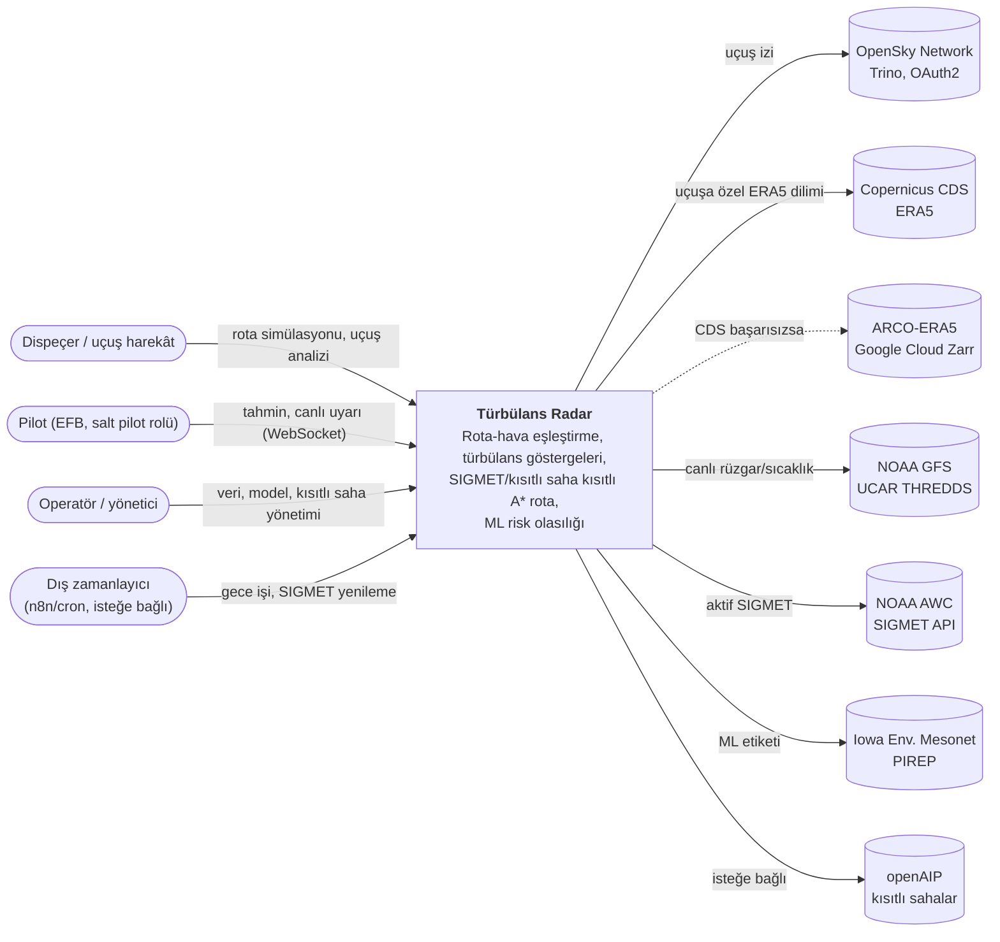
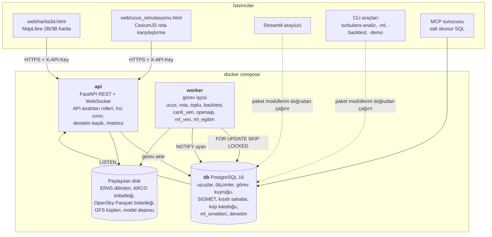
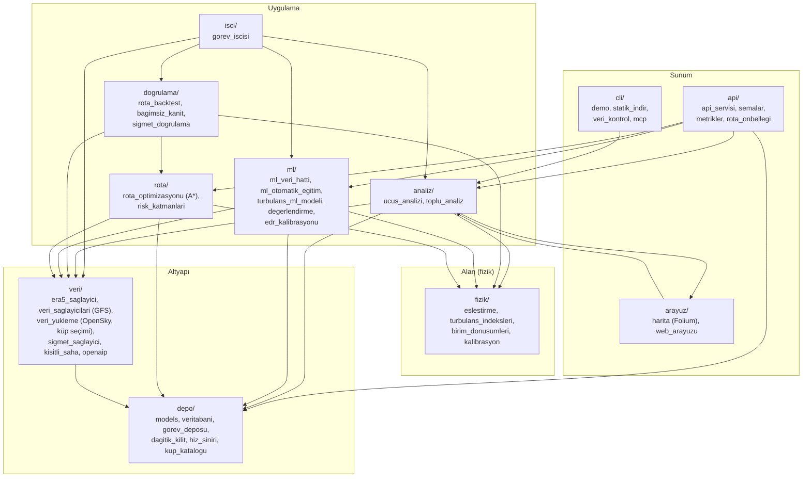
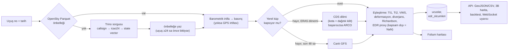
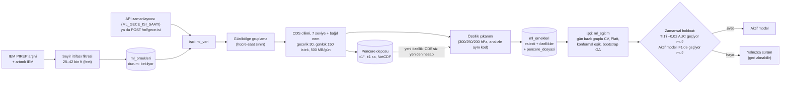

# Türbülans Radar — Mimari

Bu belge sistemi C4 modelinin üç düzeyinde (bağlam, konteyner, bileşen) ve
iki ana veri akışıyla anlatır. Diyagramlar Mermaid'dir; GitHub ve çoğu
Markdown görüntüleyici doğrudan çizer. Tasarım kararlarının gerekçeleri
[adr/](adr/) altındadır; davranış ve sınırlar [SISTEM_KARTI.md](SISTEM_KARTI.md)'dadır.

Sistem sertifikalı EDR üretmez; operasyonel karar aracı değil, karar destek aracıdır.

## 1. Bağlam

Sistem kimlere hizmet eder ve hangi dış sistemlere dayanır.

## 2. Konteynerler

`docker compose` üç servis çalıştırır: `db`, `api`, `worker` (`--profile demo`
ile ek olarak tek seferlik `demo`). Ağır işler API'de değil işçide çalışır;
iki servis kuyruğu ve kilitleri PostgreSQL üzerinden paylaşır.

| Konteyner | Sorumluluk | Teknoloji |
|---|---|---|
| api | REST/WebSocket, kimlik ve rol, hafif hesaplar (tahmin, rota simülasyonu), görev kuyruğuna ekleme, SIGMET zamanlayıcısı | FastAPI, uvicorn, SQLAlchemy (asyncpg + psycopg2) |
| worker | Uzun işler: uçuş analizi, toplu analiz, backtest, canlı veri, openAIP, ML veri hattı ve eğitim | Python iş parçacıkları, kalp atışı, bayat görev kurtarma |
| db | Tüm kalıcı durum, görev kuyruğu, dağıtık kilit (advisory lock), hız sınırı sayaçları | PostgreSQL 16, Alembic |
| Disk önbellekleri | Izgara verisi (NetCDF/Zarr) ve rota önbelleği; meta veri DB'deki katalogda | NetCDF, Parquet |

## 3. Bileşenler

`src/turbulans_radar/` paketleri ve bağımlılık yönü (üstteki alttakini kullanır).

Ortak sözleşme: tüm hava kaynakları (yerel ERA5, uçuşa özel ERA5, ARCO, GFS)
aynı şemaya normalize edilir — değişkenler `u, v, t`; boyutlar `valid_time`,
`pressure_level` (hPa), `latitude` (azalan), `longitude` (-180..180). Böylece
`fizik/` ve `rota/` verinin kaynağını bilmez.

## 4. Veri akışı: uçuş analizi

## 5. Veri akışı: ML veri hattı ve eğitim

## 6. Çapraz konular

| Konu | Uygulama | Yer |
|---|---|---|
| Kimlik ve yetki | Yönetici/pilot rolleri, kişi/cihaz başına anahtar, WebSocket bileti | `api/api_servisi.py` |
| Kötüye kullanım | İstemci başına dakikalık sınır, ağır hesap eşzamanlılık tavanı, gövde boyutu sınırı | `depo/hiz_siniri.py`, `config.py` |
| Dış kota | CDS günlük/gecelik istek sınırı kod seviyesinde | `veri/era5_saglayici.py` |
| Eşzamanlılık | Kuyruk `SKIP LOCKED`, indirmelerde advisory lock | `depo/gorev_deposu.py`, `depo/dagitik_kilit.py` |
| Gözlemlenebilirlik | JSON log, Prometheus `/metrics`, derin sağlık, kaynak durumu tablosu, denetim kaydı | `loglama.py`, `api/metrikler.py` |
| Sırlar | `.env` / Docker secret; gitleaks (pre-commit + CI) | `CONTRIBUTING.md` |
| Fail-safe | Güvenli rota yoksa öneri yapılmaz; veri yoksa uydurma değer yok | `docs/SISTEM_KARTI.md` §4 |
