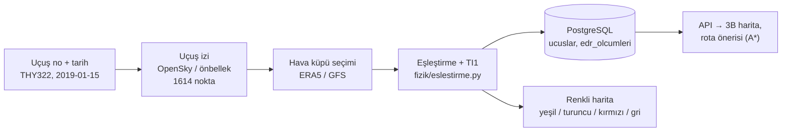
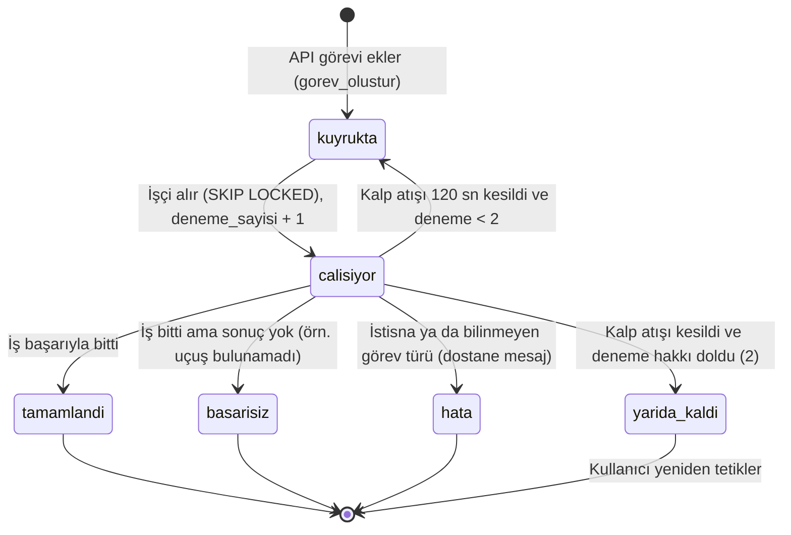

# Türbülans Radar — Proje Rehberi (öğrenme notları)

Bu rehber projeyi baştan sona sade dille anlatır. Anlatılan her şey koddan ve
çalıştırılan testlerden doğrulandı; doğrulanmayan yerler "kontrol etmedim" diye işaretlidir.
Çıktılar sertifikalı EDR değildir; sistem operasyonel karar aracı değil, karar destek aracıdır.

---

## Ders 1 — Büyük resim

**Benzetme:** Bir yol tarifi uygulaması düşün. Hangi yolda trafik olduğunu (hava), hangi
yolların kapalı olduğunu (yasak sahalar) bilir ve sana "bu yoldan git" der. Türbülans Radar
bunu gökyüzü için yapar: uçağın gideceği hattaki **açık hava türbülansını** (CAT: bulutsuz
havada, gözle görülmeyen sarsıntı) tahmin eder ve gerekirse daha sakin bir rota önerir.

**Kimin derdini çözer?** Uçuş öncesi planlama yapan dispeçer ve pilot. Karar yine onlarındır;
sistem yalnız tavsiye verir (`docs/SISTEM_KARTI.md` §1).

**Tek uçuşu takip edelim: THY322, 15 Ocak 2019** (İstanbul'dan doğuya, 19:39–21:11 UTC).
Bu uçuşun verisi depoda hazır gelir (`demo/`), internet gerekmez.

1. **Uçuş izi gelir.** `analiz/ucus_analizi.py` → `calistir()` önce önbelleğe bakar
   (`rota_onbellekten_oku`). THY322 için `demo/opensky_onbellek/THY322_2019-01-15.parquet`
   okunur: **1614 nokta** (her saniyeye yakın bir konum, hız, irtifa). Önbellekte yoksa
   OpenSky'a sorulurdu (`veri/veri_yukleme.py` → `ucus_numarasi_ile_rota_cek`).
2. **Hava verisi seçilir.** `_veri_kupunu_sec()` rotayı kapsayan "hava küpünü" bulur.
   Küp = bir bölgenin rüzgâr (u, v) ve sıcaklık (t) değerlerinin enlem × boylam × irtifa ×
   saat tablosu. THY322 için `demo/era5/era5_THY322_2019-01-15.nc`: 3 basınç seviyesi
   (300/250/200 hPa ≈ FL300/FL340/FL390), 6 saat, 22×80 nokta.
3. **Eşleştirme ve hesap.** `fizik/eslestirme.py` → `rotayi_hava_durumuyla_eslestir()`
   her noktanın irtifasını basınca çevirir (`birim_donusumleri.irtifa_metre_to_basinc_hpa`),
   küpte o noktayı bulur ve TI1 türbülans göstergesini hesaplar (Ders 3).
   Sonuç (bugün yeniden çalıştırdım): **720 nokta hesaplandı, 894 nokta "kapsam dışı"**.
   Neden? Uçak kalkış/tırmanış ve alçalışta küpün irtifa aralığının altında; sistem bu
   noktalara uydurma değer vermez, boş (NaN) bırakır. Hesaplanan 720 noktanın 103'ü sakin
   (yeşil), 266'sı hafif-orta (turuncu), 351'i eşiği aşan (kırmızı); en yüksek TI1 8,4e-7.
4. **Kayıt.** `depo/veritabani.py` → `ucus_ve_olcumleri_kaydet()` sonucu PostgreSQL'e yazar
   (yazılamazsa harita yine üretilir, uyarı verilir).
5. **Ekran.** `arayuz/harita.py` → `zaman_kaydiricili_harita_olustur()` noktaları
   `_turbulans_rengi()` ile boyar (gri = veri yok, yeşil < 4e-7 ≤ turuncu < 7e-7 ≤ kırmızı) ve
   `ciktilar/turbulans_haritasi_THY322_2019-01-15.html` dosyasını üretir. API açıkken aynı
   uçuş `web/harita3d.html`'de 3B olarak görülür.
6. **Rota önerisi** (ayrı istek, Ders 4): aynı hava verisiyle A* daha sakin bir yol arar.
   Sonuç paketine göre (`docs/sonuclar/2026-10-07/SAYILAR.md`, 7e-7 eşiği) THY322'nin riskli
   nokta oranı: gerçek iz 0,24 · büyük daire 0,39 · önerilen rota 0,02. Backtest döngüseldir:
   A* TI1'i düşürür, başarı da TI1 ile ölçülür. (README'deki 0,19 / 0,32 / 0,00 eşik
   değişmeden önceki ölçümdür.)



**Canlı testler** (`tests/test_demo.py`, `tests/test_ucus_analizi.py`: 17/17 geçti, 2,2 sn):
- `test_demo_cevrimdisi_calisir_harita_ve_kayit_uretir`: Demo internetsiz çalışır; 1614 nokta işler ve harita dosyası üretir.
- `test_demo_altin_degerleri_degismez`: THY322'nin dört noktadaki TI1 değeri ve 894 boş nokta sayısı kod değişince kaymıyor.
- `test_onbellekteki_rota_trinoya_gitmeden_kullanilir`: Önbellekte rota varsa OpenSky'a hiç gidilmiyor.
- `test_era5_alinamazsa_eldeki_kupe_ya_da_ana_kupe_dusulur`: ERA5 indirilemezse sistem çökmüyor, eldeki veriyle devam ediyor.

**Soru 1.1:** THY322'nin 1614 noktasının 894'ü neden boş (gri) kaldı?
**Soru 1.2:** Analiz sonucu veritabanına yazılamazsa ne olur?

---

## Ders 2 — Veri kaynakları

**Benzetme:** Bir hava durumu spikeri düşün. Uydu görüntüsüne (hava verisi), resmî
uyarılara (SIGMET), sahadan gelen muhabir notlarına (PIREP) ve kapalı yollar listesine
(kısıtlı sahalar) bakar. Kaynaklardan biri yoksa susmaz, ama "bu bilgi eksik" der.

| Kaynak | Ne söyler | Sistemde ne işe yarar | Yoksa ne olur |
|---|---|---|---|
| **OpenSky** (uçuş izi) | Uçağın saniye saniye konumu, irtifası, hızı | Analizin girdisi (`veri/veri_yukleme.py` → `ucus_numarasi_ile_rota_cek`; önbellek `veri/opensky_onbellegi.py`) | Analiz "[Durduruldu]" der; istersen dışarıdan ADS-B izi yüklenir (`POST /api/v1/analiz/rota`) |
| **ERA5** (geçmiş hava) | Geçmişteki rüzgâr ve sıcaklık, 0,25° (~25–30 km) ızgara, saatlik | Geçmiş uçuşların TI1'i, ML eğitimi | Önce Copernicus CDS'ten dilim indirilir, olmazsa ARCO yedeği (`veri/era5_saglayici.py` → `YedekliEra5Saglayici`); hiçbiri yoksa nokta boş (NaN) kalır |
| **GFS** (tahmin) | Gelecek 120 saate kadar rüzgâr/sıcaklık (NOAA) | Uçuş öncesi canlı rota (`veri/veri_saglayicilari.py` → `GfsThreddsSaglayici`) | Rota rüzgârsız hesaplanır, `canli_veri_alinamadi` uyarısı çıkar; 3 hatada "devre kesici" bir süre denemeyi bırakır |
| **SIGMET** (AWC) | Resmî tehlike uyarısı: poligon, irtifa bandı, geçerlilik saati | A* için **duvar** (sert kısıt) (`veri/sigmet_saglayici.py` → `sigmetleri_guncelle`) | Veritabanına ulaşılamazsa rota yine hesaplanır ama "UYARI"; 30 dk'dan eski veri "bayat" işaretlenir |
| **Kısıtlı sahalar** | Yasak/tahditli/tehlikeli saha, çatışma bölgesi (GeoJSON, AIP ENR 5.1, isteğe bağlı openAIP) | Yine duvar (`veri/kisitli_saha_saglayici.py`) | `kisitli_saha_kontrolu.durum = "erisilemedi"` ve UYARI |
| **PIREP** (IEM) | Pilotun "burada sarsıldım" raporu | Yalnız ML etiketi ve doğrulama; 28–42 bin ft arası seçilir (`ml/ml_veri_hatti.py` → `seyir_pireplerini_sec`) | ML eğitilemez (en az 60 gün gerekiyor: `config.ML_MIN_GUN`) |
| **MADIS EDR** | Uçağın kendi sensörünün ölçtüğü türbülans | Bağımsız doğrulama (`veri/madis_edr.py`) | Yalnız doğrulama eksik kalır |

Önemli fikir: bütün hava kaynakları **aynı şemaya** çevrilir (u, v, t; zaman, basınç,
enlem, boylam). Böylece hesap kodu (`fizik/`, `rota/`) verinin nereden geldiğini bilmez.

**Canlı testler** (`test_sigmet_saglayici.py`, `test_kisitli_saha_saglayici.py`: 57/57 geçti):
- `test_sema_degisikliginde_mevcut_sigmetler_korunur_ve_kaynak_hatali_isaretlenir`: AWC biçimini değiştirirse eldeki SIGMET'ler silinmiyor.
- `test_koordinati_olmayan_sigmet_fir_biliniyorsa_firin_tamamina_genisler`: "Bütün FIR" diyen SIGMET, temkinli davranılıp FIR'ın tamamına yayılıyor.
- `test_gecersiz_geojson_nedeniyle_reddedilir`: Bozuk saha dosyası sessizce kabul edilmiyor, neden yazılarak reddediliyor.

**Soru 2.1:** SIGMET ile PIREP arasındaki fark nedir; hangisi rotayı doğrudan etkiler?
**Soru 2.2:** Canlı GFS yanıt vermezse sistem "risk yok" der mi?

---

## Ders 3 — Türbülans hesabı (TI1)

**Benzetme:** Bir nehirde üst katmandaki su hızlı, alttaki yavaş akıyorsa sınırda
girdaplar oluşur. Bu, **rüzgârın yükseldikçe değişmesi**dir (düşey rüzgâr kayması, VWS).
Nehir bir yerde daralıp kıvrılıyorsa su çekiştirilir, gerilir. Bu da **yatayda bükülme**dir
(deformasyon, DEF). İkisi aynı yerde buluşunca girdap ihtimali büyür. TI1 bu ikisinin çarpımıdır:

`TI1 = VWS × DEF` → `fizik/turbulans_indeksleri.py` → `ti1_indeksi_hesapla()`
(VWS: `dusey_ruzgar_kaymasi_hesapla`, DEF: `yatay_deformasyon_hesapla`). Çarpım olduğu için
ikisinden biri sıfırsa TI1 de sıfırdır.

**Gerçek örnek (THY322, 19:56:59):** Rüzgâr her 1 km yükseklikte ~13 m/s değişiyor
(VWS 0,0130 s⁻¹), DEF 6,4e-5 s⁻¹ → TI1 = 8,4e-7. Eşik 7e-7 olduğu için nokta kırmızı.
(Değerler `tests/test_demo.py` içindeki sabit "altın değerler"den.)

**Eşik ne demek?** "Bu sayının üstü riskli" çizgisi (`config.TI1_ESIK_ORTA_SIDDETLI = 7e-7`,
hafif eşiği 4e-7). Çizgiyi aşağı çekersen daha çok türbülans yakalarsın ama yanlış alarm da artar.
- **7e-7 nereden geldi?** 8 Ekim'de veriden seçildi (`docs/sonuclar/2026-10-07/SAYILAR.md`).
  Altın test günleri dışındaki 64 günde her eşik denendi ve "yakalama oranı − yanlış alarm
  oranı" (Peirce skoru) ölçüldü. En iyi eşik 5,3e-7 çıktı. Ama tek bir en iyi sayı şansa bağlı
  olabilir. Bu yüzden en iyi skora bir standart hata yakınlıktaki **en temkinli** eşik seçildi
  (1-SE kuralı): 7,06e-7 ≈ 7e-7. Eski 8e-7 literatürden kaba bir tahmindi.
- Altın test günlerinde bu eşik: türbülanslı raporların ~%50'sini yakalıyor, sakin
  olanların ~%25'inde yanlış alarm veriyor. TI1'in tek başına ayırt etme gücü orta düzeyde (ROC-AUC 0,67).
- Eşik ERA5'te seçildi. GFS'te aynı eşik daha çok noktayı riskli sayıyor. Ayrı GFS eşiği
  tanımlanabilir ama şu an boş (`fizik/ti1_esigi.py` → `kaynak_ti1_esigi`).

**Neden "sertifikalı EDR değil"?** EDR, uçağın kendi sensörünün sarsıntıyı onaylı bir
yöntemle ölçmesidir. Bizim TI1'imiz ~25–30 km'lik ızgaralı hava verisinden çıkarılan bir
**olasılık işaretidir**. Haritadaki 0–1'lik `edr_proxy` yalnız görselleştirme ölçeğidir
(`ti1_den_edr_proxy_olcegine_cevir`). Kod bu sınırı her yanıtta `TI1_GUVENILIRLIK_NOTU` ile taşır:
güvenlik garantisi TI1'den değil SIGMET duvarından gelir.

**Canlı testler** (`test_turbulans_indeksleri.py`: 13/13 geçti):
- `test_ti1_indeksi_carpimdir`: TI1 gerçekten VWS × DEF.
- `test_kati_cisim_donmesinde_deformasyon_ve_diverjans_sifirdir`: Hava bir bütün halinde dönüyorsa "bükülme" yok, TI1 yükselmiyor.
- `test_edr_proxy_sifirda_sifir_ve_0_1_araliginda_kalir`: Görsel ölçek 0–1 dışına çıkmıyor.

**Soru 3.1:** VWS çok yüksek ama DEF sıfırsa TI1 ne olur?
**Soru 3.2:** Neden Peirce'ı en yüksek yapan 5,3e-7 değil de 7e-7 seçildi?

---

## Ders 4 — Rota bulma (A*)

**Benzetme:** Bir satranç tahtası düşün. Başlangıç bir köşede, hedef karşı köşede. Bazı
kareler **duvar** (SIGMET, yasak saha), bazıları **çamurlu** (riskli TI1; geçilebilir ama
pahalı). A*, "şimdiye kadar harcadığım + hedefe kalan iyimser tahmin" toplamı en küçük kareden
ilerleyerek en ucuz yolu bulur. Kalan tahmin hiçbir zaman gerçeğinden büyük olmadığı için
bulduğu yol gerçekten en ucuzudur.

Koddaki karşılığı (`rota/rota_optimizasyonu.py`):
- **Izgara** (`_YanalIzgara`, `_yanal_izgara_olustur`): büyük daire (iki nokta arası en kısa
  yay) 41 noktaya bölünür; her noktada rotaya dik yönde sağa-sola kaydırılmış aday noktalar
  dizilir. Sınırlar: bacak açısı ≤ 30°, toplam sapma ≤ 400 km, aralık ≤ 20 km.
- **Adım bedeli** (`_kenar_maliyeti_saniye`): bacağın gerçek rüzgârla **uçuş süresi** +
  riskli noktaya girişte **6 saatlik sanal ceza** (`rota/risk_katmanlari.py`
  → `TURBULANS_CEZASI_SANIYE`). Ceza o kadar büyük ki A* mümkünse riskli yere hiç girmez.
- **Duvar**: SIGMET/yasak sahaya düşen düğüm ve kenarlar grafiğin dışına atılır
  (`risk.yasak_dugumler`). Hava verisi olmayan düğümler de atılır: "veri yok" "risk yok" sayılmaz.
- **Sezgisel tahmin** (`_sezgisel_saniye`): kalan mesafe / (TAS × 1,8). TAS uçağın havaya göre hızıdır.
- **İrtifa seçeneği**: Yarım daire kuralına göre (doğuya tek, batıya çift FL;
  `rota/ucus_seviyeleri.py`) bir üst ve bir alt yasal seviye de denenir. Tırmanma/alçalma yakıtı
  hesaba katılır. En ucuz **tam güvenli** aday seçilir.

**Örnek rota (bugün çevrimdışı çalıştırdım, demo ERA5 küpü, A320, 15 Ocak 2019 19:00 UTC):**
İstanbul doğusu (40,9K 29,3D) → Kars civarı (40,6K 43,1D), FL350.
1. Manyetik iz 82° → doğu → tek FL. FL350 yasal; adaylar FL370 ve FL330.
2. Büyük daire 1162 km, 41 nokta → adım ~29 km → ızgara aralığı 16,8 km (30° sınırı), en çok 23 kademe sapma.
3. Normal rotada 12 riskli nokta (~188 NM, ~23 dk).
4. Yanal A* ve iki seviye karşılaştırıldı. Kazanan **FL370'e tırmanmak**: riskli nokta 12 → 0,
   süre +0,3 dk, seyir yakıtı ~%1,5 az (kütle varsayımına göre %1,1–2,9).
5. Brifing satırı: "Rota: tırmanma, FL370; riskli nokta 12→0 …".

**Neden bazen "ÖNERİ YOK"?** Duvarlara girmeyen hiçbir yol yoksa sistem uydurmaz:
`guvenli_rota_bulundu_mu: false`, açıklamada "ÖNERİ YOK", normal rota gösterilir ama önerilmez.
Tipik nedenler: başlangıç ya da bitiş SIGMET içinde, SIGMET 400 km'lik koridordan geniş, koridoru
baştan sona kesen yasak saha. Aynı örnekte başlangıcı içine alan sahte bir SIGMET ekleyince sonuç
gerçekten `False` ve "ÖNERİ YOK" oldu. Risk yoksa önerilen rota büyük daireyle birebir aynıdır;
sahte "iyileşme" gösterilmez.

**Canlı testler** (`test_rota_optimizasyonu.py`: 63/63 geçti, 17 sn):
- `test_gercek_era5_turbulans_yoksa_optimize_normalle_birebir_ayni`: Risk yoksa sistem rotayı boşuna değiştirmiyor.
- `test_rota_ortasindaki_sigmetten_yanal_sapmayla_kacinilir`: Ortadaki SIGMET'in yanından dolaşılıyor, ihlal 0.
- `test_baslangic_sigmet_icindeyse_rota_onerilmez`: Başlangıç SIGMET içindeyse "ÖNERİ YOK" ve kritik bulgu.

**Soru 4.1:** Riskli TI1 ile SIGMET, A* için nasıl farklı davranır?
**Soru 4.2:** Örnekte neden yanal sapma yerine tırmanma seçildi?

---

## Ders 5 — Makine öğrenmesi

**Benzetme:** Bir çırak düşün. Ustası (pilot raporları) "şu havada sarsıldık" diye
söyledikçe çırak hava haritasına bakıp kendi kuralını çıkarır. Sınavı, hiç görmediği ve
kilitli bir dolapta saklanan sorularla yapılır. Eski kalfayı da yalnız açık farkla geçerse yerine geçer.

- **Neyi öğreniyor?** Bir noktada "orta ve üstü türbülans" olma olasılığını. Girdiler 8 fizik
  özelliği: TI1, Richardson, rüzgâr hızı, basınç, VWS, DEF, diverjans, TI2
  (`ml/turbulans_ml_modeli.py` → `MODEL_OZELLIK_SUTUNLARI`).
- **Etiket nereden?** IEM'deki pilot raporlarından (PIREP), yalnız seyir irtifasında
  (28–42 bin ft). Rapor metninde MOD/SEV geçiyorsa "orta ve üstü" sayılır
  (`dogrulama/bagimsiz_kanit.py` → `pirep_siddet_sinifi`). Her rapor gece işinde aynı yer ve
  saatin ERA5 verisiyle eşleştirilir (`ml/ml_veri_hatti.py`). Bugün: 15.942 eşleşmiş örnek, 163 gün.
- Önemli ders: eski veri hattı IEM'in "FL" sütununu uçuş seviyesi sanmıştı. Oysa sütun feet
  cinsindendi, yani yerdeki raporlar seçilmişti. Bu yüzden eski model kullanılmıyor (`ESKI_MODEL_UYARISI`).
- **Altın test günleri neden var?** Aynı gündeki raporlar aynı hava sistemini görür. Rastgele
  bölünürse model "kopya çeker". Bu yüzden 7 Ekim'de 80 günden rastgele %20'si (16 gün, tohum 0)
  bir kez seçilip donduruldu (`ml/altin_test_gunleri.json`). Bu günler hiçbir modelin
  eğitimine girmez; bütün sürümler aynı sınavla karşılaştırılır.
- **Yeni model neden her zaman aktif olmuyor?** Kapı iki aşamalı (`ml/ml_otomatik_egitim.py`
  → `terfi_karari`): aday önce tek başına TI1'i, sonra aktif modeli ROC-AUC'de (ayırt etme
  puanı, 0,5 yazı-tura, 1 kusursuz) **en az 0,02 geçmeli** ve %95 güven aralığının alt sınırı
  0'dan büyük olmalı. Geçemezse yalnız sürüm olarak saklanır. `turbulans-ml --geri-al` ile eskiye dönülür.
  Bugünkü gece işi: aday +0,003 fark buldu (aralık −0,001…0,008) → aktifleşmedi. Aktif model
  9 Ekim'de 7.759 örnekle eğitilen Random Forest olarak kaldı.

**Canlı testler** (`test_ml_otomatik_egitim.py`: 26/26 geçti):
- `test_altin_test_gunleri_hicbir_surumun_egitimine_girmez`: Sınav soruları eğitime sızmıyor.
- `test_aday_aktif_modeli_gecemezse_aktif_model_degismez`: Açık farkla geçemeyen aday yerine geçmiyor.
- `test_tek_basina_ti1_kadar_iyi_olmayan_aday_aktiflestirilmez`: Basit formülden iyi olmayan model kullanılmıyor.

**Soru 5.1:** Neden raporlar rastgele değil de gün bazında bölünüyor?
**Soru 5.2:** Bugün eğitilen aday neden aktif olmadı?

---

## Ders 6 — Sistemin parçaları

**Benzetme: restoran.**
- **api** = garson. Siparişi alır, kısa işleri hemen kendisi yapar (rota hesabı, nokta tahmini).
  Uzun işi mutfağa fişle verir ve müşteriye "siparişiniz alındı" der (HTTP 202).
  API: diğer programların bizim sisteme soru sorduğu kapı (`api/api_servisi.py`, yollar `api/yollar/`).
- **db** = sipariş panosu + defter. Fişler (görev kuyruğu), tüm kayıtlar, SIGMET'ler, kilitler
  burada durur (PostgreSQL; `depo/models.py`).
- **worker** = aşçı. Panodan sıradaki fişi alır, pişirir, "hazır" yazar (`isci/gorev_iscisi.py`).
- **web sayfaları** = masa. `web/harita3d.html` ve `web/ucus_simulasyonu.html`, garsona
  `X-API-Key` anahtarıyla sorar (`fetch(... /api/v1/...)`).
- **yedek** servisi = gece defterin fotokopisini çeken çalışan (günlük veritabanı yedeği).

Nasıl konuşurlar? Sayfa → api (HTTPS + anahtar). api → db'ye fiş yazar. worker → fişi
`FOR UPDATE SKIP LOCKED` ile alır: iki aşçı aynı fişi kapamaz (`depo/gorev_deposu.py` →
`siradaki_gorevi_al`). Riskli bir uçuş bulunca worker db'ye `NOTIFY` der, api `LISTEN` ile
duyar, `/ws/uyarilar` üzerinden sayfaya anlık uyarı gönderir. Aşçı her 15 sn'de bir "hâlâ
bunun başındayım" işareti bırakır (kalp atışı, `kalp_atisi_gonder`).

**Görev kuyruğunun durum makinesi** (koddan: `gorev_deposu.py`, `gorev_iscisi.py`):



Not: Kodda beşinci bir bitiş durumu olan `basarisiz` da var (`BITMIS_DURUMLAR`). Yalnız analiz
görevleri sonuç bulamazsa bunu kullanır. Bitmiş görevler saklama süresinden sonra silinir; gece işi kayıtları kalır.
Süreler `config.py`'de: `GOREV_BAYAT_SANIYE=120`, `GOREV_MAKS_DENEME=2`, `GOREV_KALP_ATISI_SANIYE=15`.

**Canlı testler** (`test_gorev_deposu.py`, `test_gorev_iscisi.py`: 19/19 geçti):
- `test_eszamanli_iscilerin_her_biri_farkli_gorev_alir`: İki işçi aynı anda sorunca aynı görevi almıyor.
- `test_isci_olunce_gorev_yeniden_kuyruga_girer_deneme_bitince_yarida_kalir`: Durum makinesindeki "çökme" okları gerçekten çalışıyor.
- `test_analiz_hatasi_dostane_mesajla_hata_durumuna_cevrilir`: Hata kullanıcıya ham iz değil, anlaşılır bir mesajla gidiyor.

**Soru 6.1:** Ağır bir işi neden api değil de worker yapar?
**Soru 6.2:** İşçi bir görevin ortasında çökerse görev kaybolur mu?

---

## Ders 7 — Klasör haritası (`src/turbulans_radar/`)

**Benzetme:** Bir hastanenin kat planı. Her bölümün tek bir işi var.

| Klasör | Ne işe yarar | Önemli dosyalar (tek cümle) |
|---|---|---|
| `fizik/` | Hesabın kalbi: formüller | `turbulans_indeksleri.py` TI1, Richardson ve diğer göstergeler · `eslestirme.py` uçuş noktasını hava küpüyle eşleştirir · `birim_donusumleri.py` irtifa ↔ basınç · `ti1_esigi.py` kaynağa göre eşik · `cografya.py` büyük daire mesafesi · `sanal_pirep.py` ADS-B izindeki ani irtifa sapmalarını yakalar · `iz_bulutu.py` iz bulutu (contrail) duyarlılığı · `edr_esleme.py` göstergeleri ortak ölçeğe çevirir |
| `veri/` | Dış dünyadan veri getirir | `veri_yukleme.py` OpenSky + yerel küp seçimi · `era5_saglayici.py` CDS/ARCO dilimi · `veri_saglayicilari.py` canlı GFS · `sigmet_saglayici.py` AWC SIGMET · `kisitli_saha_saglayici.py` yasak sahalar · `madis_edr.py` uçak EDR ölçümleri · `opensky_onbellegi.py` rota önbelleği |
| `analiz/` | Uçtan uca iş akışları | `ucus_analizi.py` tek uçuş analizi (Ders 1) · `toplu_analiz.py` çok uçuş · `sanal_pirep_hatti.py` sanal PIREP akışı · `gfs_toplulugu.py` deneysel GFS topluluğu · `esik_esleme.py` ERA5–GFS eşik karşılaştırması |
| `rota/` | Rota önerisi | `rota_optimizasyonu.py` A* ve karar (Ders 4) · `risk_katmanlari.py` duvarlar ve cezalar · `ucus_seviyeleri.py` yarım daire kuralı · `performans_modeli.py` OpenAP yakıt · `hava_yolu_agi.py` FRA ağı · `fpl.py` FPL Madde 15 dizgisi · `dikey_kesit.py` FL280–400 kesiti |
| `ml/` | Öğrenen model (Ders 5) | `ml_veri_hatti.py` PIREP + ERA5 eşleştirme · `ml_otomatik_egitim.py` aday eğitimi ve kapı · `turbulans_ml_modeli.py` model kullanımı · `degerlendirme.py` ROC-AUC, POD, Peirce · `altin_test_gunleri.json` dondurulmuş sınav günleri · `model_butunlugu.py` model dosyasının sha256 mührü |
| `dogrulama/` | "Gerçekten işe yarıyor mu?" | `rota_backtest.py` önerileri gerçek uçuşlarla kıyaslar · `bagimsiz_kanit.py` TI1'in görmediği SIGMET/PIREP kanıtı · `sigmet_dogrulama.py` TI1'i SIGMET'le karşılaştırır |
| `depo/` | Veritabanı katmanı | `models.py` tablolar · `veritabani.py` kayıt · `gorev_deposu.py` görev kuyruğu · `dagitik_kilit.py` süreçler arası kilit · `hiz_siniri.py` istek sınırı · `veri_butcesi.py` günlük indirme bütçesi |
| `api/` | Garson (Ders 6) | `api_servisi.py` uygulama · `yollar/` uç noktalar (ucuslar, analiz, ml, hava_sahasi) · `guvenlik.py` anahtar ve rol · `ortak.py` ortak yardımcılar · `metrikler.py` Prometheus |
| `isci/` | Aşçı | `gorev_iscisi.py` kuyruğu işler, kalp atışı gönderir |
| `arayuz/` | Görüntü | `harita.py` renkli Folium haritası · `web_arayuzu.py` Streamlit sayfası |
| `cli/` | Komut satırı araçları | `demo.py` çevrimdışı THY322 · `aip_enr51.py` AIP'ten yasak saha · `demo_ekranlari.py` demo ekran görüntüleri · `performans_olcumu.py` süre ölçümü |
| Kök dosyalar | Ortak altyapı | `config.py` tüm ayar ve eşikler · `ayar_dogrulama.py` hatalı ayarda başlatmaz · `uretim_bilgisi.py` sonucun hangi veri/eşik/modelle üretildiği · `yeniden_deneme.py` dış servise ölçülü yeniden deneme · `webhook.py` iç ağa istek koruması |

Kural: yukarıdaki katman alttakini kullanır (api → analiz/rota/ml → fizik → veri/depo),
tersi olmaz (`docs/mimari.md` §3).

**Soru 7.1:** TI1 formülünü değiştirmek isteseydin hangi dosyaya bakardın?
**Soru 7.2:** `rota/` neden `fizik/`'i kullanır da `fizik/` `rota/`'yı kullanmaz?

---

## Ders 8 — Bir şey bozulunca ne olur? (`docs/SISTEM_KARTI.md` §4)

**Benzetme:** İyi bir pilot gösterge arızalanınca uçağı bırakmaz. "Bu gösterge yok" der,
yedek yönteme geçer. Sistemin ilkesi de bu: **sessizce yanlış söylemek yerine açıkça eksik söylemek.**

1. **Güvenli rota yok** → "ÖNERİ YOK". Normal rota gösterilir ama önerilmez. Asla duvarın içinden yol çizilmez.
2. **Hava verisi yok** (bölge/tarih/irtifa dışında) → Rota rüzgârsız hesaplanır, TI1 raporlanmaz,
   bu açıkça yazılır. SIGMET ve yasak sahalar yine uygulanır. "Veri yok", "risk yok" demek değildir.
3. **Canlı GFS cevap vermiyor** → `canli_veri_alinamadi` uyarısı. 3 hatadan sonra devre kesici
   5 dk'dan başlayıp her hatada ikiye katlanan (en çok 1 sa) süre bekler, kullanıcıyı boş yere bekletmez.
4. **SIGMET verisi eski ya da ulaşılamıyor** → Rota hesaplanır ama kaynağın adıyla "UYARI"
   verilir. 30 dk'dan eski veri "bayat" sayılır, sağlık kontrolü `bozulmus` döner.
5. **AWC biçimini değiştirdi / boş liste döndü** → Eldeki SIGMET'ler silinmez; kaynak hatalı
   işaretlenir. Aksi halde sistem "hiç SIGMET yok" sanıp tehlikeli bir rahatlık gösterirdi.
6. **İşçi ya da API çöktü** → Kuyruktaki görevler kaybolmaz. Kalp atışı 120 sn kesilen görev
   yeniden kuyruğa girer, 2 denemeden sonra `yarida_kaldi` olur (Ders 6'daki şema).

Bonus: ayar dosyasında hatalı değer (örn. ters sıralı eşikler) varsa api ve worker **hiç
başlamaz** ve tüm sorunları tek mesajda listeler (`ayar_dogrulama.py`).

**Canlı testler** (`test_devre_kesici.py`, `test_ayar_dogrulama.py`: 19/19 geçti):
- `test_bekleme_her_hatada_ikiye_katlanir_azamiyle_sinirli`: Devre kesicinin bekleme süresi ikiye katlanıyor, bir saati aşmıyor.
- `test_birden_cok_sorun_tek_mesajda_listelenir`: Hatalı ayarların hepsi tek seferde gösteriliyor.

**Tarayıcı testleri (görünür modda):** `test_web_harita3d.py` ve `test_web_ucus_simulasyonu.py`,
Chromium ekranda açık ve her tıklama 0,7 sn yavaşlatılmış şekilde çalıştı: **8/8 geçti (2 dk 5 sn)**.
- Nasıl yaptım: `tests/conftest.py` görünür modu desteklemiyor (`p.chromium.launch()` sabit).
  Proje kodunu değiştirmemek için geçici bir pytest eklentisi (`yavas_tarayici.py`,
  oturum klasöründe) `headless=False, slow_mo=700` verdi. Pencere WSLg ile Windows'ta açılır.
- Geliştirme yığını durdurulmadı: test, boş bir portta kendi geçici API sunucusunu açar ve
  `<POSTGRES_DB>-test` veritabanını kullanır (`canli_sunucu` fixture'ı).
- Tekrar izlemek için aşağıdaki dosyayı depo dışında bir klasöre `yavas_tarayici.py` adıyla
  kaydet, sonra WSL'de depo kökünden çalıştır:

```python
import os
from playwright.sync_api._generated import BrowserType

_asil = BrowserType.launch


def _gorunur_baslat(self, *args, **kwargs):
    kwargs.setdefault("headless", False)
    kwargs.setdefault("slow_mo", float(os.environ.get("YAVASLATMA_MS", "700")))
    return _asil(self, *args, **kwargs)


BrowserType.launch = _gorunur_baslat
```

```bash
PYTHONPATH=<eklentinin klasörü> YAVASLATMA_MS=700 ~/.venvs/turbulans/bin/python -m pytest \
  tests/test_web_harita3d.py tests/test_web_ucus_simulasyonu.py -v -p yavas_tarayici -m tarayici
```

**Soru 8.1:** Hava verisi olmayan bir bölgede sistem SIGMET'lerden yine kaçınır mı?
**Soru 8.2:** AWC boş bir liste döndürdüğünde neden mevcut SIGMET'ler silinmez?

---

## Kendi tarayıcında gezinti rehberi

Ön koşul: Docker yığını çalışıyor (`http://localhost:8000`). API anahtarı `.env` içindeki
`API_ANAHTARI`. **Uyarı:** `harita3d.html`'deki **Sil** düğmesine basma; uçuşu geliştirme
veritabanından siler. Rota hesabı yalnız küçük bir denetim kaydı yazar.

**A) 3B harita — `http://localhost:8000/harita/harita3d.html`**
1. Sol panelde *Uçuş numarası*: `THY322`, *Tarih*: `2019-01-15`, *API anahtarı*: `.env`'deki değer → **Yükle**.
   (THY322 geliştirme veritabanında kayıtlı: 1614 ölçüm, bugün kontrol ettim.)
2. Küre üzerinde İstanbul'dan doğuya giden noktalar görünür. Sağdaki lejant: yeşil = sakin,
   turuncu = hafif-orta, kırmızı = eşik üstü, gri = veri yok. Başta ve sondaki griler
   tırmanış/alçalış: küp o irtifayı kapsamıyor (Ders 1'deki 894 nokta).
3. Bir noktaya tıkla: açılan kutuda **Saat** ve **TI1** var. Örn. 7e-7'den büyük bir değer kırmızıdır.
4. *Yalnız seyir (FL280–FL420)* kutusunu işaretle: irtifası bu bandın dışındaki tırmanış ve
   alçalış noktaları (çoğu gri) gizlenir, seyir kısmı kalır. Filtre yalnız görünümü değiştirir.
5. Alttaki **▶** ile oynat (300×). Kaydırıcı ve saat etiketi gerçek zaman damgalarını gösterir (19:39 → 21:11 UTC).
6. Alttaki turuncu not: "TI1 tek başına bağımsız doğrulanmamıştır". Bu, Ders 3'teki dürüstlük notu.
7. *Model bilgisi* bölümü aktif ML modelini gösterir (9 Ekim Random Forest).

**B) Rota simülasyonu — `http://localhost:8000/harita/ucus_simulasyonu.html`**
1. API anahtarını gir; *Uçak modeli* listesi dolar → `A320` seç.
2. Ders 4 örneği: ToC enlem `40.9`, boylam `29.3`; ToD enlem `40.6`, boylam `43.1`;
   İrtifa `35000`; Tarih/saat `2019-01-15T19:00`; Arama uzayı: koridor → **Simüle Et**.
3. Haritada mavi çizgi = normal rota (büyük daire), yeşil = önerilen rota, kalın kırmızı = riskli bölüm,
   kırmızı/mor hacim = SIGMET/yasak saha.
4. **Sonuç** tablosu: *Riskli türbülans* satırında normal ↔ optimize karşılaştırması;
   *Seviye* satırında FL350 ↔ önerilen seviye; *Süre* ve *Seyir yakıtı* satırlarında bedel.
   Benim çevrimdışı hesabım: 12 → 0 riskli nokta, FL370, +0,3 dk, yakıt ~%1,5 az. Senin ekranın
   biraz farklı olabilir; çünkü sunucu veritabanındaki kısıtlı sahaları ve yerel ana küpü kullanır
   (bu farkı kontrol etmedim).
5. **Brifing** kutusu: tek cümlelik karar ("Rota: tırmanma, FL370 …"), FPL Madde 15 dizgisi
   (NON-OPERATIONAL) ve dikey kesit şeridi (rota boyunca FL280–400'de TI1 renkleri).
6. *Seçenekler (süre ↔ risk)* tablosu: kesikli gri alternatifler. Hepsi duvarlara uyar, birbirinden
   açıkça üstün değildir. Seçim dispeçerindir.
7. "ÖNERİ YOK" görmek için başlangıcı bir SIGMET'in içine koymak gerekir; 2019 için veritabanında
   aktif SIGMET olup olmadığını kontrol etmedim. Bu davranış testte kanıtlandı (Ders 4).

---

## Jüriye 1 dakikada anlatım

1. Türbülans Radar, uçuş öncesi planlamada açık hava türbülansından kaçınmaya yardım eden bir **karar destek** aracıdır; sertifikalı değildir, karar pilot ve dispeçerindir.
2. Girdiler: uçuş izi (OpenSky), hava verisi (geçmiş için ERA5, gelecek için GFS), resmî uyarılar (SIGMET) ve yasak sahalar.
3. Her rota noktasında Ellrod TI1 hesaplanır: rüzgârın yükseklikle değişimi × yatayda bükülmesi.
4. Riskli eşik (7e-7) veriden, temkinli bir kuralla (1-SE) seçildi; tahmin değil.
5. A* algoritması ızgarada en ucuz yolu arar: SIGMET ve yasak sahalar duvardır, riskli TI1 ağır cezadır.
6. Yanal sapmanın yanında bir üst/alt yasal uçuş seviyesi de denenir; yakıt OpenAP ile hesaplanır.
7. Güvenli yol yoksa sistem "ÖNERİ YOK" der; veri yoksa uydurmaz, açıkça "veri yok" yazar.
8. Makine öğrenmesi pilot raporlarından öğrenir; dondurulmuş altın test günleriyle sınanır ve ancak açık farkla üstünse aktifleşir.
9. Mimari: api (garson), worker (aşçı), PostgreSQL (pano + defter); görevler çökmede kaybolmaz.
10. Sınırımızı biliyoruz: TI1'in ayırt gücü orta (ROC-AUC ~0,67); güvenliği bugün SIGMET duvarı sağlar ve her yanıt bunu söyler.

## Küçük sözlük

- **CAT:** Açık hava türbülansı; bulutsuz havada görünmeyen sarsıntı.
- **TI1 (Ellrod):** Düşey rüzgâr kayması × yatay deformasyon; türbülans olasılığı işareti.
- **VWS / DEF:** Rüzgârın yükseklikle değişimi / rüzgârın yatayda gerilip bükülmesi.
- **EDR:** Uçağın sensörüyle ölçülen, onaylı türbülans şiddeti; bizim ürettiğimiz değil.
- **ERA5 / GFS:** Geçmiş hava verisinin yeniden analizi / NOAA'nın ileriye dönük tahmini.
- **SIGMET:** Resmî tehlikeli hava uyarısı (bölge + irtifa + saat).
- **PIREP:** Pilotun "şurada sarsıldım" raporu.
- **FL (uçuş seviyesi):** Standart basınca göre irtifa / 100 ft; FL350 ≈ 35.000 ft.
- **A*:** Izgarada en ucuz yolu garantili bulan arama algoritması.
- **Büyük daire:** Küre üzerinde iki nokta arası en kısa yol.
- **POD / POFD:** Türbülanslı durumları yakalama oranı / sakin durumda yanlış alarm oranı.
- **Peirce skoru:** POD − POFD; eşik seçmede kullanılan beceri ölçüsü.
- **ROC-AUC:** Modelin riskliyi risksizden ayırma puanı (0,5 yazı-tura, 1 kusursuz).
- **API / worker:** Dış programların soru sorduğu kapı / uzun işleri arka planda yapan süreç.
- **Kalp atışı:** Çalışan işçinin "hâlâ buradayım" sinyali; kesilirse görev başkasına geçer.

---

## Cevaplar

- **1.1:** O noktalar (kalkış, tırmanış, alçalış) hava küpünün irtifa aralığının
  (300–200 hPa) dışında. Sistem uydurma değer üretmez, NaN bırakır.
- **1.2:** Komut satırında harita yine üretilir ve uyarı yazılır; API/görev
  çalıştırmasında (`kayit_zorunlu=True`) hata verilir, görev "tamamlandı" gösterilmez.
- **2.1:** SIGMET resmî, ileriye dönük bir uyarıdır ve A* için duvardır. PIREP pilotun geçmiş
  raporudur; yalnız ML etiketi ve doğrulamada kullanılır, rotayı doğrudan etkilemez.
- **2.2:** Hayır. Rotayı rüzgârsız hesaplar ve `canli_veri_alinamadi` uyarısı verir; "kapsam
  dışı" ya da "risk yok" demez.
- **3.1:** Sıfır olur, çünkü TI1 bir çarpımdır; iki etkenin birlikte bulunması gerekir.
- **3.2:** Tek en iyi eşik şansa bağlı olabilir. 1-SE kuralı, en iyiye istatistiksel olarak
  yakın eşikler arasından en az yanlış alarm verenini seçer.
- **4.1:** SIGMET bir duvardır; o düğümler grafikten silinir. Riskli TI1 ise 6 saatlik ceza
  ekler; başka yol yoksa geçilebilir.
- **4.2:** Çok faktörlü karşılaştırmada FL370 riski sıfırlayan en ucuz seçenekti: süre
  +0,3 dk ve OpenAP bu örnekte FL370'te daha az seyir yakıtı hesapladı (yanal adayın bedelini ayrıca yazdırmadım).
- **5.1:** Aynı gündeki raporlar aynı hava sistemini görür. Rastgele bölünürse test eğitime
  benzer, başarı olduğundan iyi görünür.
- **5.2:** Aktif modele göre ROC-AUC farkı +0,003 idi (gereken ≥ 0,02) ve güven aralığı
  0'ı içeriyordu (−0,001…0,008).
- **6.1:** Uzun işler garsonu (api) meşgul ederse diğer müşteriler bekler. İş kuyruğa girer,
  api hemen cevap verir.
- **6.2:** Hayır. Kalp atışı 120 sn kesilince görev yeniden kuyruğa girer; 2 denemede de
  biterse `yarida_kaldi` olur ve kullanıcı yeniden tetikler.
- **7.1:** `fizik/turbulans_indeksleri.py` (`ti1_indeksi_hesapla`), eşik için `config.py`.
- **7.2:** Fizik en temel katmandır; rota onu kullanır. Tersi olsaydı bağımlılık döngüsü
  oluşur, fizik tek başına test edilemezdi.
- **8.1:** Evet. SIGMET kısıtı hava verisinden bağımsızdır; rota rüzgârsız hesaplanır ama duvarlar uygulanır.
- **8.2:** Boş liste büyük ihtimalle bir kaynak hatasıdır. Silinseydi sistem "hiç tehlike
  yok" sanıp tehlikeli bir rota önerebilirdi.
