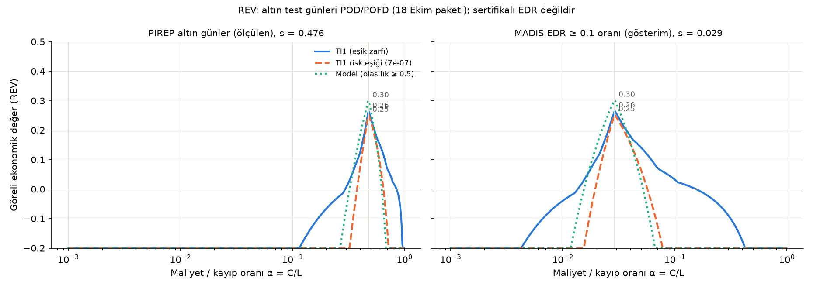

# Göreli ekonomik değer (REV)

Üretim: 2026-10-28T16:30:06+00:00 · girdi `docs/sonuclar/2026-10-18/sonuc_paketi.json` (altın test günleri POD/POFD) · yöntem Richardson (2000) maliyet/kayıp modeli. Kaçınma bedeli medyanı %2.2 sefer yakıtı (`2026-10-28_uyari_orani`, rüzgâr-optimum rotaya göre).

| Taban oran | Gösterge | En yüksek REV (α) | Değer kattığı α aralığı | Değer kattığı kayıp aralığı (sefer yakıtı) |
|---|---|---|---|---|
| PIREP altın günler (ölçülen), s = 0.476 | TI1 (eşik zarfı) | 0.264 (0.479) | 0.295–0.841 | %2.6–%7.5 |
| PIREP altın günler (ölçülen), s = 0.476 | TI1 risk eşiği (7e-07) | 0.251 (0.479) | 0.380–0.646 | %3.4–%5.8 |
| PIREP altın günler (ölçülen), s = 0.476 | Model (olasılık ≥ 0.5) | 0.299 (0.479) | 0.324–0.624 | %3.6–%6.9 |
| MADIS EDR ≥ 0,1 oranı (gösterim), s = 0.029 | TI1 (eşik zarfı) | 0.265 (0.029) | 0.014–0.153 | %14.5–%162.5 |
| MADIS EDR ≥ 0,1 oranı (gösterim), s = 0.029 | TI1 risk eşiği (7e-07) | 0.252 (0.029) | 0.019–0.057 | %39.0–%113.7 |
| MADIS EDR ≥ 0,1 oranı (gösterim), s = 0.029 | Model (olasılık ≥ 0.5) | 0.301 (0.029) | 0.015–0.052 | %42.7–%143.2 |

**Okuma.** α, önlemin (sapma) maliyetinin önlemsiz olay kaybına oranıdır. REV > 0 olan α aralığında gösterge, "hep sap" ya da "hiç sapma" kurallarından daha ucuzdur; en yüksek değer α = s'de Peirce'e eşittir. Son sütun: C = kaçınma bedeli medyanı alınırsa, bir orta-üstü karşılaşmanın kaybı (sefer yakıtı cinsinden) bu aralıktaysa gösterge değer katar; altında "hiç sapma", üstünde "hep sap" daha ucuzdur. Kaybın gerçek değeri (yaralanma, muayene, gecikme) bilinmiyor ve uydurulmadı.

**Sınırlar.** POD/POFD PIREP noktası başınadır, rota kararı başına değildir; bir rota birçok noktadan geçer. PIREP taban oranı (s ≈ 0,48) operasyonel karşılaşma sıklığı değildir (PIREP türbülans olunca verilir). İkinci panel aynı POD/POFD'nin MADIS'te ölçülen EDR ≥ 0,1 oranına (farklı olay, hafif ve üstü) aktarılabildiği varsayımıyla gösterimdir. Sonuç göstergeler arası sıralama ve büyüklük mertebesi içindir; bir eşik ya da seçim ağırlığı önerisi değildir.

Çıktılar sertifikalı EDR değildir; sistem operasyonel karar aracı değil, karar destek aracıdır.
