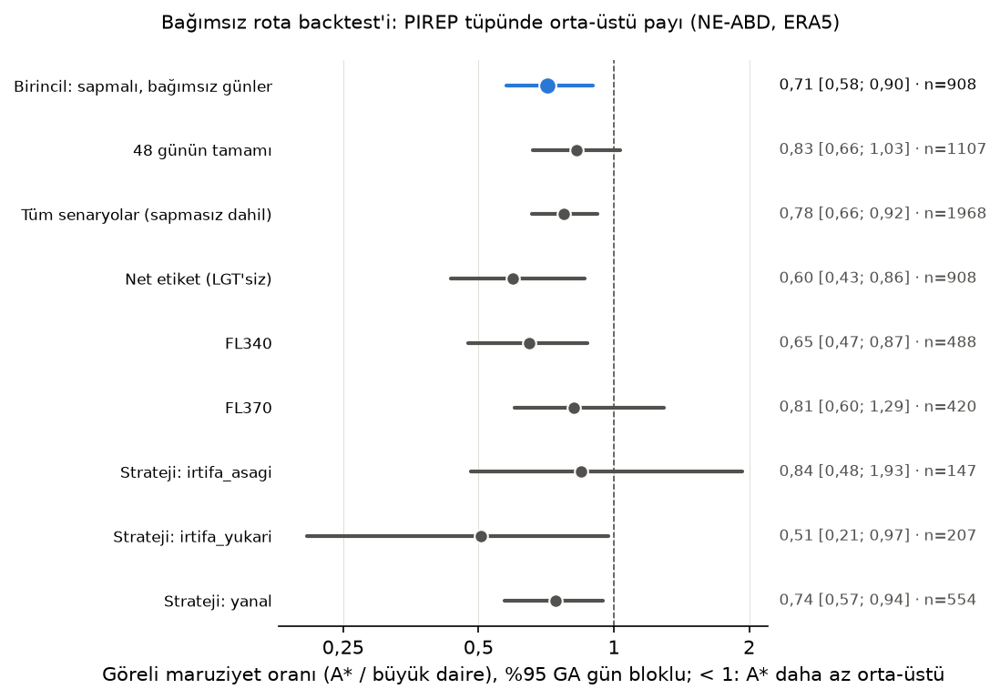

# Bağımsız rota backtest'i (kurul #3, protokol §11)

Üretim: 2026-10-29T11:29:14.001333+00:00 · commit `6e74b1a691116eb590bfd9e47d71150789f3873a` · TI1 eşiği 7.0e-07 · 8 şehir çifti × 48 küp günü × kalkış [12, 15, 18] UTC × FL [340, 370]; A320, koridor, `sozluksel` seçim kuralı; SIGMET/kısıtlı saha yok; ağsız (yerel NE-ABD ERA5 küpleri ve IEM PIREP arşivi). Tüp: 50 km, ±2000 ft, ±1 sa.

Senaryo 2304, geçerli 2304 (hata 0, ERA5 dışı/risk hesaplanmayan 0). Bağımsız günlerde (dondurma günleri hariç) 1968 rota; sapmalı 908 (46.1%); tüpünde en az bir rapor olan sapmalı rota 230.

**Birincil sonuç:** GMO = 0.713 [0.576; 0.899] → bağımsız kanıt A*'ın orta-üstü maruziyetini azalttığını destekliyor (GA üst sınırı < 1).

| Grup | Rota | Gün | BD tüpü M / N | A* tüpü M / N | BD orta-üstü payı | A* orta-üstü payı | GMO | %95 GA (gün bloklu) |
|---|---|---|---|---|---|---|---|---|
| **Birincil:** sapmalı, bağımsız günler | 908 | 38 | 204 / 93 | 161 / 103 | 0.687 | 0.610 | 0.713 | [0.576; 0.899] |
| 48 günün tamamı (sapmalı) | 1107 | 45 | 241 / 133 | 198 / 132 | 0.644 | 0.600 | 0.828 | [0.660; 1.034] |
| Tüm senaryolar (sapmasız dahil) | 1968 | 41 | 249 / 150 | 206 / 160 | 0.624 | 0.563 | 0.776 | [0.657; 0.921] |
| Net etiket (LGT'siz MOD+ / NEG) | 908 | 38 | 136 / 31 | 94 / 36 | 0.814 | 0.723 | 0.595 | [0.435; 0.861] |
| FL340 | 488 | 38 | 102 / 55 | 78 / 65 | 0.650 | 0.545 | 0.647 | [0.474; 0.872] |
| FL370 | 420 | 32 | 102 / 38 | 83 / 38 | 0.729 | 0.686 | 0.814 | [0.602; 1.290] |
| Strateji: irtifa_asagi | 147 | 28 | 45 / 19 | 32 / 16 | 0.703 | 0.667 | 0.844 | [0.481; 1.930] |
| Strateji: irtifa_yukari | 207 | 35 | 30 / 20 | 19 / 25 | 0.600 | 0.432 | 0.507 | [0.207; 0.971] |
| Strateji: yanal | 554 | 32 | 129 / 54 | 110 / 62 | 0.705 | 0.640 | 0.743 | [0.572; 0.944] |

**Fark tüpü** (sapmalı, bağımsız günler): yalnız büyük daire tüpündeki raporlar (kaçınılan) 91 / 27 (orta-üstü payı 0.771); yalnız A* tüpündekiler (girilen) 48 / 37 (0.565).

**Döngüsel referans (TI1):** aynı sapmalı rotalarda riskli nokta toplamı büyük daire 11163, A* 4427.

**Okuma.** M = orta-üstü (LGT-MOD dahil), N = NEG ve hafif (ML etiketiyle aynı). GMO < 1: A* tüpündeki raporlar arasında orta-üstü payı büyük daireninkinden düşük. Oran ölçütü trafik yoğunluğu farkını kısmen giderir, raporlama yanlılığını gidermez (pilotlar çoğunlukla türbülans görünce rapor verir). A* ve büyük daire tüpleri büyük ölçüde örtüşür; aynı rapor birden çok rotanın tüpüne girebilir (bu yüzden gün bloklu GA). Tek bölge, 48 gün, 3 seviyeli küp. Dondurma günleri (7) TI1 eşiğinin seçildiği PIREP'leri içerdiği için birincil sonuçtan çıkarıldı.

Çıktılar sertifikalı EDR değildir; sistem operasyonel karar aracı değil, karar destek aracıdır.
