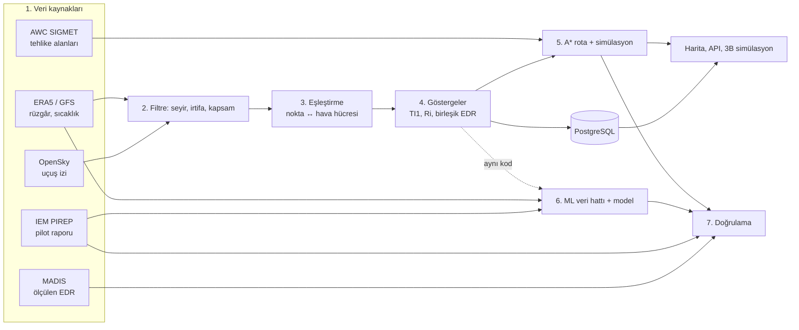

# Proje işleyişi: veriden karara

Bu belge Türbülans Radar'ın baştan sona nasıl çalıştığını anlatır: veriyi nereden
çekiyoruz, nerede filtreliyoruz, nerede birleştiriyoruz, ne hesaplıyoruz, rotayı nasıl
arıyor ve simüle ediyoruz, modeli nasıl kurduk, sonucu nasıl doğruladık. Danışmana ya da
jüriye anlatırken bu sırayı izle. Sayıların kaynağı `docs/sonuclar/2026-10-18/SAYILAR.md`
(nihai paket, 18 Ekim veri dondurması).

Sistem sertifikalı EDR üretmez; operasyonel karar aracı değil, karar destek aracıdır.

---

## 0. Tek paragrafta proje

Bir uçağın gerçek uçuş izini (OpenSky ADS-B) alıyoruz, her noktasını uçağın o anki
irtifasındaki hava verisiyle (ERA5 ya da canlı GFS) eşleştiriyoruz ve orada türbülans
göstergelerini (Ellrod TI1, Richardson sayısı, birleşik EDR) hesaplıyoruz. Bu göstergelerin
gerçekte ne kadar işe yaradığını pilot raporlarıyla (PIREP) ve uçakların ölçtüğü EDR ile
(MADIS) ölçüyoruz. Sonra iki nokta arasında, aktif SIGMET'lere ve yasak sahalara hiç girmeyen,
riskli bölgelerden mümkünse kaçan ve en az yakıt/süre harcayan rotayı A* ile arıyoruz. Bir
makine öğrenmesi modeli de var; ama yalnız TI1'den anlamlı biçimde iyiyse devreye giriyor.
Şu an girmiyor.

## 1. Büyük resim

Kod paketleri (`src/turbulans_radar/`): `veri/` (çekme), `fizik/` (eşleştirme ve formüller),
`rota/` (A*), `ml/` (model), `dogrulama/` (backtest, bağımsız kanıt), `depo/` (veritabanı),
`api/` + `isci/` (servis ve arka plan işleri), `arayuz/` (harita).

---

## 2. Veri nereden geliyor?

| Kaynak | Ne veriyor | Nasıl çekiyoruz | Kod |
|---|---|---|---|
| OpenSky Network (Trino) | Uçağın ~1 sn'lik konum, baro/GPS irtifa, hız, düşey hız kayıtları | SQL sorgusu, OAuth2 girişi | `veri/veri_yukleme.py` |
| Copernicus ERA5 (CDS) | Rüzgâr (u, v), sıcaklık (t), bağıl nem; 0,25°, saatlik, 7 basınç seviyesi (150–350 hPa) | Uçuşa özel küçük dilim indirme | `veri/era5_saglayici.py` |
| ARCO-ERA5 (Google Cloud) | ERA5'in aynısı | CDS başarısız olursa yedek | `veri/era5_saglayici.py` |
| NOAA GFS (UCAR THREDDS) | Canlı tahmin; 0,25°, 3 saatlik | Şimdi −48 sa / +120 sa arası uçuşlar için | `veri/veri_saglayicilari.py` |
| NOAA AWC SIGMET | Tehlike poligonu, irtifa bandı, geçerlilik | 15 dakikada bir otomatik yenileme | `veri/sigmet_saglayici.py` |
| Kısıtlı sahalar (GeoJSON, openAIP) | Yasak/kısıtlı hava sahaları | İçe aktarma | `veri/kisitli_saha_saglayici.py` |
| IEM PIREP arşivi | Pilotların bildirdiği türbülans şiddeti (ABD) | Arşiv + her gece artımlı | `ml/ml_veri_hatti.py` |
| NOAA MADIS (public ACARS) | Uçağın kendi sensörüyle ölçtüğü EDR | Saatlik dosyalar | `veri/madis_edr.py` |

**Ortak şema:** Bütün hava kaynakları aynı biçime çevrilir: değişkenler `u, v, t`, boyutlar
`valid_time`, `pressure_level` (hPa), `latitude`, `longitude` (−180..180). Bu sayede fizik ve
rota kodu verinin ERA5'ten mi GFS'ten mi geldiğini bilmez.

**Sağlayıcıya saygı:** Dış servislerde günlük/gecelik istek tavanı, istek aralığı ve aynı anda
tek indirme (veritabanı kilidi) var. CDS için gecelik 30, günlük 150 istek ve 500 MB/gün
sınırı kod seviyesinde uygulanır.

---

## 3. Uçuş izini çekme ve filtreleme

1. **Uçuş numarası + tarih → uçak kimliği:** OpenSky'de çağrı adı (callsign, ör. `THY322`)
   ile uçağın `icao24` kodu bulunur, sonra o uçağın kayıtları (state vector) çekilir. Trino
   tablosunda `hour` bölüm filtresi zorunludur; yoksa sorgu reddedilir.
2. **Önbellek:** Bitmiş uçuşların izi Parquet dosyasına yazılır; aynı uçuş ikinci kez
   sorulursa OpenSky'ye gidilmez.
3. **İrtifa seçimi:** Barometrik irtifa öncelikli, yoksa GPS irtifası. Neden: seyirde
   altimetre 1013,25 hPa'ya ayarlıdır, yani baro irtifa doğrudan standart atmosfer (ISA)
   basıncına karşılık gelir. GPS irtifası sıcaklığa göre sapar (THY322'de medyan 225 m).
4. **İrtifa → basınç:** ISA formülü `p = 1013,25 · (1 − 2,25577e-5 · h)^5,25588`
   (`fizik/birim_donusumleri.py`).
5. **Kapsam filtresi:** Hava küpünün dışında kalan nokta hesaplanmaz, "veri yok" (NaN)
   kalır: yatayda ±0,125°'den uzak, zamanda en yakın saat adımına 3 saatten uzak ya da
   düşeyde küp seviyelerinden 50 hPa'dan uzak (kalkış, iniş, yer) noktalar. Bu filtre
   önemli: xarray "en yakın" hücreyi ne kadar uzakta olursa olsun döndürür; filtre olmasa
   Teksas'taki uçuş Türkiye küpünün kenarından sessizce değer alırdı.

Örnek (demo, THY322, 15 Ocak 2019): 1614 noktanın 720'si seyir seviyesinde (150–350 hPa) ve
gösterge alır; geri kalanı kalkış/iniş olduğu için gri kalır.

---

## 4. Hava verisini seçme

Uçuşun bölgesi ve tarihine göre sırayla:
1. Yerel ERA5 küpü kapsıyorsa onu kullan.
2. Kapsamıyorsa ve tarih ERA5 dönemindeyse CDS'ten uçuşa özel küçük dilim indir; CDS
   başarısızsa ARCO yedeği.
3. Son 48 saat ya da gelecek (uçuş öncesi planlama) ise canlı GFS.

İndirilen küpler diskte saklanır, veritabanındaki küp kataloğundan bulunur.

---

## 5. Birleştirme: her nokta ↔ hava hücresi (`fizik/eslestirme.py`)

Her uçuş noktası için:
1. Zamanı en yakın saat adımına, konumu en yakın 0,25° hücreye eşle.
2. Düşeyde uçağın basıncını **çevreleyen iki seviyeyi** bul (`p_ust ≤ p ≤ p_alt`).
3. Bütün noktalar tek bir vektörel sorguyla seçilir (döngü yok; 5000 nokta ~0,03 sn).

Çıktı: her noktaya rüzgâr ve sıcaklık değerleri eklenmiş uçuş tablosu.

---

## 6. Ne hesaplıyoruz: türbülans göstergeleri (`fizik/turbulans_indeksleri.py`)

| Gösterge | Formül | Anlamı |
|---|---|---|
| Katman kalınlığı | Δz = R_d · T̄ / g · ln(p_alt / p_ust) | İki seviye arası metre (hipsometrik) |
| Düşey rüzgâr kayması (VWS) | √(Δu² + Δv²) / Δz | Rüzgârın yükseklikle değişimi |
| Yatay deformasyon (DEF) | √(gerilme² + kayma²), küresel metrik terimli | Akışın yatayda bozulması |
| **Ellrod TI1** | VWS × DEF | Klasik açık hava türbülansı göstergesi (1992) |
| TI2 | VWS × (DEF − diverjans) | TI1'in diverjanslı hâli |
| Richardson (Ri) | g · Δθ · Δz / (θ̄ · (Δu² + Δv²)) | Kararlılık / kayma; Ri < 0,25 kararsız |
| Birleşik EDR | Göstergeler log-normal eşlemeyle EDR'ye çevrilip ortalanır (Sharman ve Pearson, 2017) | 0–1 ölçekte tek gösterge; sertifikalı EDR değil |

**Risk kararı:** TI1 ≥ 7e-7 s⁻² olan nokta "riskli" sayılır. Bu eşik veriden seçildi (bkz. §9).

Sonuçlar PostgreSQL'e yazılır (`ucuslar`, `edr_olcumleri` tabloları), zaman kaydırıcılı
haritada renklendirilir (`arayuz/harita.py`) ve API'den GeoJSON/CSV olarak verilir.

---

## 7. Rota arama ve simülasyon (`rota/rota_optimizasyonu.py`)

**Girdi:** başlangıç ve bitiş (seyre giriş/çıkış noktaları), seyir seviyesi, kalkış zamanı,
uçak tipi.

1. **Normal rota:** İki nokta arası büyük daire (en kısa yol), 41 ara nokta.
2. **Yanal ızgara:** Her ara noktada büyük daireye dik yönde ±20 km'lik adımlarla aday
   konumlar; bacak açısı ≤ 30°, toplam sapma ≤ 400 km.
3. **Sert kısıtlar** (`rota/risk_katmanlari.py`): Aktif SIGMET ve kısıtlı sahalara giren
   düğüm ve kenarlar grafdan silinir. Uçağın o noktaya varış zamanı ve irtifa bandı da
   bakılır (zaman belirsizliği: geçen sürenin %30'u + 5 dk).
4. **Yumuşak kısıt:** TI1 riskli düğüme 6 saatlik sanal ceza eklenir. Yani kaçmak mümkünse
   her zaman kaçılır, değilse en az riskli yol seçilir.
5. **A\* araması:** Kenar maliyeti = mesafe / yer hızı (TAS + rüzgâr) + ceza. Sezgisel =
   kalan büyük daire mesafesi / (1,8 × TAS); hiçbir yol bundan hızlı olamayacağı için
   bulunan yol optimaldir.
6. **Seviye alternatifleri:** Bir üst/alt yasal uçuş seviyesi (yarım daire kuralı, RVSM)
   tırmanma yakıt bedeliyle karşılaştırılır.
7. **Pareto seçenekleri:** Farklı ceza düzeyleriyle aramalar; "daha kısa ama riskli" ile
   "daha uzun ama güvenli" seçenekleri dispeçere birlikte sunulur.
8. **Rüzgârla zamanlama ve son kontrol:** Seçilen rota gerçek rüzgârla yeniden zamanlanır ve
   sert kısıtlarla son kez kontrol edilir. Güvenli rota yoksa **öneri verilmez**.
9. **Kaçınacak risk yoksa** önerilen rota büyük daireyle birebir aynı kalır; uydurma
   "iyileşme" gösterilmez.

**Simülasyon:** `web/ucus_simulasyonu.html` (CesiumJS 3B küre) iki rotayı yan yana uçurur:
normal ve optimize. API (`POST /api/v1/simulasyon/rota`) sonucu CZML'e çevirir; riskli
bölümler kırmızı, yanında UTC saat, FL ve NM olarak yer/zaman, ekstra yakıt ve süre.
`web/harita3d.html` (MapLibre) aynı veriyi 2B/3B haritada gösterir.

Hesap süresi: rota başına 0,03–0,45 sn (dizüstü, şarjda).

---

## 8. Etiket verisi: gerçekte türbülans var mıydı?

Göstergeyi ölçmek için ondan bağımsız "gerçek" veri lazım.

**PIREP veri hattı** (`ml/ml_veri_hatti.py`):
1. IEM arşivinden pilot raporları alınır (yerel arşiv + her gece yenileri).
2. **Filtre:** Yalnız seyir irtifası, 28.000–42.000 ft. Mükerrer raporlar silinir; günde en
   fazla 100 rapor (bir günün veriye baskın çıkmaması için, rastgele seçim).
3. **Etiket:** Orta ve üzeri türbülans = 1, hafif ve altı = 0.
4. **Bulunan iki veri hatası:** IEM'in `FL` alanı aslında feet; eski veri seti bu yüzden
   seyir yerine 300–400 ft'teki raporları seçmişti (düzeltildi). Konumu bilinmeyen (`/OV UNK`)
   raporları IEM Alaska'ya yerleştiriyor; bunlar dışlandı.
5. Raporlar `ml_ornekleri` tablosuna "bekliyor" durumunda girer.

**Gece işi** (`isci/gorev_iscisi.py`): Bekleyen raporlar gün ve bölgeye göre gruplanır, her
grup için CDS'ten bir ERA5 dilimi indirilir, **uçuş analiziyle aynı eşleştirme koduyla**
özellikler hesaplanır ve rapora yazılır. Her raporun çevresindeki küçük pencere (±1°, ±1 sa)
diske saklanır; yeni bir özellik eklenirse CDS'ten yeniden indirmeden hesaplanır.

Nihai pakette: 163 günde 15.940 eşleşmiş seyir PIREP'i, pozitif oranı 0,53.

**MADIS EDR** (`veri/madis_edr.py`): Uçakların kendi sensörüyle ölçtüğü EDR (nesnel etiket).
Seyir irtifasındaki geçerli ölçümler günlük dosyalara yazılır. 14 günde 45.075 ölçüm; hafif ve
üstü oranı %3, orta ve üstü yalnız 1 ölçüm.

---

## 9. Modelleme (`ml/`)

**Özellikler (8):** TI1, Richardson, rüzgâr hızı, basınç seviyesi, VWS, deformasyon,
diverjans, TI2. Hepsi bölüm 5–6'daki kodla hesaplanır.

**Adaylar:** Lojistik regresyon (ölçekli, dengeli), Rastgele Orman, Gradient Boosting (dengeli)
(`ml/ml_egitimi.py`).

**Protokol** (`ml/ml_otomatik_egitim.py`, `ml/degerlendirme.py`):
1. **Altın test günleri:** 7 Ekim'deki 80 günden 16'sı rastgele (tohum 0) seçilip donduruldu; hiçbir
   modelin eğitimine girmez (`ml/altin_test_gunleri.json`).
2. **Gün gruplu çapraz doğrulama:** Aynı günün raporları aynı katta kalır (aynı hava sistemi
   hem eğitimde hem testte olmasın diye).
3. **1-SE kuralı:** En iyi modelle sade model (lojistik regresyon) arasındaki fark bir
   standart hatadan küçükse sade model seçilir. 7 Ekim'de (80 gün) lojistik regresyon seçildi;
   nihai pakette (147 eğitim günü) fark SE'den büyük çıktı ve Random Forest seçildi (GB ile berabere).
4. **Olasılık kalibrasyonu:** Sigmoid (Platt) ile çıktı gerçek olasılığa yaklaştırılır.
5. **"Emin değilim" çıktısı:** Konformal tahminle her nokta `dusuk_risk`, `yuksek_risk` ya da
   `belirsiz` olur (hedef kapsama %90; `ml/belirsizlik.py`).
6. **Güven aralıkları:** Gün bazlı blok bootstrap (günler iadeli 1000 kez örneklenir).
7. **Kapı:** Model altın günlerde TI1'i ROC-AUC'de en az 0,02 geçmeli ve farkın güven
   aralığının alt sınırı 0'ın üstünde olmalı; aktif modeli de geçmeli. Geçemezse yalnız
   sürüm olarak saklanır.

**Eşik seçimi:** TI1 risk eşiği yalnız eğitim günlerinde seçildi: POD − POFD'yi (Peirce) en
yükselten eşiğin bir standart hatası içindeki en tutucu eşik = 7e-7 (8 Ekim). Nihai pakette
kural 7,39e-7 verdi; 7e-7 bandın içinde kaldığı için değişmedi.

---

## 10. Sonuçlar ve doğrulama

| Ne ölçtük | Sonuç |
|---|---|
| TI1, 15.940 PIREP (163 gün) | ROC-AUC 0,673 [0,661–0,684] |
| TI1, altın günler, eşik 7e-7 | Yakalama (POD) 0,50, yanlış alarm (POFD) 0,25 |
| Birleşik EDR − TI1 (altın günler) | +0,013 [+0,007; +0,020], anlamlı |
| ML protokol modeli (Random Forest) − TI1 | +0,033 [+0,018; +0,049], anlamlı → kapı geçildi (7 Ekim ön paketinde LR +0,008, geçememişti) |
| Çalışan model (9 Ekim Random Forest) − TI1 | +0,033 [+0,018; +0,048]; dondurmadaki GB aday onu geçemedi (+0,003), canlıda RF kaldı |
| MADIS ölçülen EDR'de TI1 / model | ROC-AUC 0,722 / 0,775 (14 gün) |
| Backtest THY322, 15 Oca 2019, riskli nokta oranı | gerçek iz 0,24 / büyük daire 0,39 / A* 0,02 |

**Backtest** (`dogrulama/rota_backtest.py`): Veritabanındaki gerçek bir uçuş için üç rota aynı
ölçütle karşılaştırılır: uçağın gerçekte uçtuğu iz, büyük daire, A* önerisi. TI1'le optimize
edilen rotayı yine TI1'le ölçmek döngüsel olduğu için rotalar ayrıca **bağımsız kanıta**
(türbülans SIGMET'leri ve PIREP'ler) göre de sayılır (`dogrulama/bagimsiz_kanit.py`).

**Sanal PIREP** (`fizik/sanal_pirep.py`): ADS-B izinde seyirdeki uçağın seviyesinden ≥90 ft ani
sapması olay sayılır; en az iki farklı uçak doğrularsa canlı uyarı olur. Rota kararına girmez.
İlk ölçümde POD 1/8, POFD 0/8 (örneklem küçük).

**Ana bulgu:** TI1'in ayırt ediciliği orta düzey; tek başına güvenliğe yetmez. Bu yüzden
güvenlik SIGMET sert kısıtından gelir, TI1 yalnız yumuşak kısıttır. Gerçek bir uçuşta (PUE502)
aktif TURB SIGMET'in gösterdiği bölgede TI1 hiç risk görmedi.

---

## 11. Altyapı: sistem nasıl ayakta duruyor?

- **Docker:** `db` (PostgreSQL 16), `api` (FastAPI), `worker` (arka plan işçisi).
- **Görev kuyruğu:** Uzun işler (uçuş analizi, gece veri işi, eğitim, backtest) API'yi
  bekletmez; kuyruğa girer, işçi alır. İşçi çökerse görev kaybolmaz, yeniden kuyruğa girer.
- **Kilit ve kota:** Aynı anda tek dış indirme; sağlayıcı sınırları kodda.
- **Güvenlik:** API anahtarı ve roller, istek sınırı, denetim kaydı, sırlar `.env`'de.
- **Yedek:** Her gün `db_yedekleri/` + OneDrive kopyası.
- **Testler:** 908 otomatik test (birim, veritabanı, gerçek veri, tarayıcı) ve CI.
- **Ağsız demo:** Depoyla gelen THY322 verisiyle internet ve şifre olmadan çalışır.

---

## 12. Sınırlar (mutlaka söyle)

- Yalnız açık hava türbülansı (CAT) ve seyir safhası; konvektif, bulut içi, dağ dalgası ve iz
  türbülansı kapsam dışı.
- ERA5 0,25° (~25–30 km) ve saatlik; türbülansın ölçeği bunun altında.
- Doğrulama ABD verisiyle (PIREP, MADIS); Türkiye için etiket yok.
- PIREP gönüllü ve yanlı (pozitif oranı 0,52; gerçek uçuşta çok daha düşük).
- Sertifikasyon yok; GTG/WAFS gibi operasyonel ürünlerle kıyas yapılmadı.

---

## 13. Hocaya anlatım sırası (~10 dakika)

1. Problem ve soru (1 dk): §0.
2. Büyük resim diyagramı (1 dk): §1.
3. Veri ve filtre (2 dk): §2–3, "neden baro irtifa" ve "neden kapsam filtresi".
4. Birleştirme ve göstergeler (2 dk): §5–6, TI1 = VWS × DEF.
5. Rota ve simülasyon (2 dk): §7, demo ekranı.
6. Etiket, model, sonuç (2 dk): §8–10, "model geçemedi, bunu dürüstçe raporladık".

## 14. Sık gelebilecek sorular

- **0,67–0,71 iyi mi?** Rastgele tahmin 0,5. Orta düzey; bu yüzden güvenlik SIGMET'e dayanıyor.
- **Neden GPS değil baro irtifa?** Hava verisi basınç seviyelerinde; baro irtifa ISA basıncına
  birebir denk gelir.
- **Model TI1'i ne kadar geçiyor?** Altın günlerde +0,033 ROC-AUC (0,708'e karşı 0,675). Fark
  anlamlı ama küçük: model aynı 0,25° ERA5 alanlarından türetilen özelliklerle öğreniyor, ölçek
  sınırı özellik eklemekle aşılmıyor. 7 Ekim'de 80 günle seçilen LR geçememişti; sonuç veri
  hacmine duyarlı.
- **Neden günler gruplu?** Aynı günün raporları aynı hava sistemine ait; satır satır karıştırmak
  sonucu olduğundan iyi gösterir.
- **A* neden optimal?** Sezgisel hiçbir zaman gerçek kalan süreden büyük değil (kabul edilebilir).
- **Türkiye'de çalışıyor mu?** Hesap evet (ERA5/GFS küresel, SIGMET Ankara FIR dahil);
  doğrulama etiketi yalnız ABD'de var.
